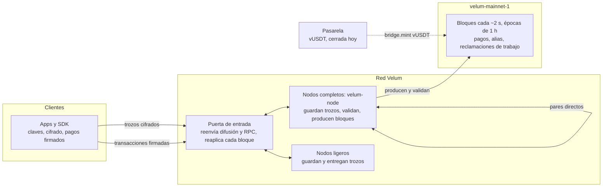

<p align="center"></p>

<h1 align="center">velum-node</h1>

<p align="center"><em>Información al instante, privada y autosostenida. Para hablar, pagar y mover valor sin parar.</em></p>

<p align="center"><a href="README.md">English</a> · <strong>Español</strong> · <a href="README.fr.md">Français</a> · <a href="README.ru.md">Русский</a> · <a href="README.zh.md">中文</a></p>

---

## Qué es

Este repositorio contiene el núcleo abierto, con licencia Apache-2.0, de **Velum**: una red de mensajería privada que sostiene su propia comunidad, con una cadena hecha a medida que registra pagos y pruebas auditadas de la entrega de mensajes.

| Parte | Ruta | Qué es |
|---|---|---|
| Núcleo | `packages/core` | Implementación de referencia del protocolo: claves, cifrado híbrido, trozos, buzones que rotan, recibos anónimos, sorteo, transacciones, bloques, consenso, economía y actualizaciones en vivo |
| SDK | `packages/sdk` | `@velum/sdk`: claves, direcciones, transacciones, RPC, depósitos y cobros para carteras, comercios, exchanges y carteras físicas |
| Nodo | `apps/node` | `velum-node`: guarda y entrega trozos de mensajes, valida cada bloque, produce bloques por turnos, actualización automática firmada |
| Pasarela | `apps/bridge` | Servicio de la pasarela de USDT envuelto (vUSDT). Hecho y probado, cerrado hoy |
| Especificación | `spec`, `PROTOCOL.md` | Vectores de prueba exactos byte a byte y la especificación del protocolo |

Los mensajes se cifran de extremo a extremo en el dispositivo de quien escribe, se rellenan hasta tamaños fijos, se parten en cinco trozos (con tres cualesquiera se reconstruye el mensaje) y se dejan en buzones que cambian cada día. Los nodos guardan y entregan los trozos; los mensajes nunca tocan la cadena. La cadena (`velum-mainnet-1`, en marcha desde el 1 de noviembre de 2026 a las 21:00 UTC) registra pagos, altas de nodos, alias y reclamaciones de trabajo. La unidad propia, VEL, sirve para pagar en el día a día y para pagar la mensajería por encima de un cupo gratuito.

Las apps para usuarios (iOS, Android y la interfaz de escritorio incluida en el nodo) están en <https://velumprotocol.org>.

## Inicio rápido

### Instalar un nodo (recomendado)

**macOS y Linux** (sin sudo):

```bash
curl -fsSL https://velumprotocol.org/install.sh | bash
```

**Windows x64** (PowerShell):

```powershell
irm https://velumprotocol.org/install.ps1 | iex
```

El instalador descarga el binario compilado para tu plataforma (`darwin-arm64`, `darwin-x64`, `linux-x64`, `linux-arm64`, `windows-x64`), lo deja como servicio en segundo plano y añade la orden `velum`. No necesitas Bun. Las actualizaciones salen de un manifiesto firmado con Ed25519; el nodo comprueba la firma y el SHA-512 de la descarga, cambia el binario de forma atómica y vuelve atrás si el nuevo no aguanta 60 segundos.

Órdenes del día a día: `velum start`, `velum stop`, `velum restart`, `velum status`, `velum open`, `velum pause`, `velum resume`, `velum update`, `velum reset`, `velum logs`, `velum address`, `velum version`, `velum uninstall [--purge]`.

### Compilar y arrancar desde el código

Necesitas [Bun](https://bun.sh).

```bash
git clone https://github.com/Consultora-BIM/velum-node.git
cd velum-node
bun install
bun run --cwd apps/node start                     # = bun src/main.ts start
```

Para pasar opciones, llama directamente al punto de entrada:

```bash
bun apps/node/src/main.ts start --port 7421 --payout vel…
```

Para generar un binario autónomo: `bun run --cwd apps/node build`.

## Línea de órdenes del nodo

```
velum-node [start] [opciones]
```

Las opciones se guardan en `~/.velum/config.json`.

| Opción | Significado |
|---|---|
| `--name NOMBRE` | Nombre opcional y decorativo (por defecto ninguno: el nodo es su dirección; `""` lo borra) |
| `--payout vel…` | Cartera que cobra las recompensas (por defecto, la del nodo) |
| `--port N` | Puerto local de la interfaz y de las conexiones directas (por defecto `7420`) |
| `--gateway URL[,URL]` | Puertas de entrada por orden (se repite o se separa con comas); `none` = solo pares directos |
| `--peer ws://host:puerto/ws` | Añade un par directo (se puede repetir) |
| `--endpoint ws://…` | Dirección pública por la que otros nodos pueden llamarte (se publica en la cadena) |
| `--dns-seed NOMBRE` | Semilla DNS (registro TXT con direcciones ws/wss) para encontrar vecinos |
| `--no-auto-update` | No instalar actualizaciones firmadas automáticamente |

| Orden | Qué hace |
|---|---|
| `start` | Arranca el nodo (orden por defecto) |
| `init` | Prepara clave y configuración sin arrancar (lo usa el instalador) |
| `update` | Busca e instala ya la última versión firmada |
| `status` | Estado legible del nodo en marcha |
| `open` | Abre la interfaz de escritorio en `http://localhost:7420/app/` |
| `reset` | Borra la cadena y los trozos guardados (conserva clave y configuración); al arrancar se resincroniza |
| `snapshot export ARCHIVO` | Guarda una foto del estado con su raíz (con el nodo parado) |
| `snapshot import ARCHIVO` | Arranca desde una foto tras comprobar su raíz (con el nodo parado) |
| `address` · `version` | Dirección y versión del nodo |

| Variable de entorno | Significado |
|---|---|
| `VELUM_HOME` | Carpeta de datos (por defecto `~/.velum`) |
| `VELUM_PORT` | Puerto local (por defecto `7420`) |
| `VELUM_GATEWAY` | Puertas de entrada, separadas por comas |
| `VELUM_PEERS` | Pares directos, separados por comas |
| `VELUM_MANIFEST_URL` | De dónde leer el manifiesto firmado de actualizaciones |
| `VELUM_AUTO_UPDATE=0` | Desactiva las actualizaciones automáticas |
| `VELUM_LOG=debug` | Registro detallado |
| `VELUM_NETWORK` | `mainnet` (por defecto) o `testnet` |

## SDK

`@velum/sdk` funciona en Bun, Node 22+, navegadores y Workers. Conéctate a tu propio nodo (`ws://127.0.0.1:7420/ws?role=client`, lo recomendado para exchanges) o a la puerta pública (`wss://velumprotocol.org/hub?role=client`).

**Cobrar** con una factura firmada, un enlace `velum:pay` (QR o NFC) y un vigilante que sigue el pago hasta que es firme:

```ts
import { VelumRpc, createInvoice, parsePaymentURI, watchPayment, walletFromPhrase, parseAmount } from "@velum/sdk";

const rpc = new VelumRpc("wss://velumprotocol.org/hub?role=client");
const shop = walletFromPhrase(process.env.SHOP_PHRASE!);

// 1. Factura firmada y su URI velum:pay, lista para un código QR o una etiqueta NFC
const { invoice, uri } = createInvoice({
  to: shop.address,
  amount: parseAmount("12.5")!,          // BigInt en velos (18 decimales)
  ref: "T-0042",
  label: "Café",
  exp: Date.now() + 15 * 60_000,
  secret: shop.secret,                   // firma la factura; sin ella quien paga ve «sin verificar»
});

// 2. Lado de quien paga: leer la URI y comprobar la firma de quien cobra
const parsed = parsePaymentURI(uri);
if (parsed.ok) console.log(parsed.verified ? "verificada" : "sin verificar", parsed.invoice.amount);

// 3. Seguir el pago: "pendiente" -> "incluido" (~2 s) -> "firme" (30 bloques; 1.800 para 10.000 VEL o más)
const result = await watchPayment(rpc, invoice, {
  onUpdate: (u) => console.log(u.state, `${u.confirmations}/${u.need}`),
});
rpc.close();
```

**Pagar**:

```ts
import { VelumRpc, buildTransfer, paymentMemo, walletFromPhrase, CHAIN_ID } from "@velum/sdk";

const me = walletFromPhrase(phrase);
const tx = buildTransfer({
  secret: me.secret, from: me.address, to: invoice.to, amount: invoice.amount,
  memo: paymentMemo(invoice), nonce: await rpc.nextNonce(me.address), chain: CHAIN_ID,
  ctx: await rpc.fees(),                 // comisión o sello de prueba de trabajo, según el oráculo
});
const { id } = await rpc.submit(tx);
```

Los estados del cobro llegan como los textos `pendiente`, `incluido`, `firme` (y `caducada` si la factura vence). Hay más ejemplos en `packages/sdk/examples`: un terminal de cobro mínimo (`pos/`), un vigilante de depósitos para exchanges, un firmante de retiros y staking delegado.

## Protocolo, especificación y vectores de prueba

- `PROTOCOL.md` es la especificación pública, para quien quiera escribir un nodo, un cliente o una cartera compatible en otro lenguaje.
- `spec/vectors/*.json` contiene vectores de prueba exactos byte a byte: codificación canónica, claves, sobres, trozos, buzones, recibos, sorteo, reclamaciones, transacciones, bloques, importes, oferta, comisiones, prueba de trabajo, oráculo, niveles y liquidación. **Una implementación es compatible si los reproduce.** Si la especificación y el código no coinciden, mandan los vectores.

```bash
VELUM_NETWORK=testnet bun spec/generate.ts --check
VELUM_NETWORK=testnet bun packages/core/scripts/vectors.ts --check
```

Cualquiera puede reaplicar la red principal en vivo y comprobar cada raíz de estado y el cuadre contable:

```bash
VELUM_NETWORK=mainnet bun packages/core/scripts/replay-mainnet.ts
```

## Arquitectura



Los mensajes viajan como trozos cifrados entre clientes y nodos y nunca se escriben en la cadena. Un sorteo público y determinista decide qué nodo se lleva el mérito de cada trozo; los nodos se comprometen con los recibos anónimos que han recogido y demuestran una muestra al azar. Todo el tráfico es JSON sobre WebSocket. Para encontrarse se usan puertas de entrada, direcciones publicadas en la cadena, semillas DNS e intercambio de pares; si fallan todas las puertas, los nodos siguen entre ellos.

## Seguridad

**Garantías**

- Cifrado poscuántico híbrido (X25519 + ML-KEM-768, XChaCha20-Poly1305): para romper un mensaje hay que romper los dos.
- El remitente sellado, los buzones que rotan cada día y los 7 tamaños fijos limitan lo que aprenden los nodos.
- Solo el destinatario real puede generar un recibo de entrega; solo el dueño de un buzón puede abrirlo.
- Cada nodo reconstruye cada bloque. Si quien produce un bloque se paga un velo de más, cambia la raíz de estado y todos los validadores rechazan el bloque. Las cuentas del sistema sin clave no pueden firmar.

**Límites honestos hoy**

- **Las firmas son Ed25519 clásicas.** Las firmas poscuánticas (ML-DSA) están en la hoja de ruta.
- **Hoy produce bloques un solo nodo.** Puede censurar o retrasar, pero no puede robar ni crear VEL.
- **Todavía no hay finalidad.** Gana la cadena más alta; da un pago por firme tras 30 bloques (1.800 para 10.000 VEL o más).
- Sin trinquete por mensaje, sin tráfico de cobertura y sin rutas de varios saltos.
- Una sola puerta de entrada reenvía la mayor parte del tráfico; una sola clave firma los binarios del nodo; la reserva de génesis está en una única cartera fría sin conexión.
- Dar de alta un nodo es gratis; el cupo gratuito de mensajes está definido pero aún no se aplica.

**Plan para descentralizar:** operadores independientes con nodos completos 2.1.0 (el orden de turnos ya los admite), un coste de entrada para quien produce bloques (fianza mínima o prueba de trabajo), comités por época con finalidad a partir de más de 2/3 del peso del comité, varias puertas de entrada independientes y multifirma para la clave de publicación y la cartera fría.

## Economía

La economía v4 se activa en vivo en el bloque **28.800** (previsto hacia las 12:05 UTC del 2 de noviembre de 2026), sin reiniciar la cadena.

| Parámetro | Valor |
|---|---|
| Decimales | 18 (1 velo = 10⁻¹⁸ VEL) |
| Tope | 21.000.000.000 VEL |
| Reserva de génesis | 100.000.000 VEL, en la cartera fría sin conexión del operador |
| Reducción a la mitad | Cada 4 años (35.064 épocas de una hora); 33 mitades |
| Quema | Ninguna |
| Comisión de pago | 0 por debajo de 1.100 vUSDT de valor (con sello de prueba de trabajo); 1 punto básico por encima |
| Reparto de la comisión | 80 % al bote de los nodos, 20 % a la Reserva de la Red |
| Créditos de mensajería | 22 µUSDT por mensaje por encima del cupo gratuito (cupo definido, aún no se aplica) |

```
R0   = floor((21.000.000.000 − 100.000.000) VEL / (2 · 35.064)) ≈ 298.026,47 VEL
R(e) = R0 >> floor(e / 35064)        (0 a partir de la mitad número 33)
```

**VEL aún no tiene precio.** El protocolo no fija ninguno. Un valor de referencia solo aparece si la gente intercambia VEL por vUSDT en el mercado de la cadena y el oráculo lo lee; hasta entonces las comisiones son cero. El operador que puso en marcha el proyecto (NC CONSULTORIA E INVERSIONES SL, Sevilla, España) no vende VEL ni lo regala.

## Estado

| Parte | Estado |
|---|---|
| `velum-mainnet-1` | En marcha desde el 1 de noviembre de 2026, 21:00 UTC |
| Economía v4 | Se activa en el bloque 28.800 (nodo 2.1.0) |
| Mensajería, pagos, nodos completos y ligeros | Activos |
| Producción de bloques | Un solo nodo hoy |
| Finalidad | Todavía no |
| Intercambio entre personas (HTLC, protocolo v5) | Escrito y probado, sin activar |
| Pasarela vUSDT | Hecha y probada, cerrada |
| Firmas poscuánticas | En la hoja de ruta |

## Documentación

- Whitepaper: [docs/paper/velum-paper.es.md](docs/paper/velum-paper.es.md) (inglés: [docs/paper/velum-paper.md](docs/paper/velum-paper.md))
- Especificación del protocolo: [PROTOCOL.md](PROTOCOL.md)
- Vectores de prueba: [spec/vectors](spec/vectors)
- Web y explorador en vivo: <https://velumprotocol.org>

## Contribuir

```bash
bun install
bun test packages apps/node/test apps/bridge/test   # pruebas del núcleo, SDK, nodo y pasarela
bun run --cwd packages/core test:mainnet      # pruebas de la red principal y de la actualización v4
```

Abre incidencias y pull requests en <https://github.com/Consultora-BIM/velum-node>. Haz cambios pequeños y con pruebas. Todo cambio de consenso debe mantener los vectores en verde, o regenerarlos dentro de una versión de protocolo explícita con altura de activación. Los bloques antiguos deben seguir validándose byte a byte.

## Licencia

Apache License 2.0. Consulta [LICENSE](LICENSE) y [NOTICE](NOTICE).

Copyright 2026 Consultora BIM.
