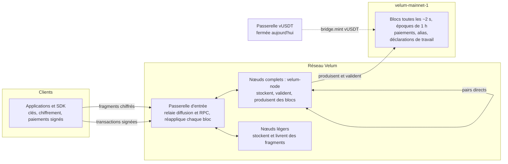

<p align="center"></p>

<h1 align="center">velum-node</h1>

<p align="center"><em>L'information à l'instant, privée et autosuffisante. Pour parler, payer et faire circuler la valeur sans s'arrêter.</em></p>

<p align="center"><a href="README.md">English</a> · <a href="README.es.md">Español</a> · <strong>Français</strong> · <a href="README.ru.md">Русский</a> · <a href="README.zh.md">中文</a></p>

---

## De quoi s'agit-il

Ce dépôt contient le cœur ouvert, sous licence Apache-2.0, de **Velum** : un réseau de messagerie privée porté par sa propre communauté, doté d'un registre conçu sur mesure qui enregistre les paiements et des preuves auditées de la livraison des messages.

| Élément | Chemin | Ce que c'est |
|---|---|---|
| Cœur | `packages/core` | Implémentation de référence du protocole : clés, chiffrement hybride, fragments, boîtes aux lettres tournantes, accusés anonymes, tirage, transactions, blocs, consensus, économie et mises à jour en direct |
| SDK | `packages/sdk` | `@velum/sdk` : clés, adresses, transactions, RPC, dépôts et encaissements pour portefeuilles, commerces, plateformes d'échange et portefeuilles matériels |
| Nœud | `apps/node` | `velum-node` : stocke et livre les fragments de messages, valide chaque bloc, produit des blocs à tour de rôle, mise à jour automatique signée |
| Passerelle | `apps/bridge` | Service de passerelle USDT encapsulé (vUSDT). Construit et testé, fermé aujourd'hui |
| Spécification | `spec`, `PROTOCOL.md` | Vecteurs de test exacts à l'octet près et spécification du protocole |

Les messages sont chiffrés de bout en bout sur l'appareil de l'expéditeur, complétés jusqu'à des tailles fixes, découpés en cinq fragments (trois suffisent pour reconstruire le message) et déposés dans des boîtes aux lettres qui changent chaque jour. Les nœuds stockent et livrent les fragments ; les messages ne touchent jamais la chaîne. La chaîne (`velum-mainnet-1`, en service depuis le 1er novembre 2026 à 21 h 00 UTC) enregistre les paiements, les inscriptions de nœuds, les alias et les déclarations de travail. L'unité native, VEL, sert aux paiements du quotidien et à payer la messagerie au-delà d'un quota gratuit.

Les applications pour les utilisateurs (iOS, Android et l'interface de bureau intégrée au nœud) sont disponibles sur <https://velumprotocol.org>.

## Démarrage rapide

### Installer un nœud (recommandé)

**macOS et Linux** (sans sudo) :

```bash
curl -fsSL https://velumprotocol.org/install.sh | bash
```

**Windows x64** (PowerShell) :

```powershell
irm https://velumprotocol.org/install.ps1 | iex
```

L'installateur télécharge le binaire compilé pour votre plateforme (`darwin-arm64`, `darwin-x64`, `linux-x64`, `linux-arm64`, `windows-x64`), l'enregistre comme service en arrière-plan et ajoute la commande `velum`. Bun n'est pas nécessaire. Les mises à jour proviennent d'un manifeste signé en Ed25519 ; le nœud vérifie la signature et le SHA-512 du téléchargement, remplace le binaire de façon atomique et revient en arrière si le nouveau ne tient pas 60 secondes.

Commandes courantes : `velum start`, `velum stop`, `velum restart`, `velum status`, `velum open`, `velum pause`, `velum resume`, `velum update`, `velum reset`, `velum logs`, `velum address`, `velum version`, `velum uninstall [--purge]`.

### Compiler et lancer depuis les sources

Il vous faut [Bun](https://bun.sh).

```bash
git clone https://github.com/Consultora-BIM/velum-node.git
cd velum-node
bun install
bun run --cwd apps/node start                     # = bun src/main.ts start
```

Pour passer des options, appelez directement le point d'entrée :

```bash
bun apps/node/src/main.ts start --port 7421 --payout vel…
```

Pour produire un binaire autonome : `bun run --cwd apps/node build`.

## Ligne de commande du nœud

```
velum-node [start] [options]
```

Les options sont enregistrées dans `~/.velum/config.json`.

| Option | Signification |
|---|---|
| `--name NOM` | Nom facultatif et décoratif (par défaut aucun : le nœud est son adresse ; `""` l'efface) |
| `--payout vel…` | Portefeuille qui reçoit les récompenses (par défaut, celui du nœud) |
| `--port N` | Port local de l'interface et des connexions directes (par défaut `7420`) |
| `--gateway URL[,URL]` | Passerelles d'entrée dans l'ordre (à répéter ou séparer par des virgules) ; `none` = pairs directs uniquement |
| `--peer ws://hôte:port/ws` | Ajoute un pair direct (peut être répété) |
| `--endpoint ws://…` | Adresse publique par laquelle les autres nœuds peuvent vous joindre (publiée sur la chaîne) |
| `--dns-seed NOM` | Graine DNS (enregistrement TXT avec des adresses ws/wss) pour trouver des pairs |
| `--no-auto-update` | Ne pas installer automatiquement les mises à jour signées |

| Commande | Ce qu'elle fait |
|---|---|
| `start` | Démarre le nœud (commande par défaut) |
| `init` | Prépare la clé et la configuration sans démarrer (utilisée par l'installateur) |
| `update` | Cherche et installe tout de suite la dernière version signée |
| `status` | État lisible du nœud en cours d'exécution |
| `open` | Ouvre l'interface de bureau sur `http://localhost:7420/app/` |
| `reset` | Efface la chaîne et les fragments stockés (garde la clé et la configuration) ; resynchronise au démarrage |
| `snapshot export FICHIER` | Enregistre un instantané de l'état avec sa racine (nœud arrêté) |
| `snapshot import FICHIER` | Démarre depuis un instantané après en avoir vérifié la racine (nœud arrêté) |
| `address` · `version` | Adresse et version du nœud |

| Variable d'environnement | Signification |
|---|---|
| `VELUM_HOME` | Dossier de données (par défaut `~/.velum`) |
| `VELUM_PORT` | Port local (par défaut `7420`) |
| `VELUM_GATEWAY` | Passerelles d'entrée, séparées par des virgules |
| `VELUM_PEERS` | Pairs directs, séparés par des virgules |
| `VELUM_MANIFEST_URL` | Où lire le manifeste signé des mises à jour |
| `VELUM_AUTO_UPDATE=0` | Désactive les mises à jour automatiques |
| `VELUM_LOG=debug` | Journal détaillé |
| `VELUM_NETWORK` | `mainnet` (par défaut) ou `testnet` |

## SDK

`@velum/sdk` fonctionne avec Bun, Node 22+, les navigateurs et les Workers. Connectez-vous à votre propre nœud (`ws://127.0.0.1:7420/ws?role=client`, recommandé pour les plateformes d'échange) ou à la passerelle publique (`wss://velumprotocol.org/hub?role=client`).

**Encaisser un paiement** avec une facture signée, un lien `velum:pay` (QR ou NFC) et une surveillance qui suit le paiement jusqu'à ce qu'il soit ferme :

```ts
import { VelumRpc, createInvoice, parsePaymentURI, watchPayment, walletFromPhrase, parseAmount } from "@velum/sdk";

const rpc = new VelumRpc("wss://velumprotocol.org/hub?role=client");
const shop = walletFromPhrase(process.env.SHOP_PHRASE!);

// 1. Facture signée et son URI velum:pay, prête pour un code QR ou une étiquette NFC
const { invoice, uri } = createInvoice({
  to: shop.address,
  amount: parseAmount("12.5")!,          // BigInt en velos (18 décimales)
  ref: "T-0042",
  label: "Café",
  exp: Date.now() + 15 * 60_000,
  secret: shop.secret,                   // signe la facture ; sans elle, le payeur voit « non vérifiée »
});

// 2. Côté payeur : lire l'URI et vérifier la signature du bénéficiaire
const parsed = parsePaymentURI(uri);
if (parsed.ok) console.log(parsed.verified ? "vérifiée" : "non vérifiée", parsed.invoice.amount);

// 3. Suivre le paiement : "pendiente" -> "incluido" (~2 s) -> "firme" (30 blocs ; 1 800 pour 10 000 VEL ou plus)
const result = await watchPayment(rpc, invoice, {
  onUpdate: (u) => console.log(u.state, `${u.confirmations}/${u.need}`),
});
rpc.close();
```

**Envoyer un paiement** :

```ts
import { VelumRpc, buildTransfer, paymentMemo, walletFromPhrase, CHAIN_ID } from "@velum/sdk";

const me = walletFromPhrase(phrase);
const tx = buildTransfer({
  secret: me.secret, from: me.address, to: invoice.to, amount: invoice.amount,
  memo: paymentMemo(invoice), nonce: await rpc.nextNonce(me.address), chain: CHAIN_ID,
  ctx: await rpc.fees(),                 // frais ou tampon de preuve de travail, selon l'oracle
});
const { id } = await rpc.submit(tx);
```

Les états d'un encaissement sont renvoyés sous forme de chaînes `pendiente`, `incluido`, `firme` (et `caducada` quand la facture expire). D'autres exemples se trouvent dans `packages/sdk/examples` : un terminal de paiement minimal (`pos/`), une surveillance des dépôts pour plateformes d'échange, un signataire de retraits et le staking délégué.

## Protocole, spécification et vecteurs de test

- `PROTOCOL.md` est la spécification publique, pour qui veut écrire un nœud, un client ou un portefeuille compatible dans un autre langage.
- `spec/vectors/*.json` contient des vecteurs de test exacts à l'octet près : encodage canonique, clés, enveloppes, fragments, boîtes aux lettres, accusés, tirage, déclarations, transactions, blocs, montants, offre, frais, preuve de travail, oracle, niveaux et règlement. **Une implémentation est compatible si elle les reproduit.** En cas de désaccord entre la spécification et le code, ce sont les vecteurs qui font foi.

```bash
VELUM_NETWORK=testnet bun spec/generate.ts --check
VELUM_NETWORK=testnet bun packages/core/scripts/vectors.ts --check
```

Chacun peut rejouer le réseau principal en direct et vérifier chaque racine d'état ainsi que l'invariant comptable :

```bash
VELUM_NETWORK=mainnet bun packages/core/scripts/replay-mainnet.ts
```

## Architecture



Les messages circulent sous forme de fragments chiffrés entre clients et nœuds et ne sont jamais écrits sur la chaîne. Un tirage public et déterministe décide quel nœud est crédité pour chaque fragment ; les nœuds s'engagent sur les accusés anonymes qu'ils ont recueillis et en prouvent un échantillon aléatoire. Tout le trafic est du JSON sur WebSocket. La découverte passe par les passerelles, des adresses publiées sur la chaîne, des graines DNS et l'échange de pairs ; si toutes les passerelles tombent, les nœuds continuent entre eux.

## Sécurité

**Garanties**

- Chiffrement post-quantique hybride (X25519 + ML-KEM-768, XChaCha20-Poly1305) : pour casser un message, il faut casser les deux.
- L'expéditeur scellé, les boîtes aux lettres qui changent chaque jour et les 7 tailles fixes limitent ce que les nœuds apprennent.
- Seul le vrai destinataire peut produire un accusé de livraison ; seul le propriétaire d'une boîte peut l'ouvrir.
- Chaque nœud reconstruit chaque bloc. Un producteur qui se paie un velo de trop change la racine d'état, et tous les validateurs rejettent le bloc. Les comptes système sans clé ne peuvent pas signer.

**Limites actuelles, en toute franchise**

- **Les signatures sont en Ed25519 classique.** Les signatures post-quantiques (ML-DSA) sont dans la feuille de route.
- **Un seul nœud produit des blocs aujourd'hui.** Il peut censurer ou retarder, mais il ne peut ni voler ni créer de VEL.
- **Pas encore de finalité.** La chaîne la plus haute l'emporte ; considérez un paiement comme ferme après 30 blocs (1 800 pour 10 000 VEL ou plus).
- Pas de cliquet par message, pas de trafic de couverture, pas de routage multi-sauts.
- Une seule passerelle relaie l'essentiel du trafic ; une seule clé signe les binaires du nœud ; la réserve de genèse est dans un unique portefeuille froid hors ligne.
- L'inscription d'un nœud est gratuite ; le quota gratuit de messages est défini mais pas encore appliqué.

**Plan de décentralisation :** des opérateurs indépendants avec des nœuds complets 2.1.0 (l'ordre des tours les admet déjà), un coût d'entrée pour les producteurs de blocs (caution minimale ou preuve de travail), des comités par époque avec une finalité au-delà des 2/3 du poids du comité, plusieurs passerelles indépendantes et la multisignature pour la clé de publication et le portefeuille froid.

## Économie

L'économie v4 s'active en place au bloc **64 800** (prévu vers 9 h 00 UTC le 3 novembre 2026), sans redémarrer la chaîne.

| Paramètre | Valeur |
|---|---|
| Décimales | 18 (1 velo = 10⁻¹⁸ VEL) |
| Plafond | 21 000 000 000 VEL |
| Réserve de genèse | 100 000 000 VEL, dans le portefeuille froid hors ligne de l'opérateur |
| Division par deux | Tous les 4 ans (35 064 époques d'une heure) ; 33 divisions |
| Destruction | Aucune |
| Frais de paiement | 0 en dessous de 1 100 vUSDT de valeur (avec tampon de preuve de travail) ; 1 point de base au-delà |
| Répartition des frais | 80 % à la cagnotte des nœuds, 20 % à la Réserve du réseau |
| Crédits de messagerie | 22 µUSDT par message au-delà du quota gratuit (quota défini, pas encore appliqué) |

```
R0   = floor((21 000 000 000 − 100 000 000) VEL / (2 · 35 064)) ≈ 298 026,47 VEL
R(e) = R0 >> floor(e / 35064)        (0 à partir de la 33e division)
```

**VEL n'a pas encore de prix.** Le protocole n'en fixe aucun. Une valeur de référence n'apparaît que si des personnes échangent du VEL contre du vUSDT sur le marché de la chaîne et que l'oracle la lit ; d'ici là, les frais restent à zéro. L'opérateur à l'origine du projet (NC CONSULTORIA E INVERSIONES SL, Séville, Espagne) ne vend pas de VEL et n'en donne pas.

## État

| Élément | État |
|---|---|
| `velum-mainnet-1` | En service depuis le 1er novembre 2026, 21 h 00 UTC |
| Économie v4 | S'active au bloc 64 800 (nœud 2.1.0) |
| Messagerie, paiements, nœuds complets et légers | Actifs |
| Production de blocs | Un seul nœud aujourd'hui |
| Finalité | Pas encore |
| Échange de pair à pair (HTLC, protocole v5) | Écrit et testé, non activé |
| Passerelle vUSDT | Construite et testée, fermée |
| Signatures post-quantiques | Dans la feuille de route |

## Documentation

- Livre blanc : [docs/paper/velum-paper.md](docs/paper/velum-paper.md) (espagnol : [docs/paper/velum-paper.es.md](docs/paper/velum-paper.es.md))
- Spécification du protocole : [PROTOCOL.md](PROTOCOL.md)
- Vecteurs de test : [spec/vectors](spec/vectors)
- Site et explorateur en direct : <https://velumprotocol.org>

## Contribuer

```bash
bun install
bun test packages apps/node/test apps/bridge/test   # tests du cœur, du SDK, du nœud et de la passerelle
bun run --cwd packages/core test:mainnet      # tests du réseau principal et de la mise à jour v4
```

Ouvrez des tickets et des pull requests sur <https://github.com/Consultora-BIM/velum-node>. Faites des changements courts et testés. Toute modification du consensus doit garder les vecteurs au vert, ou les régénérer dans le cadre d'une version de protocole explicite avec une hauteur d'activation. Les anciens blocs doivent continuer à se valider à l'octet près.

## Licence

Apache License 2.0. Voir [LICENSE](LICENSE) et [NOTICE](NOTICE).

Copyright 2026 Consultora BIM.
