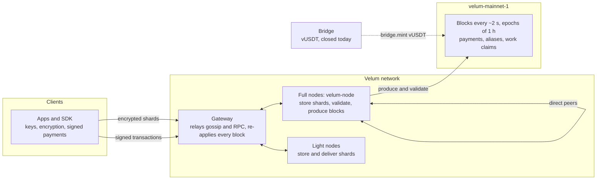

<p align="center"></p>

<h1 align="center">velum-node</h1>

<p align="center"><em>Information at once, private and self-sustaining. To talk, pay and move value without stopping.</em></p>

<p align="center"><strong>English</strong> · <a href="README.es.md">Español</a> · <a href="README.fr.md">Français</a> · <a href="README.ru.md">Русский</a> · <a href="README.zh.md">中文</a></p>

---

## What this is

This repository holds the open, Apache-2.0 core of **Velum**: a private messaging network carried by its own community, with a purpose-built ledger that records payments and audited proofs of message delivery.

| Part | Path | What it is |
|---|---|---|
| Core | `packages/core` | Reference implementation of the protocol: keys, hybrid encryption, shards, rotating mailboxes, anonymous receipts, lottery, transactions, blocks, consensus, economy and live upgrades |
| SDK | `packages/sdk` | `@velum/sdk`: keys, addresses, transactions, RPC, deposits and payments for wallets, shops, exchanges and hardware wallets |
| Node | `apps/node` | `velum-node`: stores and delivers message shards, validates every block, takes turns producing blocks, signed auto-update |
| Bridge | `apps/bridge` | Wrapped USDT (vUSDT) bridge service. Built and tested, closed today |
| Spec | `spec`, `PROTOCOL.md` | Byte-exact test vectors and the protocol specification |

Messages are end-to-end encrypted on the sender's device, padded to fixed sizes, split into five shards (any three rebuild the message) and left in mailboxes that change every day. Nodes store and deliver the shards; messages never touch the chain. The chain (`velum-mainnet-1`, live since 1 November 2026, 21:00 UTC) records payments, node registrations, aliases and work claims. The native unit, VEL, is used for everyday payments and to pay for messaging above a free quota.

The user apps (iOS, Android and the desktop interface built into the node) are available at <https://velumprotocol.org>.

## Quick start

### Install a node (recommended)

**macOS and Linux** (no sudo):

```bash
curl -fsSL https://velumprotocol.org/install.sh | bash
```

**Windows x64** (PowerShell):

```powershell
irm https://velumprotocol.org/install.ps1 | iex
```

The installer downloads the compiled binary for your platform (`darwin-arm64`, `darwin-x64`, `linux-x64`, `linux-arm64`, `windows-x64`), registers a background service and adds the `velum` command. Bun is not needed. Updates are pulled from a manifest signed with Ed25519; the node checks the signature and the SHA-512 of the download, swaps atomically and rolls back if the new binary does not survive 60 seconds.

Day-to-day commands: `velum start`, `velum stop`, `velum restart`, `velum status`, `velum open`, `velum pause`, `velum resume`, `velum update`, `velum reset`, `velum logs`, `velum address`, `velum version`, `velum uninstall [--purge]`.

### Build and run from source

You need [Bun](https://bun.sh).

```bash
git clone https://github.com/Consultora-BIM/velum-node.git
cd velum-node
bun install
bun run --cwd apps/node start                     # = bun src/main.ts start
```

Pass options directly to the entry point:

```bash
bun apps/node/src/main.ts start --port 7421 --payout vel…
```

Build a standalone binary with `bun run --cwd apps/node build`.

## Node CLI

```
velum-node [start] [options]
```

Options are saved in `~/.velum/config.json`.

| Option | Meaning |
|---|---|
| `--name NAME` | Optional, decorative name (by default none: the node is its address; `""` clears it) |
| `--payout vel…` | Wallet that receives the rewards (by default, the node's own) |
| `--port N` | Local port for the interface and direct connections (default `7420`) |
| `--gateway URL[,URL]` | Gateways in order (repeat or separate with commas); `none` means direct peers only |
| `--peer ws://host:port/ws` | Adds a direct peer (can be repeated) |
| `--endpoint ws://…` | Public address other nodes can use to reach you (published on chain) |
| `--dns-seed NAME` | DNS seed (TXT record with ws/wss addresses) to find peers |
| `--no-auto-update` | Do not install signed updates automatically |

| Command | What it does |
|---|---|
| `start` | Starts the node (default command) |
| `init` | Prepares key and configuration without starting (used by the installer) |
| `update` | Looks for and installs the latest signed version now |
| `status` | Readable status of the running node |
| `open` | Opens the desktop interface at `http://localhost:7420/app/` |
| `reset` | Deletes the chain and stored shards (keeps key and configuration); resyncs on start |
| `snapshot export FILE` | Saves a snapshot of the state with its root (node stopped) |
| `snapshot import FILE` | Starts from a snapshot after checking its root (node stopped) |
| `address` · `version` | Node address and version |

| Environment variable | Meaning |
|---|---|
| `VELUM_HOME` | Data directory (default `~/.velum`) |
| `VELUM_PORT` | Local port (default `7420`) |
| `VELUM_GATEWAY` | Gateways, comma-separated |
| `VELUM_PEERS` | Direct peers, comma-separated |
| `VELUM_MANIFEST_URL` | Where to read the signed update manifest |
| `VELUM_AUTO_UPDATE=0` | Disables automatic updates |
| `VELUM_LOG=debug` | Verbose logging |
| `VELUM_NETWORK` | `mainnet` (default) or `testnet` |

## SDK

`@velum/sdk` works in Bun, Node 22+, browsers and Workers. Connect to your own node (`ws://127.0.0.1:7420/ws?role=client`, recommended for exchanges) or to the public gateway (`wss://velumprotocol.org/hub?role=client`).

**Accept a payment** with a signed invoice, a `velum:pay` link (QR or NFC) and a watcher that follows the payment until it is firm:

```ts
import { VelumRpc, createInvoice, parsePaymentURI, watchPayment, walletFromPhrase, parseAmount } from "@velum/sdk";

const rpc = new VelumRpc("wss://velumprotocol.org/hub?role=client");
const shop = walletFromPhrase(process.env.SHOP_PHRASE!);

// 1. Signed invoice and its velum:pay URI, ready for a QR code or an NFC tag
const { invoice, uri } = createInvoice({
  to: shop.address,
  amount: parseAmount("12.5")!,          // BigInt in velos (18 decimals)
  ref: "T-0042",
  label: "Coffee",
  exp: Date.now() + 15 * 60_000,
  secret: shop.secret,                   // signs the invoice; without it the payer sees "unverified"
});

// 2. Payer side: read the URI and check the payee's signature
const parsed = parsePaymentURI(uri);
if (parsed.ok) console.log(parsed.verified ? "verified" : "unverified", parsed.invoice.amount);

// 3. Follow the payment: "pendiente" -> "incluido" (~2 s) -> "firme" (30 blocks; 1,800 for 10,000 VEL or more)
const result = await watchPayment(rpc, invoice, {
  onUpdate: (u) => console.log(u.state, `${u.confirmations}/${u.need}`),
});
rpc.close();
```

**Send a payment**:

```ts
import { VelumRpc, buildTransfer, paymentMemo, walletFromPhrase, CHAIN_ID } from "@velum/sdk";

const me = walletFromPhrase(phrase);
const tx = buildTransfer({
  secret: me.secret, from: me.address, to: invoice.to, amount: invoice.amount,
  memo: paymentMemo(invoice), nonce: await rpc.nextNonce(me.address), chain: CHAIN_ID,
  ctx: await rpc.fees(),                 // fee or proof-of-work stamp, computed from the oracle
});
const { id } = await rpc.submit(tx);
```

Settlement states are returned as the strings `pendiente`, `incluido`, `firme` (and `caducada` when the invoice expires). More examples in `packages/sdk/examples`: a minimal point of sale (`pos/`), a deposit watcher for exchanges, a withdrawal signer and delegated staking.

## Protocol, spec and test vectors

- `PROTOCOL.md` is the public specification, for anyone writing a compatible node, client or wallet in another language.
- `spec/vectors/*.json` hold byte-exact test vectors: canonical encoding, keys, envelopes, shards, mailboxes, receipts, lottery, claims, transactions, blocks, amounts, supply, fees, proof-of-work, oracle, tiers and settlement. **An implementation is compatible if it reproduces them.** Where the spec and the code disagree, the vectors decide.

```bash
VELUM_NETWORK=testnet bun spec/generate.ts --check
VELUM_NETWORK=testnet bun packages/core/scripts/vectors.ts --check
```

Anyone can replay the live main network and check every state root and the accounting invariant:

```bash
VELUM_NETWORK=mainnet bun packages/core/scripts/replay-mainnet.ts
```

## Architecture



Messages travel as encrypted shards between clients and nodes and are never written to the chain. A public, deterministic lottery decides which node gets credit for each shard; nodes commit to the anonymous receipts they collected and prove a random sample of them. All traffic is JSON over WebSocket. Discovery uses gateways, endpoints published on chain, DNS seeds and peer exchange; if every gateway fails, nodes continue among themselves.

## Security

**Guarantees**

- Hybrid post-quantum encryption (X25519 + ML-KEM-768, XChaCha20-Poly1305): breaking a message requires breaking both.
- Sealed sender, daily rotating mailboxes and 7 fixed size buckets limit what nodes learn.
- Only the real recipient can produce a delivery receipt; only the mailbox owner can open a mailbox.
- Every node rebuilds every block. A producer that pays itself one velo more changes the state root, and every validator rejects the block. Keyless system accounts cannot sign.

**Honest limits today**

- **Signatures are classical Ed25519.** Post-quantum signatures (ML-DSA) are on the roadmap.
- **A single node produces blocks today.** It can censor or delay, but it cannot steal or create VEL.
- **No finality yet.** Highest chain wins; treat payments as firm after 30 blocks (1,800 for 10,000 VEL or more).
- No per-message ratchet, no cover traffic, no multi-hop routing.
- One gateway relays most traffic; one key signs node binaries; the genesis reserve sits in a single offline cold wallet.
- Node registration is free; the free messaging quota is defined but not yet enforced.

**Plan to decentralise:** independent operators running full nodes 2.1.0 (the turn order already admits them), an entry cost for block producers (minimum bond or proof-of-work), per-epoch committees with finality at more than 2/3 of committee weight, several independent gateways, and multisig for the publishing key and the cold wallet.

## Economy

Economy v4 activates in place at block **64,800** (scheduled for about 09:00 UTC on 3 November 2026), without restarting the chain.

| Parameter | Value |
|---|---|
| Decimals | 18 (1 velo = 10⁻¹⁸ VEL) |
| Hard cap | 21,000,000,000 VEL |
| Genesis reserve | 100,000,000 VEL, in the operator's offline cold wallet |
| Halving | Every 4 years (35,064 hourly epochs); 33 halvings |
| Burn | None |
| Payment fee | 0 below 1,100 vUSDT of value (with a proof-of-work stamp); 1 basis point above |
| Fee split | 80 % node pot, 20 % Network Reserve |
| Messaging credits | 22 µUSDT per message above the free quota (quota defined, not yet enforced) |

```
R0   = floor((21,000,000,000 − 100,000,000) VEL / (2 · 35,064)) ≈ 298,026.47 VEL
R(e) = R0 >> floor(e / 35064)        (0 from the 33rd halving)
```

**VEL has no price yet.** The protocol sets none. A reference value only appears if people trade VEL against vUSDT on the on-chain market and the oracle reads it; until then fees stay at zero. The operator that started the project (NC CONSULTORIA E INVERSIONES SL, Seville, Spain) does not sell VEL and does not give it away.

## Status

| Part | Status |
|---|---|
| `velum-mainnet-1` | Live since 1 November 2026, 21:00 UTC |
| Economy v4 | Activates at block 64,800 (node 2.1.0) |
| Messaging, payments, full and light nodes | Active |
| Block production | A single node today |
| Finality | Not yet |
| Peer-to-peer exchange (HTLC, protocol v5) | Written and tested, not activated |
| vUSDT bridge | Built and tested, closed |
| Post-quantum signatures | On the roadmap |

## Documentation

- Whitepaper: [docs/paper/velum-paper.md](docs/paper/velum-paper.md) (Spanish: [docs/paper/velum-paper.es.md](docs/paper/velum-paper.es.md))
- Protocol specification: [PROTOCOL.md](PROTOCOL.md)
- Test vectors: [spec/vectors](spec/vectors)
- Website and live explorer: <https://velumprotocol.org>

## Contributing

```bash
bun install
bun test packages apps/node/test apps/bridge/test   # core, SDK, node and bridge tests
bun run --cwd packages/core test:mainnet      # mainnet and v4 upgrade tests
```

Open issues and pull requests at <https://github.com/Consultora-BIM/velum-node>. Keep changes small and tested. Any change to consensus must keep the vectors passing, or regenerate them as part of an explicit protocol version with an activation height. Old blocks must keep validating byte for byte.

## License

Apache License 2.0. See [LICENSE](LICENSE) and [NOTICE](NOTICE).

Copyright 2026 Consultora BIM.
