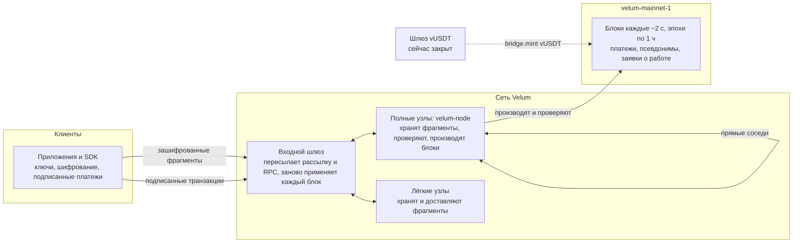

<p align="center"></p>

<h1 align="center">velum-node</h1>

<p align="center"><em>Информация мгновенно, приватно и самодостаточно. Чтобы общаться, платить и передавать ценность без остановки.</em></p>

<p align="center"><a href="README.md">English</a> · <a href="README.es.md">Español</a> · <a href="README.fr.md">Français</a> · <strong>Русский</strong> · <a href="README.zh.md">中文</a></p>

---

## Что это

В этом репозитории находится открытое ядро **Velum** под лицензией Apache-2.0. Velum — сеть приватных сообщений, которую поддерживает само сообщество, со специально созданным реестром, где записываются платежи и проверенные доказательства доставки сообщений.

| Часть | Путь | Что это |
|---|---|---|
| Ядро | `packages/core` | Эталонная реализация протокола: ключи, гибридное шифрование, фрагменты, сменяемые почтовые ящики, анонимные квитанции, жеребьёвка, транзакции, блоки, консенсус, экономика и обновления на ходу |
| SDK | `packages/sdk` | `@velum/sdk`: ключи, адреса, транзакции, RPC, депозиты и приём платежей для кошельков, магазинов, бирж и аппаратных кошельков |
| Узел | `apps/node` | `velum-node`: хранит и доставляет фрагменты сообщений, проверяет каждый блок, по очереди производит блоки, подписанное автообновление |
| Шлюз | `apps/bridge` | Служба шлюза обёрнутого USDT (vUSDT). Создана и протестирована, сейчас закрыта |
| Спецификация | `spec`, `PROTOCOL.md` | Тестовые векторы с точностью до байта и спецификация протокола |

Сообщения шифруются сквозным шифрованием на устройстве отправителя, дополняются до фиксированных размеров, делятся на пять фрагментов (любых трёх достаточно, чтобы восстановить сообщение) и оставляются в почтовых ящиках, которые меняются каждый день. Узлы хранят и доставляют фрагменты; сообщения никогда не попадают в цепочку. Цепочка (`velum-mainnet-1`, работает с 1 ноября 2026 года, 21:00 UTC) записывает платежи, регистрации узлов, псевдонимы и заявки о выполненной работе. Собственная единица сети, VEL, служит для повседневных платежей и для оплаты сообщений сверх бесплатной квоты.

Приложения для пользователей (iOS, Android и настольный интерфейс, встроенный в узел) доступны на <https://velumprotocol.org>.

## Быстрый старт

### Установка узла (рекомендуется)

**macOS и Linux** (без sudo):

```bash
curl -fsSL https://velumprotocol.org/install.sh | bash
```

**Windows x64** (PowerShell):

```powershell
irm https://velumprotocol.org/install.ps1 | iex
```

Установщик скачивает скомпилированный файл для вашей платформы (`darwin-arm64`, `darwin-x64`, `linux-x64`, `linux-arm64`, `windows-x64`), регистрирует фоновую службу и добавляет команду `velum`. Bun не нужен. Обновления берутся из манифеста, подписанного Ed25519; узел проверяет подпись и SHA-512 загрузки, атомарно заменяет исполняемый файл и откатывается, если новый не проработал 60 секунд.

Повседневные команды: `velum start`, `velum stop`, `velum restart`, `velum status`, `velum open`, `velum pause`, `velum resume`, `velum update`, `velum reset`, `velum logs`, `velum address`, `velum version`, `velum uninstall [--purge]`.

### Сборка и запуск из исходного кода

Нужен [Bun](https://bun.sh).

```bash
git clone https://github.com/Consultora-BIM/velum-node.git
cd velum-node
bun install
bun run --cwd apps/node start                     # = bun src/main.ts start
```

Чтобы передать параметры, вызовите точку входа напрямую:

```bash
bun apps/node/src/main.ts start --port 7421 --payout vel…
```

Собрать автономный исполняемый файл: `bun run --cwd apps/node build`.

## Командная строка узла

```
velum-node [start] [параметры]
```

Параметры сохраняются в `~/.velum/config.json`.

| Параметр | Значение |
|---|---|
| `--name ИМЯ` | Необязательное декоративное имя (по умолчанию нет: узел — это его адрес; `""` удаляет имя) |
| `--payout vel…` | Кошелёк, который получает вознаграждения (по умолчанию — кошелёк узла) |
| `--port N` | Локальный порт интерфейса и прямых соединений (по умолчанию `7420`) |
| `--gateway URL[,URL]` | Входные шлюзы по порядку (повторяется или через запятую); `none` — только прямые соседи |
| `--peer ws://хост:порт/ws` | Добавляет прямого соседа (можно повторять) |
| `--endpoint ws://…` | Публичный адрес, по которому к вам могут подключаться другие узлы (публикуется в цепочке) |
| `--dns-seed ИМЯ` | DNS-сид (TXT-запись с адресами ws/wss) для поиска соседей |
| `--no-auto-update` | Не устанавливать подписанные обновления автоматически |

| Команда | Что делает |
|---|---|
| `start` | Запускает узел (команда по умолчанию) |
| `init` | Готовит ключ и настройки без запуска (используется установщиком) |
| `update` | Сразу ищет и устанавливает последнюю подписанную версию |
| `status` | Понятное состояние работающего узла |
| `open` | Открывает настольный интерфейс по адресу `http://localhost:7420/app/` |
| `reset` | Удаляет цепочку и сохранённые фрагменты (ключ и настройки остаются); при запуске синхронизируется заново |
| `snapshot export ФАЙЛ` | Сохраняет снимок состояния вместе с его корнем (узел должен быть остановлен) |
| `snapshot import ФАЙЛ` | Запускается из снимка, предварительно проверив его корень (узел должен быть остановлен) |
| `address` · `version` | Адрес и версия узла |

| Переменная окружения | Значение |
|---|---|
| `VELUM_HOME` | Папка данных (по умолчанию `~/.velum`) |
| `VELUM_PORT` | Локальный порт (по умолчанию `7420`) |
| `VELUM_GATEWAY` | Входные шлюзы через запятую |
| `VELUM_PEERS` | Прямые соседи через запятую |
| `VELUM_MANIFEST_URL` | Откуда читать подписанный манифест обновлений |
| `VELUM_AUTO_UPDATE=0` | Отключает автоматические обновления |
| `VELUM_LOG=debug` | Подробный журнал |
| `VELUM_NETWORK` | `mainnet` (по умолчанию) или `testnet` |

## SDK

`@velum/sdk` работает в Bun, Node 22+, браузерах и Workers. Подключайтесь к своему узлу (`ws://127.0.0.1:7420/ws?role=client`, рекомендуется для бирж) или к публичному шлюзу (`wss://velumprotocol.org/hub?role=client`).

**Приём платежа** с подписанным счётом, ссылкой `velum:pay` (QR или NFC) и наблюдением за платежом, пока он не станет надёжным:

```ts
import { VelumRpc, createInvoice, parsePaymentURI, watchPayment, walletFromPhrase, parseAmount } from "@velum/sdk";

const rpc = new VelumRpc("wss://velumprotocol.org/hub?role=client");
const shop = walletFromPhrase(process.env.SHOP_PHRASE!);

// 1. Подписанный счёт и его URI velum:pay, готовый для QR-кода или NFC-метки
const { invoice, uri } = createInvoice({
  to: shop.address,
  amount: parseAmount("12.5")!,          // BigInt в velo (18 знаков после запятой)
  ref: "T-0042",
  label: "Кофе",
  exp: Date.now() + 15 * 60_000,
  secret: shop.secret,                   // подписывает счёт; без подписи плательщик увидит «не проверен»
});

// 2. Сторона плательщика: прочитать URI и проверить подпись получателя
const parsed = parsePaymentURI(uri);
if (parsed.ok) console.log(parsed.verified ? "проверен" : "не проверен", parsed.invoice.amount);

// 3. Следить за платежом: "pendiente" -> "incluido" (~2 с) -> "firme" (30 блоков; 1 800 для сумм от 10 000 VEL)
const result = await watchPayment(rpc, invoice, {
  onUpdate: (u) => console.log(u.state, `${u.confirmations}/${u.need}`),
});
rpc.close();
```

**Отправка платежа**:

```ts
import { VelumRpc, buildTransfer, paymentMemo, walletFromPhrase, CHAIN_ID } from "@velum/sdk";

const me = walletFromPhrase(phrase);
const tx = buildTransfer({
  secret: me.secret, from: me.address, to: invoice.to, amount: invoice.amount,
  memo: paymentMemo(invoice), nonce: await rpc.nextNonce(me.address), chain: CHAIN_ID,
  ctx: await rpc.fees(),                 // комиссия или отметка доказательства работы, по данным оракула
});
const { id } = await rpc.submit(tx);
```

Состояния платежа возвращаются в виде строк `pendiente`, `incluido`, `firme` (и `caducada`, если срок счёта истёк). Другие примеры — в `packages/sdk/examples`: минимальный кассовый терминал (`pos/`), отслеживание депозитов для бирж, подпись выводов и делегированный стейкинг.

## Протокол, спецификация и тестовые векторы

- `PROTOCOL.md` — открытая спецификация для тех, кто пишет совместимый узел, клиент или кошелёк на другом языке.
- `spec/vectors/*.json` содержат тестовые векторы с точностью до байта: каноническое кодирование, ключи, конверты, фрагменты, почтовые ящики, квитанции, жеребьёвка, заявки, транзакции, блоки, суммы, предложение, комиссии, доказательство работы, оракул, уровни и расчёты. **Реализация совместима, если воспроизводит их.** Если спецификация и код расходятся, решают векторы.

```bash
VELUM_NETWORK=testnet bun spec/generate.ts --check
VELUM_NETWORK=testnet bun packages/core/scripts/vectors.ts --check
```

Любой может заново применить действующую основную сеть и проверить каждый корень состояния и бухгалтерский инвариант:

```bash
VELUM_NETWORK=mainnet bun packages/core/scripts/replay-mainnet.ts
```

## Архитектура



Сообщения передаются как зашифрованные фрагменты между клиентами и узлами и никогда не записываются в цепочку. Открытая детерминированная жеребьёвка решает, какой узел получит зачёт за каждый фрагмент; узлы фиксируют собранные анонимные квитанции и доказывают случайную выборку из них. Весь трафик — JSON поверх WebSocket. Для поиска используются входные шлюзы, адреса, опубликованные в цепочке, DNS-сиды и обмен списками соседей; если все шлюзы недоступны, узлы продолжают работать между собой.

## Безопасность

**Гарантии**

- Гибридное постквантовое шифрование (X25519 + ML-KEM-768, XChaCha20-Poly1305): чтобы взломать сообщение, нужно взломать оба алгоритма.
- Скрытый отправитель, ежедневно меняющиеся почтовые ящики и 7 фиксированных размеров ограничивают то, что узнают узлы.
- Только настоящий получатель может создать квитанцию о доставке; только владелец почтового ящика может его открыть.
- Каждый узел заново собирает каждый блок. Если производитель блока заплатит себе хотя бы на один velo больше, изменится корень состояния, и все валидаторы отклонят блок. Системные счета без ключа не могут подписывать.

**Честные ограничения на сегодня**

- **Подписи — классические Ed25519.** Постквантовые подписи (ML-DSA) есть в плане развития.
- **Сегодня блоки производит один узел.** Он может цензурировать или задерживать, но не может украсть или создать VEL.
- **Финальности пока нет.** Побеждает самая высокая цепочка; считайте платёж надёжным после 30 блоков (1 800 для сумм от 10 000 VEL).
- Нет храповика для каждого сообщения, нет маскирующего трафика, нет многоэтапной маршрутизации.
- Один входной шлюз пересылает большую часть трафика; один ключ подписывает файлы узла; резерв генезиса хранится в одном холодном кошельке без подключения к сети.
- Регистрация узла бесплатна; бесплатная квота сообщений определена, но пока не применяется.

**План децентрализации:** независимые операторы с полными узлами 2.1.0 (очерёдность производства блоков уже их допускает), плата за вход для производителей блоков (минимальный залог или доказательство работы), комитеты на каждую эпоху с финальностью при подписях более 2/3 веса комитета, несколько независимых входных шлюзов и мультиподпись для ключа публикации и холодного кошелька.

## Экономика

Экономика v4 включается на ходу на блоке **64 800** (запланировано примерно на 09:00 UTC 3 ноября 2026 года), без перезапуска цепочки.

| Параметр | Значение |
|---|---|
| Знаков после запятой | 18 (1 velo = 10⁻¹⁸ VEL) |
| Предельный объём | 21 000 000 000 VEL |
| Резерв генезиса | 100 000 000 VEL, в холодном кошельке оператора без подключения к сети |
| Халвинг | Каждые 4 года (35 064 часовые эпохи); 33 халвинга |
| Сжигание | Нет |
| Комиссия за платёж | 0 при стоимости меньше 1 100 vUSDT (с отметкой доказательства работы); 1 базисный пункт при большей сумме |
| Распределение комиссии | 80 % в общий фонд узлов, 20 % в Резерв сети |
| Кредиты на сообщения | 22 µUSDT за сообщение сверх бесплатной квоты (квота определена, пока не применяется) |

```
R0   = floor((21 000 000 000 − 100 000 000) VEL / (2 · 35 064)) ≈ 298 026,47 VEL
R(e) = R0 >> floor(e / 35064)        (0 начиная с 33-го халвинга)
```

**У VEL пока нет цены.** Протокол её не устанавливает. Ориентировочная стоимость появится, только если люди начнут обменивать VEL на vUSDT на рынке внутри цепочки и оракул её считает; до тех пор комиссии остаются нулевыми. Оператор, запустивший проект (NC CONSULTORIA E INVERSIONES SL, Севилья, Испания), не продаёт и не раздаёт VEL.

## Состояние

| Часть | Состояние |
|---|---|
| `velum-mainnet-1` | Работает с 1 ноября 2026 года, 21:00 UTC |
| Экономика v4 | Включается на блоке 64 800 (узел 2.1.0) |
| Сообщения, платежи, полные и лёгкие узлы | Работают |
| Производство блоков | Сегодня один узел |
| Финальность | Пока нет |
| Обмен между людьми (HTLC, протокол v5) | Написан и протестирован, не включён |
| Шлюз vUSDT | Создан и протестирован, закрыт |
| Постквантовые подписи | В плане развития |

## Документация

- Технический документ: [docs/paper/velum-paper.md](docs/paper/velum-paper.md) (на испанском: [docs/paper/velum-paper.es.md](docs/paper/velum-paper.es.md))
- Спецификация протокола: [PROTOCOL.md](PROTOCOL.md)
- Тестовые векторы: [spec/vectors](spec/vectors)
- Сайт и обозреватель в реальном времени: <https://velumprotocol.org>

## Участие в разработке

```bash
bun install
bun test packages apps/node/test apps/bridge/test   # тесты ядра, SDK, узла и шлюза
bun run --cwd packages/core test:mainnet      # тесты основной сети и обновления v4
```

Создавайте задачи (issues) и pull request на <https://github.com/Consultora-BIM/velum-node>. Делайте небольшие изменения с тестами. Любое изменение консенсуса должно сохранять векторы зелёными или пересоздавать их в рамках явной версии протокола с высотой активации. Старые блоки должны по-прежнему проверяться байт в байт.

## Лицензия

Apache License 2.0. См. [LICENSE](LICENSE) и [NOTICE](NOTICE).

Copyright 2026 Consultora BIM.
