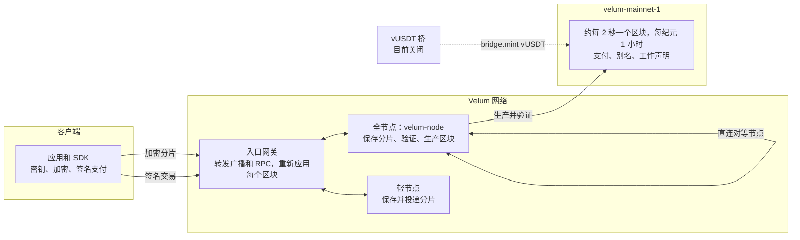

<p align="center"></p>

<h1 align="center">velum-node</h1>

<p align="center"><em>信息即时送达，私密且自我维持。用来交谈、支付和流转价值，从不停歇。</em></p>

<p align="center"><a href="README.md">English</a> · <a href="README.es.md">Español</a> · <a href="README.fr.md">Français</a> · <a href="README.ru.md">Русский</a> · <strong>中文</strong></p>

---

## 这是什么

本仓库包含 **Velum** 以 Apache-2.0 许可开源的核心部分。Velum 是一个由社区自身承载的私密通信网络，配有一条专门打造的账本，用来记录支付以及经过审计的消息投递证明。

| 部分 | 路径 | 说明 |
|---|---|---|
| 核心 | `packages/core` | 协议的参考实现：密钥、混合加密、分片、轮换信箱、匿名回执、抽签、交易、区块、共识、经济模型和在线升级 |
| SDK | `packages/sdk` | `@velum/sdk`：为钱包、商家、交易所和硬件钱包提供密钥、地址、交易、RPC、充值和收款功能 |
| 节点 | `apps/node` | `velum-node`：保存并投递消息分片，验证每个区块，轮流生产区块，签名自动更新 |
| 桥 | `apps/bridge` | 包装 USDT（vUSDT）桥接服务。已完成并测试，目前关闭 |
| 规范 | `spec`、`PROTOCOL.md` | 逐字节精确的测试向量和协议规范 |

消息在发送者的设备上进行端到端加密，填充到固定大小，拆分成五个分片（任意三个即可还原消息），并存放在每天更换的信箱中。节点负责保存和投递分片；消息从不上链。链（`velum-mainnet-1`，自 2026 年 11 月 1 日 21:00 UTC 起运行）记录支付、节点注册、别名和工作声明。原生单位 VEL 用于日常支付，以及支付超出免费额度的消息。

面向用户的应用（iOS、Android 以及内置于节点的桌面界面）可在 <https://velumprotocol.org> 获取。

## 快速开始

### 安装节点（推荐）

**macOS 和 Linux**（无需 sudo）：

```bash
curl -fsSL https://velumprotocol.org/install.sh | bash
```

**Windows x64**（PowerShell）：

```powershell
irm https://velumprotocol.org/install.ps1 | iex
```

安装程序会下载适合你平台的编译版本（`darwin-arm64`、`darwin-x64`、`linux-x64`、`linux-arm64`、`windows-x64`），注册为后台服务并添加 `velum` 命令。不需要安装 Bun。更新来自一份用 Ed25519 签名的清单；节点会校验下载文件的签名和 SHA-512，以原子方式替换程序，如果新程序运行不到 60 秒就失败则自动回退。

日常命令：`velum start`、`velum stop`、`velum restart`、`velum status`、`velum open`、`velum pause`、`velum resume`、`velum update`、`velum reset`、`velum logs`、`velum address`、`velum version`、`velum uninstall [--purge]`。

### 从源代码构建和运行

需要安装 [Bun](https://bun.sh)。

```bash
git clone https://github.com/Consultora-BIM/velum-node.git
cd velum-node
bun install
bun run --cwd apps/node start                     # 等同于 bun src/main.ts start
```

如需传入选项，可直接调用入口文件：

```bash
bun apps/node/src/main.ts start --port 7421 --payout vel…
```

构建独立可执行文件：`bun run --cwd apps/node build`。

## 节点命令行

```
velum-node [start] [选项]
```

选项保存在 `~/.velum/config.json` 中。

| 选项 | 含义 |
|---|---|
| `--name 名称` | 可选的装饰性名称（默认无：节点即其地址；`""` 表示清除） |
| `--payout vel…` | 接收奖励的钱包（默认为节点自己的钱包） |
| `--port N` | 界面和直连使用的本地端口（默认 `7420`） |
| `--gateway URL[,URL]` | 按顺序排列的入口网关（可重复或用逗号分隔）；`none` 表示只用直连对等节点 |
| `--peer ws://主机:端口/ws` | 添加一个直连对等节点（可重复） |
| `--endpoint ws://…` | 其他节点可以连接你的公开地址（发布在链上） |
| `--dns-seed 名称` | DNS 种子（包含 ws/wss 地址的 TXT 记录），用于发现对等节点 |
| `--no-auto-update` | 不自动安装签名更新 |

| 命令 | 作用 |
|---|---|
| `start` | 启动节点（默认命令） |
| `init` | 准备密钥和配置但不启动（供安装程序使用） |
| `update` | 立即查找并安装最新的签名版本 |
| `status` | 运行中节点的可读状态 |
| `open` | 在 `http://localhost:7420/app/` 打开桌面界面 |
| `reset` | 删除链数据和已存分片（保留密钥和配置）；启动时重新同步 |
| `snapshot export 文件` | 保存带状态根的状态快照（需先停止节点） |
| `snapshot import 文件` | 校验快照的状态根后从快照启动（需先停止节点） |
| `address` · `version` | 节点地址和版本 |

| 环境变量 | 含义 |
|---|---|
| `VELUM_HOME` | 数据目录（默认 `~/.velum`） |
| `VELUM_PORT` | 本地端口（默认 `7420`） |
| `VELUM_GATEWAY` | 入口网关，用逗号分隔 |
| `VELUM_PEERS` | 直连对等节点，用逗号分隔 |
| `VELUM_MANIFEST_URL` | 读取签名更新清单的地址 |
| `VELUM_AUTO_UPDATE=0` | 关闭自动更新 |
| `VELUM_LOG=debug` | 详细日志 |
| `VELUM_NETWORK` | `mainnet`（默认）或 `testnet` |

## SDK

`@velum/sdk` 可在 Bun、Node 22+、浏览器和 Workers 中运行。可以连接你自己的节点（`ws://127.0.0.1:7420/ws?role=client`，推荐交易所使用），也可以连接公共网关（`wss://velumprotocol.org/hub?role=client`）。

**收款**：使用签名发票、`velum:pay` 链接（二维码或 NFC），并跟踪付款直到确定：

```ts
import { VelumRpc, createInvoice, parsePaymentURI, watchPayment, walletFromPhrase, parseAmount } from "@velum/sdk";

const rpc = new VelumRpc("wss://velumprotocol.org/hub?role=client");
const shop = walletFromPhrase(process.env.SHOP_PHRASE!);

// 1. 签名发票及其 velum:pay URI，可直接生成二维码或写入 NFC 标签
const { invoice, uri } = createInvoice({
  to: shop.address,
  amount: parseAmount("12.5")!,          // 以 velo 为单位的 BigInt（18 位小数）
  ref: "T-0042",
  label: "咖啡",
  exp: Date.now() + 15 * 60_000,
  secret: shop.secret,                   // 为发票签名；没有签名时付款方会看到"未验证"
});

// 2. 付款方：读取 URI 并校验收款方的签名
const parsed = parsePaymentURI(uri);
if (parsed.ok) console.log(parsed.verified ? "已验证" : "未验证", parsed.invoice.amount);

// 3. 跟踪付款："pendiente" -> "incluido"（约 2 秒）-> "firme"（30 个区块；10,000 VEL 及以上为 1,800 个）
const result = await watchPayment(rpc, invoice, {
  onUpdate: (u) => console.log(u.state, `${u.confirmations}/${u.need}`),
});
rpc.close();
```

**付款**：

```ts
import { VelumRpc, buildTransfer, paymentMemo, walletFromPhrase, CHAIN_ID } from "@velum/sdk";

const me = walletFromPhrase(phrase);
const tx = buildTransfer({
  secret: me.secret, from: me.address, to: invoice.to, amount: invoice.amount,
  memo: paymentMemo(invoice), nonce: await rpc.nextNonce(me.address), chain: CHAIN_ID,
  ctx: await rpc.fees(),                 // 根据预言机计算手续费或工作量证明戳记
});
const { id } = await rpc.submit(tx);
```

收款状态以字符串 `pendiente`、`incluido`、`firme` 返回（发票过期时为 `caducada`）。更多示例见 `packages/sdk/examples`：最小收银终端（`pos/`）、面向交易所的充值监听、提现签名和委托质押。

## 协议、规范和测试向量

- `PROTOCOL.md` 是公开规范，供希望用其他语言编写兼容节点、客户端或钱包的人参考。
- `spec/vectors/*.json` 包含逐字节精确的测试向量：规范编码、密钥、信封、分片、信箱、回执、抽签、声明、交易、区块、金额、供应量、手续费、工作量证明、预言机、等级和结算。**实现若能复现这些向量即为兼容。** 规范与代码不一致时，以测试向量为准。

```bash
VELUM_NETWORK=testnet bun spec/generate.ts --check
VELUM_NETWORK=testnet bun packages/core/scripts/vectors.ts --check
```

任何人都可以重放正在运行的主网，核对每一个状态根和记账不变式：

```bash
VELUM_NETWORK=mainnet bun packages/core/scripts/replay-mainnet.ts
```

## 架构



消息以加密分片的形式在客户端和节点之间传递，从不写入链中。一个公开、确定性的抽签决定每个分片的功劳归哪个节点；节点对收集到的匿名回执作出承诺，并证明其中随机抽取的样本。所有流量都是基于 WebSocket 的 JSON。节点通过入口网关、链上公布的地址、DNS 种子和对等节点交换相互发现；即使所有网关都失效，节点之间仍能继续运行。

## 安全

**保障**

- 混合后量子加密（X25519 + ML-KEM-768，XChaCha20-Poly1305）：要破解一条消息，必须同时攻破两者。
- 密封发送者、每天轮换的信箱和 7 种固定大小限制了节点能获知的信息。
- 只有真正的收件人才能生成投递回执；只有信箱的主人才能打开信箱。
- 每个节点都会重建每个区块。区块生产者哪怕多给自己付一个 velo，状态根也会改变，所有验证者都会拒绝该区块。无密钥的系统账户无法签名。

**如实说明当前的局限**

- **签名使用经典的 Ed25519。** 后量子签名（ML-DSA）已列入路线图。
- **目前只有一个节点在生产区块。** 它可以审查或延迟，但无法窃取或凭空创造 VEL。
- **尚无最终性。** 最高的链胜出；请在 30 个区块后再视支付为确定（10,000 VEL 及以上为 1,800 个区块）。
- 没有逐条消息的棘轮，没有掩护流量，没有多跳路由。
- 一个入口网关转发大部分流量；只有一把密钥为节点程序签名；创世储备存放在单个离线冷钱包中。
- 注册节点是免费的；免费消息额度已定义但尚未执行。

**去中心化计划：** 由独立运营者运行 2.1.0 版全节点（出块轮次已允许它们加入）；为区块生产者设置准入成本（最低保证金或工作量证明）；每个纪元设立委员会，获得超过委员会 2/3 权重的签名即达到最终性；建设多个独立的入口网关；发布密钥和冷钱包采用多重签名。

## 经济模型

v4 经济模型在区块 **28,800** 原地激活（预计在 2026 年 11 月 2 日 12:05 UTC 左右），无需重启链。

| 参数 | 数值 |
|---|---|
| 小数位 | 18（1 velo = 10⁻¹⁸ VEL） |
| 总量上限 | 21,000,000,000 VEL |
| 创世储备 | 100,000,000 VEL，存放在运营方的离线冷钱包中 |
| 减半 | 每 4 年一次（35,064 个一小时纪元）；共 33 次减半 |
| 销毁 | 无 |
| 支付手续费 | 价值低于 1,100 vUSDT 时为 0（需附工作量证明戳记）；超过时为 1 个基点 |
| 手续费分配 | 80 % 进入节点奖励池，20 % 进入网络储备 |
| 消息额度 | 超出免费额度后每条消息 22 µUSDT（额度已定义，尚未执行） |

```
R0   = floor((21,000,000,000 − 100,000,000) VEL / (2 · 35,064)) ≈ 298,026.47 VEL
R(e) = R0 >> floor(e / 35064)        （第 33 次减半起为 0）
```

**VEL 目前没有价格。** 协议不设定任何价格。只有当人们在链上市场用 VEL 与 vUSDT 进行交易、并由预言机读取时，才会出现参考价值；在此之前手续费保持为零。发起本项目的运营方（NC CONSULTORIA E INVERSIONES SL，西班牙塞维利亚）不出售、也不赠送 VEL。

## 状态

| 部分 | 状态 |
|---|---|
| `velum-mainnet-1` | 自 2026 年 11 月 1 日 21:00 UTC 起运行 |
| v4 经济模型 | 在区块 28,800 激活（节点 2.1.0） |
| 消息、支付、全节点和轻节点 | 已启用 |
| 区块生产 | 目前只有一个节点 |
| 最终性 | 尚无 |
| 点对点兑换（HTLC，协议 v5） | 已编写并测试，未激活 |
| vUSDT 桥 | 已完成并测试，目前关闭 |
| 后量子签名 | 已列入路线图 |

## 文档

- 白皮书：[docs/paper/velum-paper.md](docs/paper/velum-paper.md)（西班牙文版：[docs/paper/velum-paper.es.md](docs/paper/velum-paper.es.md)）
- 协议规范：[PROTOCOL.md](PROTOCOL.md)
- 测试向量：[spec/vectors](spec/vectors)
- 网站和实时浏览器：<https://velumprotocol.org>

## 参与贡献

```bash
bun install
bun test packages apps/node/test apps/bridge/test   # 核心、SDK、节点和桥的测试
bun run --cwd packages/core test:mainnet      # 主网和 v4 升级测试
```

请在 <https://github.com/Consultora-BIM/velum-node> 提交 issue 和 pull request。保持改动精简并附带测试。任何共识变更都必须让测试向量继续通过，或者在一个带有激活高度的明确协议版本中重新生成向量。旧区块必须继续逐字节通过验证。

## 许可证

Apache License 2.0。参见 [LICENSE](LICENSE) 和 [NOTICE](NOTICE)。

Copyright 2026 Consultora BIM。
