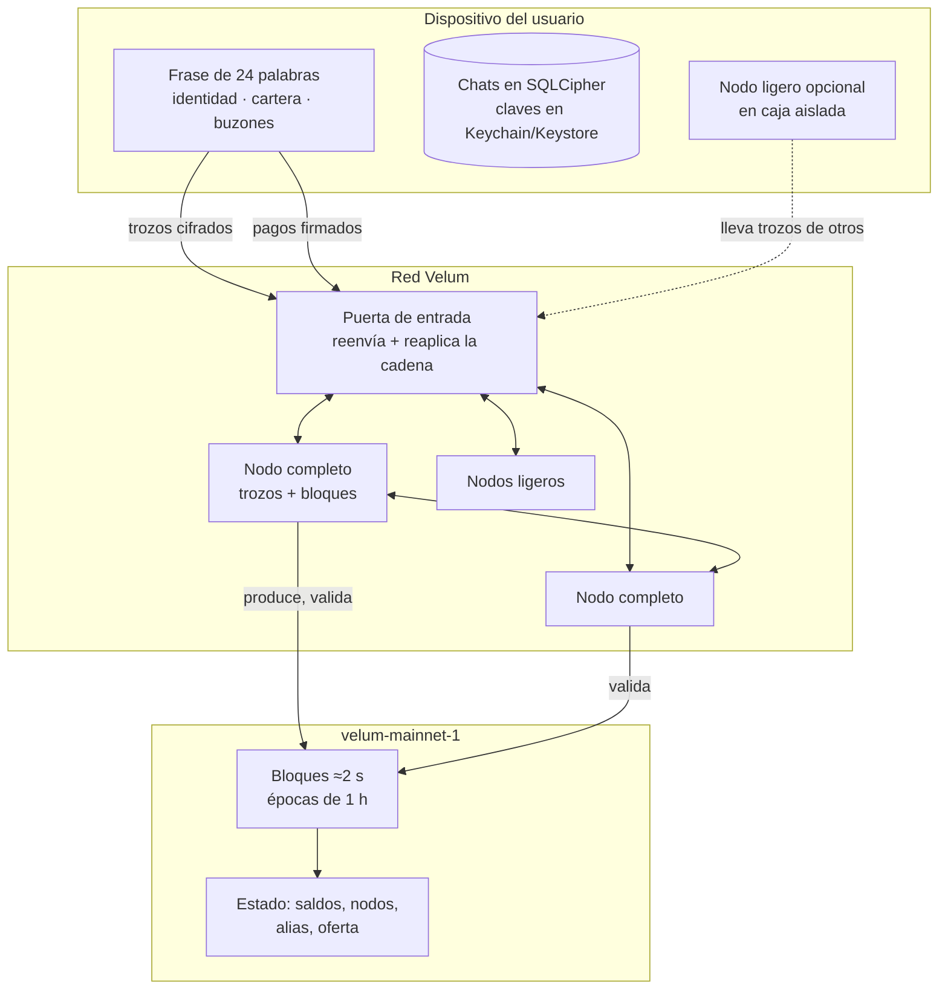
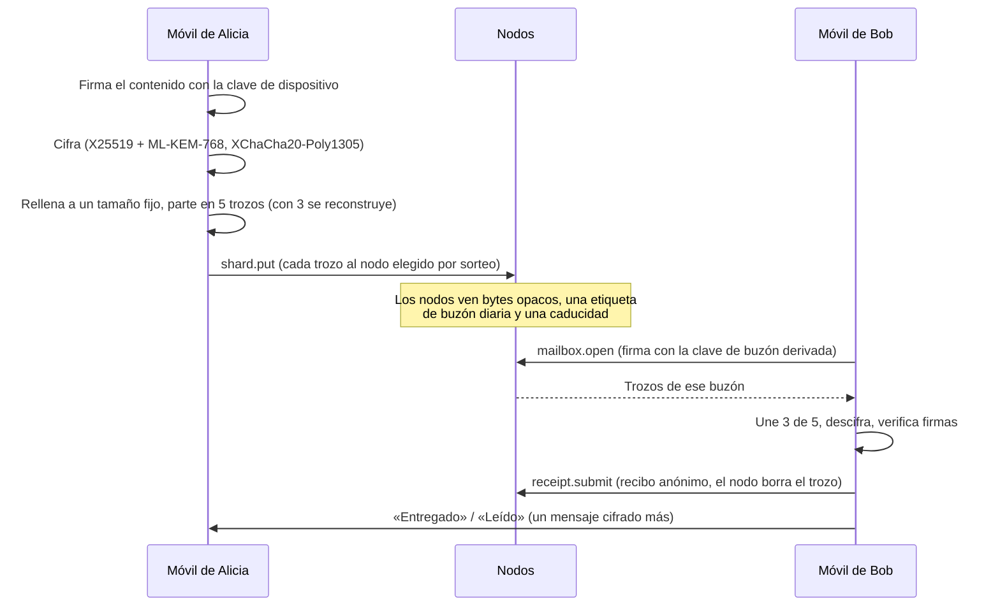
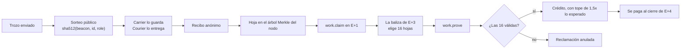
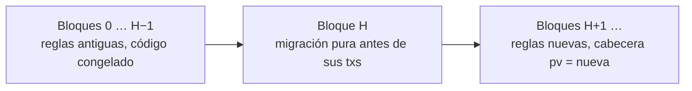

# Velum: mensajería y pagos al instante, privados y autosostenidos

**Versión 1.0 — 2 de noviembre de 2026 — red `velum-mainnet-1`**

> *Información al instante, privada y autosostenida. Para hablar, pagar y mover valor sin parar.*

Web: <https://velumprotocol.org> · Código (Apache-2.0): <https://github.com/Consultora-BIM/velum-node> · Versión en inglés: [velum-paper.md](velum-paper.md)

---

## Resumen

Velum es una red de mensajería privada que funciona sobre una infraestructura sostenida por su propia comunidad y lleva las cuentas de ese trabajo en un libro contable hecho a medida. Los mensajes se cifran de extremo a extremo en el dispositivo de quien envía con un acuerdo de claves híbrido clásico/poscuántico (X25519 + ML-KEM-768), se rellenan hasta uno de siete tamaños fijos, se reparten con un código Reed–Solomon 3 de 5 y se dejan en buzones que cambian cada día, guardados por nodos de la comunidad. Los mensajes nunca tocan la cadena. La cadena registra pagos, altas de nodos, alias y *reclamaciones de trabajo*: compromisos Merkle compactos sobre recibos anónimos de entrega, auditados por muestreo aleatorio público. Los nodos que llevan mensajes y producen bloques reciben, en cada época de una hora, una parte de una bolsa formada por comisiones, una liberación lenta desde una Reserva de la Red sin clave y una emisión fija que se reduce a la mitad periódicamente. La unidad nativa, VEL, tiene 18 decimales y un tope fijo de 21.000.000.000; se usa para pagos del día a día (de móvil a móvil o con el QR de una tienda) y para pagar la mensajería por encima de una cuota gratuita. Nunca se quema VEL.

La red principal, `velum-mainnet-1`, está en marcha desde el 1 de noviembre de 2026 a las 21:00 UTC. La economía v4 se activa sobre la marcha en el bloque 28.800 (previsto hacia las 12:05 UTC del 2 de noviembre de 2026) sin reiniciar la cadena. Este documento describe el sistema tal como está implementado en el código de referencia, incluidos sus límites actuales: hoy un solo nodo produce bloques, todavía no hay mecanismo de finalidad y las firmas son Ed25519 clásicas. Lo decimos sin rodeos y describimos el plan para resolverlo.

---

## 1. Motivación

Los mensajeros populares han hecho normal el cifrado de extremo a extremo. El contenido está protegido; el resto no siempre. Quedan tres problemas.

1. **Metadatos.** Un servidor central ve quién habla con quién, cuándo y cuánto. Incluso con remitente sellado, el operador sigue controlando los buzones, el directorio y la ruta de entrega.
2. **Identidad.** La mayoría de los mensajeros exige un número de teléfono para darse de alta. El número une la cuenta a una identidad legal y a un operador de telefonía.
3. **Sostenibilidad.** Alguien paga los servidores. O es la publicidad, o la buena voluntad de una empresa, o las donaciones. Los usuarios no pueden aportar capacidad ni ver lo que cuesta.

Las redes de pago tienen el problema inverso. Las tarjetas y la banca son rápidas para el usuario, pero lentas y caras de liquidar, y dependen de intermediarios. Las cadenas de bloques públicas eliminan a los intermediarios, pero sus comisiones, tiempos de confirmación y experiencia de uso rara vez encajan con un café o una transferencia entre amigos.

Velum une las dos necesidades en un solo diseño:

- **La mensajería es el uso principal.** Texto, voz, imágenes y archivos, cifrados de extremo a extremo, sin servidor central de mensajes.
- **Sin número de teléfono obligatorio.** Una cuenta es una frase de 24 palabras. Tus amigos te encuentran por alias (apodo), enlace, código QR o invitación de un solo uso. Añadir un número de teléfono para que los contactos te encuentren, como en WhatsApp o Telegram, es opcional y nunca se exige para darse de alta.
- **La red se paga a sí misma.** Los nodos que llevan mensajes lo demuestran con recibos anónimos y se les compensa según las reglas del protocolo, en VEL, con comisiones, la Reserva de la Red y un calendario de emisión fijo.
- **VEL sirve para pagar en el día a día.** De móvil a móvil o en el mostrador de una tienda con un código QR; gratis por debajo de un umbral (con un pequeño sello de prueba de trabajo), un punto básico por encima.

El operador que inició el proyecto (NC CONSULTORIA E INVERSIONES SL, Sevilla, España) no vende VEL ni lo regala. Este documento describe reglas técnicas. No dice nada sobre el valor de VEL.

---

## 2. Modelo del sistema y modelo de amenazas

### 2.1 Participantes

| Participante | Función |
|---|---|
| **Cliente** | App móvil (iOS, Android) o interfaz de escritorio. Guarda las claves, cifra, descifra y firma pagos. Guarda los chats en local, en una base de datos cifrada. |
| **Nodo completo** | Binario `velum-node`. Guarda y entrega trozos de mensajes, valida cada bloque y produce bloques por turnos. Peso en el sorteo: 2. |
| **Nodo ligero** | Funciona dentro de la app móvil en una caja aislada, o en cualquier sitio con un WebSocket. Guarda y entrega trozos; no guarda la cadena ni produce bloques. Peso en el sorteo: 1. |
| **Puerta de entrada (hub)** | Servicio de entrada que reenvía la difusión entre nodos (gossip) y las llamadas RPC de los clientes, e indexa la cadena reaplicando cada bloque con el mismo código del núcleo. No guarda claves. |
| **Explorador** | Vista web pública alimentada por el estado que recalcula la puerta de entrada. |

No hay un papel aparte de validador ni de repetidor. Cualquier nodo completo registrado con señales de vida recientes puede producir bloques.



Dos mundos se mantienen separados a propósito:

1. **Los mensajes** viajan como trozos cifrados entre clientes y nodos. Nunca se escriben en la cadena.
2. **La cadena** ve pagos, altas de nodos y de alias, reclamaciones de trabajo y sus pruebas.

El puente entre ambos es la *reclamación de trabajo*: los nodos demuestran, por muestreo, que llevaron trozos que los destinatarios recibieron de verdad.

### 2.2 Adversarios

Consideramos:

- **Un observador pasivo de la red** que ve el tráfico IP entre clientes, nodos y puertas de entrada.
- **Nodos curiosos o maliciosos**, incluida una coalición con una fracción del peso total del sorteo, que guardan trozos, ven metadatos de conexión y pueden descartar, retrasar o repetir datos, o fabricar tráfico para cobrar recompensas.
- **Un operador de puerta de entrada curioso**, con la misma vista que un nodo sobre el tráfico que pasa por ella.
- **Un productor de bloques malicioso** que puede censurar, reordenar o retener transacciones, o intentar pagarse más de lo que permiten las reglas.
- **Un observador de la cadena** que lee todos los bloques.
- **Un adversario cuántico futuro** que graba tráfico hoy para descifrarlo más adelante («guardar ahora, descifrar después»).
- **Un ladrón** que tiene un dispositivo bloqueado.

### 2.3 Objetivos

| Objetivo | Mecanismo |
|---|---|
| Confidencialidad del contenido | Acuerdo de claves híbrido X25519 + ML-KEM-768, XChaCha20-Poly1305 |
| Anonimato del remitente frente a la red | Remitente sellado: el remitente solo está dentro del texto cifrado |
| Que no se pueda enlazar al destinatario entre días | Las etiquetas de buzón y las claves de apertura cambian cada día |
| Privacidad del tamaño | Relleno a 7 tamaños fijos |
| Disponibilidad | Código de borrado 3 de 5 sobre nodos distintos; 7 días de retención sin conexión |
| Compensación honesta | Un sorteo público decide a quién se paga por cada trozo; auditorías por muestreo de las reclamaciones |
| Integridad monetaria | Cada nodo reejecuta cada bloque; la emisión es una fórmula fija; no hay quema; no hay otra vía de acuñación que la emisión |
| Actualizar sin reiniciar | Versiones de protocolo activadas por altura, con migraciones de estado puras |

### 2.4 Lo que no se busca (hoy)

Velum todavía no ofrece tráfico de cobertura ni enrutamiento por red de mezcla (mixnet), secreto hacia adelante por mensaje (doble trinquete), firmas poscuánticas ni finalidad bizantina. La sección 10 enumera todas las limitaciones conocidas.

---

## 3. Identidades y claves

### 3.1 De la frase a las claves

Una cuenta es una frase BIP-39 de 24 palabras (256 bits de entropía). La semilla de 64 bytes deriva todos los secretos de largo plazo:

| Clave | Derivación | Para qué |
|---|---|---|
| Semilla | BIP-39 PBKDF2, sin frase de paso | Raíz |
| Identidad | `HKDF-SHA512(seed, salt = ∅, "velum/v2/identity", 32)` → Ed25519 | Firma perfiles, listas de dispositivos y certificados de dispositivo |
| Cartera | SLIP-10 Ed25519, ruta `m/44'/7420'/account'/0'/index'` (todo endurecido) | Firma transacciones |
| Base de buzones | `HKDF-SHA512(seed, salt = ∅, "velum/v2/mailbox", 32)` | Deriva los buzones rotatorios |
| Clave de dispositivo | Aleatoria por dispositivo | Firma cada mensaje saliente |
| Preclave | X25519 + ML-KEM-768 aleatoria, cambia cada 24 h | Recibe sobres cifrados |

Identidad y cartera son **claves distintas por diseño**: mirar la cadena no enlaza los chats de una persona con sus pagos. La ruta de la cartera sigue el tipo de moneda SLIP-44 7420, que es lo que implementan las carteras físicas para Ed25519.

Una dirección es `"vel" + base58(Ed25519 public key)` (alfabeto de Bitcoin). Las direcciones que empiezan por `vel_` son cuentas de sistema sin clave (sección 9.2).

Un **número de seguridad** —SHA-256 de ambas direcciones en orden canónico, mostrado como seis grupos de cinco cifras— permite que dos personas comprueben en persona que nadie se ha colado en medio.

### 3.2 Algoritmos

| Uso | Algoritmo | ¿Poscuántico? |
|---|---|---|
| Firmas (identidad, dispositivo, cartera, buzón) | Ed25519, RFC 8032 estricto | **No** |
| Acuerdo de claves | X25519 **y** ML-KEM-768 (FIPS 203) | **Sí (híbrido)** |
| Derivación de claves | HKDF-SHA512 | — |
| Cifrado autenticado | XChaCha20-Poly1305 (nonce de 24 bytes) | Simétrico |
| Copias de seguridad | Argon2id + XChaCha20-Poly1305 | Simétrico |

La implementación de referencia usa bibliotecas auditadas y sin dependencias (`@noble/curves`, `@noble/post-quantum`, `@noble/hashes`, `@noble/ciphers`).

**Qué significa esto.** El contenido de los mensajes resiste el «guardar ahora, descifrar después» de un futuro ordenador cuántico, porque romper la clave de sesión exige romper *a la vez* X25519 y ML-KEM-768. Las firmas aún no son poscuánticas: un adversario cuántico futuro podría falsificar firmas Ed25519, pero no podría leer los mensajes ya enviados. La migración a firmas poscuánticas (ML-DSA) está en la hoja de ruta (sección 11).

### 3.3 Descubrimiento: alias, enlaces y número de teléfono opcional

A un usuario se le puede encontrar de cuatro formas, todas opcionales:

| Forma | Qué se publica |
|---|---|
| **Alias (apodo)** — `name.register` | Una tarjeta de contacto firmada en la cadena: clave de identidad, preclave de primer contacto y un buzón de solicitudes. Patrón `[a-z0-9_.]{3,24}`, uno por cartera, válido un año, exige una prueba de trabajo adicional. |
| **Enlace o código QR** | La misma tarjeta, fuera de la cadena. |
| **Invitación de un solo uso** | Un secreto de 32 bytes válido durante 24 h. |
| **Número de teléfono (opcional)** | Nada en la cadena. Tras verificar por SMS, la puerta de entrada guarda `HMAC-SHA256(pepper, E.164 number) → card`. |

Hoy la búsqueda por teléfono envía los números de la agenda a la puerta de entrada por TLS. La puerta los resume con un hash en memoria, responde solo con las coincidencias y no guarda la consulta. Las peticiones van firmadas por una clave de dispositivo, tienen límite de ritmo (50 números por petición, 500 al día por dispositivo) y se pueden retirar con un borrado firmado por la identidad. Está prevista una búsqueda por intersección privada de conjuntos o basada en un enclave. Cada usuario puede poner «encontrarme» en todos, solo contactos o nadie.

La política de contacto con desconocidos es *permitir*, *solicitud* (por defecto) o *bloquear*. Las solicitudes de primer contacto se cifran con el mismo esquema híbrido, se rellenan y van firmadas por la identidad. El bloqueo es local.

### 3.4 Varios dispositivos

Una identidad puede tener hasta **cinco dispositivos**. La lista de dispositivos

```
DeviceList = { v: 2, identity, devices[≤5], seq, ts, sig }
```

va firmada por la clave de identidad; gana el `seq` más alto. Cada entrada lleva la clave de firma del dispositivo, su preclave actual, su semilla de buzones y su clave pública de buzón. La lista nunca va a la cadena: viaja a los contactos dentro de mensajes `profile` cifrados. Cada mensaje lleva un `DeviceCert` —la firma de la identidad sobre `{identity, device, signPub, ts}`— para que los destinatarios sepan que el dispositivo que envía pertenece a esa identidad.

Quitar un dispositivo publica una lista nueva con `seq + 1`; los dispositivos que quedan cambian la sal de los buzones, así que el dispositivo retirado no puede abrir buzones nuevos.

Vincular un dispositivo nuevo usa una sesión híbrida efímera que se muestra como un código QR que cambia cada 2 s (cada fotograma vale 6 s), un `hello` a través de un buzón efímero y un código de seis cifras que se compara a simple vista. Después, el dispositivo activo envía los secretos de la cuenta y el historial comprimido por el canal cifrado y secuenciado. La sesión caduca a los 5 minutos.

---

## 4. Protocolo de mensajería

### 4.1 Visión general



### 4.2 El sobre

El cuerpo del mensaje se cifra **una sola vez** con una clave aleatoria de 32 bytes. Para cada dispositivo destinatario (y para cada uno de los otros dispositivos del remitente, para mantener el historial sincronizado), la clave del cuerpo y una *semilla de recibo* `rseed` de 32 bytes se sellan con el esquema híbrido:

```
[1 version=2][32 eph X25519][1088 kemCt][24 nonce][80 wrap][24 nonce2][encrypted body]

k = HKDF-SHA512( X25519(eph, prekey) ‖ ss_ML-KEM ,
                 salt = eph ‖ kemCt , info = "velum/v2/envelope" , 32 )
```

La cabecera se autentica como dato asociado. La sobrecarga fija por copia es de 1.265 bytes.

Dentro va `[1 byte compression flag][JSON { p, cert }]`, comprimido con deflate cuando el contenido ocupa como mucho 64 KB y la compresión ayuda. `p` es el contenido firmado por la clave de dispositivo; `cert` es el certificado del dispositivo. El remitente (`from`, `dev`) aparece **solo dentro del texto cifrado** (remitente sellado). Los tipos de contenido incluyen texto, imagen, audio, archivo, recibo, grupo, pago, perfil, escribiendo, sincronización y seguridad. Los archivos multimedia viajan dentro del mismo sobre como bloques base64 con su tipo MIME; el sobre máximo es de 8 MB.

Los mensajes de grupo son una copia sellada por cada dispositivo destinatario. En la red, un mensaje de grupo y uno entre dos personas son indistinguibles.

«Entregado» y «leído» son mensajes cifrados normales de tipo `receipt`. Desactivar las confirmaciones de lectura deja de enviarlas (y de ver las de los demás).

### 4.3 Relleno y trozos

| Paso | Regla |
|---|---|
| Relleno | Longitud de 4 bytes + datos + ceros hasta un tamaño fijo: 2, 8, 32, 128, 512, 2.048 o 8.192 KB |
| Codificación | Reed–Solomon sistemático **3 de 5** sobre GF(2⁸) (polinomio 0x11d, matriz de Cauchy), por franjas |
| Tamaño del trozo | tamaño fijo / 3, redondeado a 1 KB, con tope de 24 KB (1, 3, 11 o 24 KB) |
| Retención | 7 días |

Velum usa un código de borrado de tasa fija en lugar de un código fuente (fountain) sin tasa: con cinco trozos en cinco nodos elegidos de forma independiente, cualesquiera tres reconstruyen el sobre, y el número de trozos por mensaje es fijo y predecible para el sorteo y las reclamaciones.

Un trozo es

```
Shard = { id, msg, mailbox, stripe, idx, k: 3, n: 5, bucket, data, rh, mbAuth, exp, ep? }
id    = hex( sha512("msg|stripe|idx") )[0..64]
```

Qué ve un nodo y qué revela:

| Campo | Significado | Revela |
|---|---|---|
| `id` | Huella del trozo | Nada del contenido |
| `msg` | Aleatorio por copia | Agrupa los trozos de *una* copia |
| `mailbox` | Buzón del destinatario para ese día | Que algo va a ese buzón hoy |
| `stripe, idx, k, n, bucket` | Posición y tamaño fijo | El tamaño fijo |
| `data` | Texto cifrado | Nada |
| `rh` | Hash del secreto del recibo | Nada |
| `mbAuth` | Clave de apertura del buzón (diaria) | Nada entre días |
| `exp, ep` | Caducidad y época del sorteo | Hora aproximada |

Los nodos validan los trozos **sin estado**: `id` correcto, tamaño fijo válido, `k/n = 3/5`, tamaño exacto, formato de `rh` (128 hex) y de `mbAuth` (64 hex), caducidad dentro de 7 días.

### 4.4 Buzones rotatorios

La etiqueta de buzón del día es

```
mailbox(day) = hex( HMAC-SHA512(mailboxSeed, "day:" ‖ floor(ts / 86 400 000)) )[0..40]
```

Cada dispositivo guarda un escalar secreto `s` con punto público `mbPub = s·G`. El remitente escribe en cada trozo

```
t      = sha512("velum/v2/mbauth|" ‖ mbPub ‖ mailbox) mod L
mbAuth = mbPub + t·G
```

Para abrir, el dueño genera una firma Ed25519 estándar con el escalar modificado `s + t` sobre `velum/v2/open|<mailbox>|<ts>` (±15 minutos). El nodo la verifica usando `mbAuth` como clave pública y entrega solo los trozos que llevan ese `mbAuth`. Así, un nodo no puede enlazar el buzón de hoy con el de ayer, y nadie más puede vaciar el buzón de otra persona. Los clientes abren el buzón de hoy y el de ayer.

### 4.5 Recibos anónimos

Para cada trozo, el destinatario deriva

```
secret = HMAC-SHA512(rseed, shardId)[0..32]        rh = sha512(secret)
Receipt = { shard, mailbox, rh, secret, carrier, courier, ts, ep? }
```

Solo quien abrió el sobre conoce `rseed`, así que solo el destinatario real puede generar `secret`. Un recibo no lleva firma ni identidad del destinatario; es válido si y solo si `sha512(secret) = rh`. Con un recibo válido, los nodos borran el trozo.

### 4.6 Enrutamiento por sorteo público

Un nodo al que se paga por trozo entregado tiene un incentivo para enviarse tráfico falso a sí mismo. Velum elimina la elección: **quién se lleva el mérito de un trozo lo decide un sorteo público y determinista** que nadie puede predecir antes de que empiece la época.

- Al empezar cada época, la cadena guarda una foto de los nodos que pueden participar: registrados antes de la época y con una señal de vida en los últimos 300 bloques. Los nodos completos pesan 2 y los ligeros 1 (multiplicado por los factores de nivel y de fianza, sección 5.6).
- La baliza es el hash del último bloque de la época anterior.
- Para cada trozo y papel (`carrier` lo guarda, `courier` lo entrega):

```
x = first 8 bytes (big-endian) of sha512(beacon ‖ "|" ‖ id ‖ "|" ‖ role)  mod  Σweights
```

  elige un nodo por peso acumulado sobre los nodos ordenados por dirección. Las rondas `i ≥ 1`, con el sufijo `"|" ‖ i`, dan hasta tres candidatos.

El cliente envía cada trozo al candidato conectado con menos latencia y el recibo al `courier` sorteado. Si ninguno responde, el trozo va por otro nodo: sigue llegando, pero ese papel no cobra nada. El nodo que lo acepta guarda el trozo y lo reenvía a sus pares.

Si un atacante con una fracción de peso `σ` fabrica `F` trozos, el sorteo elige a sus nodos para unos `σ·F` de ellos: fabricar tráfico no aumenta su parte. El ataque que queda —un remitente que prueba identificadores de trozo hasta que el sorteo elige su propio nodo— está acotado por un tope de 400 créditos por época por par (nodo, buzón) y por un tope de plausibilidad (sección 5.4).

### 4.7 Entrega sin conexión y límites

Los trozos esperan hasta **7 días**; después caducan. El nodo de referencia guarda como mucho 2.000 trozos por buzón y 200.000 en total (expulsando los que caducan antes), limpia cada 60 s, acepta 50 `shard.put` por segundo por conexión (ráfaga de 200) y rechaza llamadas de más de 1 MB. Un `open` devuelve hasta 16 buzones y 700 KB por respuesta; el resto se empuja después. Aún no existen notificaciones push remotas: los clientes reciben los avisos por su WebSocket abierto.

### 4.8 Almacenamiento local y copias de seguridad

Los chats, los contactos y los ajustes viven solo en los dispositivos del usuario, en SQLite con SQLCipher, bajo una clave aleatoria de 32 bytes guardada en el Keychain de iOS o el Keystore de Android (`WHEN_UNLOCKED_THIS_DEVICE_ONLY`, para que no viaje en las copias en la nube). Una copia `.velum` es

```
header = "VELUMBK1" ‖ version ‖ kdf ‖ m ‖ t ‖ p ‖ salt(16) ‖ nonce(24)
key    = Argon2id(NFKC password, salt, m = 19 456 KiB, t = 2, p = 1, 32 B)
body   = XChaCha20-Poly1305(key, nonce, deflate(JSON), AAD = header)
```

con una contraseña de 10 caracteres como mínimo. Los parámetros van en la cabecera para poder subirlos sin romper los archivos antiguos.

### 4.9 Control del spam y créditos de mensajería

| Mecanismo | Estado |
|---|---|
| Ritmo por conexión (50 `shard.put`/s, ráfaga de 200), topes por buzón y globales | Activo en los nodos |
| Sello PoW (16–26 bits, reajustado cada época) | Activo, solo en transacciones |
| Cuota gratuita de 20 mensajes cada 10 minutos por remitente | Definida en el código, **aún no se aplica** |
| Créditos de mensajería (`credits.buy`) | Compra activa desde v4; **el consumo aún no está implementado** |

Los créditos son para empresas y bots que envían por encima de la cuota gratuita; las personas no los necesitan. Como los trozos no llevan remitente (esa es la propiedad de privacidad), un nodo no puede aplicar una cuota por remitente mirando un trozo. Aplicarla exige un pase anónimo: por ejemplo, un anulador con límite de ritmo, tickets ciegos o una firma de dispositivo atestiguada. Es trabajo abierto (sección 11).

---

## 5. Red, nodos y consenso

### 5.1 Transporte

Todo el tráfico es JSON sobre WebSocket, con los papeles `node`, `client` y `watch`.

- **Puerta de entrada** (`wss://…/hub?role=…`). Un nodo saluda con `{t:"hello", node, name, version, height, ts, sig, kind?}`, donde `sig` es una firma Ed25519 sobre `hello|<node>|<ts>` (±2 min). La puerta reenvía la difusión (`block`, `tx`, `shard`, `receipt`, `presence`), dirige las llamadas RPC de los clientes a un nodo, empuja trozos a los clientes y reenvía los mensajes `direct` de nodo a nodo.
- **Pares directos** (`ws://host:7420/ws?role=node`). Los mismos mensajes, más el intercambio de pares (`{t:"peers", urls}`): hasta 64 pares conocidos y 12 conexiones salientes.
- **Descubrimiento.** Puertas de entrada por orden, `endpoint`s publicados en la cadena por los nodos que lo eligen, semillas DNS (registros TXT) e intercambio de pares. Si fallan todas las puertas, los nodos siguen entre ellos.

El binario del nodo se publica para `darwin-arm64`, `darwin-x64`, `linux-x64`, `linux-arm64` y `windows-x64`. Las actualizaciones se descargan a partir de un manifiesto firmado con Ed25519 por una clave de publicación cuya dirección va incrustada en el binario; el nodo comprueba la firma y el SHA-512 de la descarga, hace el cambio de forma atómica y vuelve atrás si el binario nuevo no sobrevive 60 s. Un nodo más antiguo que el `minNodeVersion` del manifiesto se detiene y deja de contribuir hasta que se actualiza.

### 5.2 Codificación y transacciones

El JSON canónico (claves ordenadas por unidad de código UTF-16, sin espacios) es el formato de firma y de hash. `hashHex(x) = SHA-256(UTF-8(x))`. Las raíces Merkle emparejan hojas hexadecimales y duplican la última en los niveles impares. Los importes son **cadenas decimales** de enteros en unidades mínimas (`^(0|[1-9][0-9]{0,77})$`); un número JSON en un campo de importe invalida la transacción, así que una transacción anterior a v4 nunca puede confundirse con una de v4.

Cada transacción lleva `{chain, from, nonce, ts, sig}` y la firma la cartera sobre el JSON canónico sin `sig`. Los tipos incluyen `transfer`, `register` (`kind: full | light`), `name.register`, `token.create`, `token.mint`, `pool.fund`, `order.place`, `order.cancel`, `device.attest`, `work.claim`, `work.prove`, `node.bond`, `node.unbond`, `stake.delegate`, `stake.undelegate`, `node.commission`, `bridge.mint`, `bridge.redeem` y, desde v4, `credits.buy`. `txId = hashObj(tx)[0..48]`.

Por debajo del umbral de comisión, las transacciones llevan un **sello PoW** (prueba de trabajo) en lugar de una comisión:

```
body  = sha512(canonical(tx without sig, pow))
stamp = sha512(body ‖ u64be(pow))      valid iff leadingZeroBits(stamp) ≥ bits(epoch)
```

`bits` se mueve entre 16 y 26 y se reajusta en cada época en torno a 3.000 transacciones selladas por minuto. Se calcula antes de firmar, así que no se puede reutilizar. Es un mecanismo antispam, no minería.

Los **vectores de prueba** exactos al byte (`spec/vectors/*.json`) cubren la codificación canónica, las claves, los sobres, los trozos, los buzones, los recibos, el sorteo, las reclamaciones, las transacciones, los bloques, los importes, la oferta, las comisiones, el PoW, el oráculo, los niveles y la liquidación. Una implementación es compatible si los reproduce.

### 5.3 Bloques, ranuras y elección de rama

| Parámetro | Valor |
|---|---|
| Intervalo nominal entre bloques | 2 s |
| Época | 1.800 bloques ≈ 1 hora (mainnet) |
| Cierre de época | `height mod 1800 = 0` |

**Líder de la ranura.** Los productores activos son los nodos completos registrados con una señal de vida en los últimos 15 bloques. La ranura es `floor((now − genesis) / 2 s)`. Los nodos activos se ordenan por `hashHex(prevHash | slot | address)`; el primero es el líder y los suplentes esperan ¼ de bloque (500 ms) por puesto. Cada ranura vacía adelanta a todos un puesto, así que la cadena no puede pararse mientras haya algún productor conectado. Sin productores activos, cualquiera puede empezar (arranque). La fianza y la delegación no cambian los turnos; solo pesan en las recompensas.

**Cabecera.** `chain, height, prev, ts, slot, proposer, txRoot, receiptRoot, presenceRoot, stateRoot` y, en mainnet, `pv` (versión de protocolo). `stateRoot = SHA-256(canonical consensus state)`. El hash del bloque es el hash de la cabecera; el productor lo firma.

**Validación.** Cada nodo comprueba la cadena, la altura, el enlace, la hora (≤ 5 s en el futuro), la ranura, el hash de la cabecera, la firma del productor, la versión de protocolo y la ventana de turno, y después **rehace el bloque** a partir de las mismas transacciones y señales de vida. Si el hash resultante —que incluye la raíz de estado— no coincide, el bloque se rechaza y no se reenvía. La puerta de entrada aplica el mismo procedimiento para indexar la cadena, así que los saldos y la oferta del explorador salen del estado recalculado, no de lo que diga un nodo.

**Elección de rama.** Gana la cadena más alta; a igual altura, el hash más bajo. **Hoy no hay finalidad.** Por eso el software de pagos distingue entre *incluido* (en un bloque, ≈ 2 s) y *firme* (30 bloques encima, ≈ 1 min; 1.800 bloques para importes de 10.000 VEL o más).

### 5.4 Reclamaciones de trabajo y auditorías por muestreo

Los recibos no van a los bloques. En su lugar:

1. Cada nodo apunta como hoja `{r, role}` cada recibo en el que aparece y en el que está entre los tres candidatos del sorteo para ese papel.
2. En la época E+1 publica `work.claim {epoch, count, root}`: el número de hojas y una raíz Merkle SHA-512.
3. La baliza de la época E+3 elige **16 hojas** al azar; el nodo las publica con sus rutas Merkle en `work.prove`.
4. Una sola hoja inválida anula toda la reclamación. Un tope de plausibilidad limita el crédito a **1,5×** lo que predeciría el peso del nodo.
5. La bolsa de trabajo de la época E se reparte al cierre de E+4 en proporción al crédito verificado.



Un nodo que infla su cuenta con una fracción `f` de hojas falsas pasa la auditoría con probabilidad `(1 − f)^16`; con `f = 10%` es un 18,5 %, con `f = 25%` es un 1 %, y lo que obtiene queda en todo caso acotado por el tope de plausibilidad.

### 5.5 Cierre de época

En cada múltiplo de 1.800, la máquina de estados, de forma determinista: paga a los productores, liquida las reclamaciones de la época E−4, actualiza niveles y colas de desbloqueo, reajusta la dificultad del PoW, cierra la ventana del oráculo, caduca alias y saca la foto de nodos para el siguiente sorteo.

### 5.6 Niveles, fianzas y delegación

| Concepto | Regla |
|---|---|
| Peso en el sorteo | `kind (2 full / 1 light) × tier × bondFactor` |
| Niveles por servicio continuo | Nuevo 0,5 · Activo 0,65 (1 mes, ≥ 90 % de presencia) · Veterano 0,85 (3 meses, ≥ 95 %) · Pilar 1,0 (6–12 meses, ≥ 98 %). Una ausencia de más de 48 h reinicia la racha |
| Fianza (`node.bond`) | Opcional, hasta 10.000 VEL; `bondFactor = 1 + min(bond, 10 000)/10 000`, es decir, hasta ×2 |
| Delegación (`stake.delegate`) | Mínimo 1 VEL, hasta 1.000 delegantes por nodo; cuenta para el mismo tope |
| Retirada de fianza / de delegación | 14 días |
| Comisión del nodo | 10 % por defecto, 20 % como máximo; cambios de ±5 puntos, como mucho una vez cada 7 días |

Los niveles, las fianzas y la delegación **nunca crean VEL**: redistribuyen la misma bolsa. El VEL en fianza o delegado está en la cuenta sin clave `vel_escrow` y solo se mueve según las reglas de la cadena.

### 5.7 Nodos ligeros en el móvil

Los nodos ligeros funcionan dentro de la app, en una caja aislada con su propia clave, memoria y límites de ritmo; no pueden tocar las claves ni los chats del usuario y solo conocen la dirección de cobro. Vienen apagados; una vez activados funcionan con wifi y mientras el móvil carga, nunca por debajo del 30 % de batería. En Android usan un servicio en primer plano con un aviso permanente; en iOS funcionan mientras la app está abierta y en las ventanas en segundo plano que concede el sistema (≈ 25 s, normalmente de noche mientras carga). Los límites de la caja aislada son 400 trozos / 8 MB / 150 MB por hora en modo normal y la mitad en modo ahorro. iOS no permite un servidor permanente, así que un nodo ligero en iOS aporta poco por diseño.

---

## 6. Economía v4

### 6.1 Parámetros

| Parámetro | Valor |
|---|---|
| Unidad | **1 velo = 10⁻¹⁸ VEL** (18 decimales) |
| Tope fijo | **21.000.000.000 VEL** |
| Reserva de génesis | 100.000.000 VEL, en la cartera fría sin conexión del operador |
| Por descubrir mediante trabajo | 20.900.000.000 VEL |
| Época | 1 h = 1.800 bloques; 8.766 épocas al año |
| Mitad | cada **35.064 épocas** (4 años) |
| Fin de la emisión | tras **33 mitades** (≈ 132 años) |
| Recompensa inicial por época `R0` | 298.026,465890942276979237 VEL |
| Quema | **Ninguna.** El VEL nunca se destruye |
| Comisión de pago | 0 por debajo de 1.100 vUSDT de valor (con sello PoW); **1 pb (0,01 %)** a partir de ahí |
| Reparto de la comisión | 80 % bolsa de nodos · 20 % Reserva de la Red |
| Liberación de la Reserva | 0,1 % de su saldo por época, a la bolsa de nodos |
| Crédito de mensajería | 22 µUSDT por mensaje por encima de la cuota gratuita |
| Cuota gratuita | 20 mensajes / 10 min (≈ 2.880/día): definida, aún no se aplica |
| Reparto de la bolsa | 15 % productores de bloques · 85 % trabajo de mensajería verificado |
| Creación de tokens | 100 VEL a la Reserva (antispam) |

### 6.2 Emisión

Toda la aritmética es entera (BigInt, en velos); `>>` es un desplazamiento a la derecha (división entera por 2ᵏ).

```
VELO      = 10^18
CAP       = 21 000 000 000 · VELO
GENESIS   = 100 000 000 · VELO
MINEABLE  = CAP − GENESIS
HALVING   = 35 064                                  (= round(4 · 365.25 · 24))
R0        = floor(MINEABLE / (2 · HALVING))         = 298 026 465 890 942 276 979 237 velos

k(e)      = floor(e / HALVING)
R(e)      = k(e) ≥ 33 ? 0 : R0 >> k(e)
emission(e) = someoneProducedBlocks(e) ? min(R(e), CAP − minted) : 0
```

La época `e` se cuenta desde el génesis. Por el redondeo entero hacia abajo,

```
Σ_{k=0..32} HALVING · (R0 >> k) = 20 899 999 997.567… VEL
```

así que unos 2,43 VEL nunca se descubren y nunca se llega al tope. `R0 >> 32 ≈ 0.0000694 VEL`; el corte en `k ≥ 33` impide que el `R0` de 78 bits siga goteando hasta la mitad 77.

| Periodo `k` | Años | VEL por época | VEL por día | Descubierto al final |
|---|---|---|---|---|
| 0 | 0–4 | 298.026,47 | 7.152.635 | 50,00 % |
| 1 | 4–8 | 149.013,23 | 3.576.318 | 75,00 % |
| 2 | 8–12 | 74.506,62 | 1.788.159 | 87,50 % |
| 3 | 12–16 | 37.253,31 | 894.079 | 93,75 % |
| 6 | 24–28 | 4.656,66 | 111.760 | 99,22 % |
| 32 | 128–132 | 0,0000694 | 0,0017 | ≈ 100 % |
| ≥ 33 | > 132 | 0 | 0 | — |

El perfil copia el de Bitcoin (210.000 bloques por mitad, unos 4 años, última unidad hacia 2140) escalado por 1.000 en la oferta [1][2]. No hay emisión de cola. El tope y las 33 mitades no son parámetros ajustables.

### 6.3 Comisiones

Sea `P` el precio medio ponderado por tiempo de VEL en la última hora, en µUSDT, según el oráculo (sección 6.6), y `a` un importe en velos.

```
value(a)    = floor(a · P / VELO)                               (µUSDT)
fee(a)      = (P ≠ null ∧ value(a) ≥ 1 100 000 000) ? max(1, floor(a / 10 000)) : 0
pool_fee    = floor(fee · 8 000 / 10 000)                       (80 %)
reserve_fee = fee − pool_fee                                    (20 %)
```

Por debajo del umbral, o cuando el oráculo no tiene precio, la comisión es cero y se exige un sello PoW en su lugar. Quien cobra recibe siempre el importe completo; quien paga abona la comisión aparte. Las comisiones nunca se queman.

### 6.4 La bolsa de cada época

```
release(e) = floor(balance(vel_reserve) · 10 / 10 000)                      (0.1 %)
pot(e)     = Σ pool_fee(e) + Σ VEL of credits.buy(e) + release(e) + emission(e)
producers  = someoneProduced ? floor(pot · 1 500 / 10 000) : 0             (15 %, ∝ blocks)
work(e)    = pot − producers                                                (85 %, settled in E+4)
```

Dentro de la recompensa de un nodo, primero se descuenta la comisión del nodo y el resto se reparte a prorrata entre su propia fianza y sus delegantes (división entera hacia abajo; el resto del redondeo, para el nodo).

**La Reserva de la Red no crea dinero; lo retrasa.** Su semivida es `ln 2 / −ln(1 − 0.001) ≈ 692.8 epochs ≈ 28.9 days`; un VEL que entra se queda de media 1.000 épocas (≈ 42 días). En régimen estable la liberación iguala a la entrada, y el saldo de equilibrio son 1.000 épocas de entradas. Suaviza huecos de uno o dos meses, en la línea de la reserva de Nym [3] y de la acuñación de referencia (baseline minting) de Filecoin [4]. No es un fondo para varios años.

### 6.5 Créditos de mensajería

```
credits.buy { amount, to?, fee }
credits(a) = floor(a · P / (VELO · 22))         requires P ≠ null and a ≥ 1 VEL
```

Los créditos no se pueden transferir, pertenecen a `to` (por defecto, quien compra) y el VEL pagado va **entero a la bolsa de nodos de la época en curso**. A 22 µUSDT por mensaje, 100.000 mensajes por encima de la cuota cuestan 2,2 USDT en VEL. Las compras quedan registradas en la cadena (`supply.creditsPaid`, `supply.credits`); el consumo lo cuentan fuera de la cadena las puertas de entrada y los nodos, y aún no está implementado (sección 4.9).

### 6.6 Oráculo

El único par del oráculo en mainnet es `VEL/vUSDT`, sacado del libro de órdenes de la cadena. El precio es una media ponderada por tiempo de una hora (una época) y solo se usa si en la ventana se han negociado al menos 1.000 VEL; si no, «no hay precio»: las comisiones son cero y `credits.buy` se rechaza. El euro nunca entra en el consenso. `vUSDT` es un token envuelto de 6 decimales que solo acuña la autoridad de la pasarela (sección 7.4); el servicio de la pasarela está cerrado hoy, así que el libro de órdenes está vacío y el oráculo no da precio.

### 6.7 Sostenibilidad

La compensación de los nodos sale de cuatro fuentes:

| Fuente | La paga | Destino | ¿Ligada al uso? |
|---|---|---|---|
| Emisión `R(e)` | nadie (VEL nuevo) | bolsa | No: calendario fijo |
| Comisión de 1 pb (≥ 1.100 vUSDT) | quien paga / quien toma en el mercado | 80 % bolsa · 20 % Reserva | Sí: fracción del valor del pago |
| Créditos de mensajería | empresas y bots por encima de la cuota | 100 % bolsa | Sí: precio fijo en USDT por mensaje |
| Creación de tokens | quien lo crea | 100 % Reserva | Sí |

La emisión es el **motor de arranque**: el 50 % de lo descubrible se emite en los cuatro primeros años y el 99,2 % en 28 años. Después, lo que mantenga los nodos en marcha tiene que salir del **uso**: comisiones de pago y créditos de mensajería, ambos expresados en valor (una fracción del valor en USDT, un precio fijo en USDT por mensaje) y no en unidades de VEL. Como referencia del orden de magnitud, con 10¹¹ mensajes al día, como WhatsApp, si un 5 % fuera tráfico de empresas por encima de la cuota, solo los créditos llevarían a los nodos 110.000 USDT en VEL al día.

El número de nodos no es fijo: si la compensación no cubre los costes de un nodo, los operadores lo apagan hasta que a los que quedan sí les compensa. Este autoajuste es esperable y sano. Nada en el protocolo promete un rendimiento a ningún operador.

Las debilidades económicas conocidas se enumeran en la sección 10.3; las palancas para corregirlas (precio del crédito, cuota gratuita, coste de la identidad, agregación del umbral de comisión por cuenta, ritmo de liberación de la Reserva, volumen mínimo del oráculo) son todas versiones de protocolo con una altura de activación. La emisión no es una palanca.

### 6.8 Invariante contable

```
Σ VEL balances (including vel_reserve, vel_escrow, vel_htlc) + epoch pot + Σ pending work pots  ==  supply.minted
```

`velLedgerGap(state)` tiene que valer 0 en cada altura. Se cumple por construcción —toda vía que suma a una cuenta resta antes de otra, y el único dinero nuevo es la emisión, que también incrementa `minted`— y se comprueba en cada altura con el script público de reaplicación (sección 9.3), en los tests y al generar los vectores.

---

## 7. Pagos

### 7.1 Transferencias

Un pago es un `transfer {to, amount, token?, memo?, fee}` firmado. Los pagos del día a día por debajo del umbral no pagan comisión y llevan un sello PoW que un móvil calcula en décimas de segundo. Una transferencia queda *incluida* en ≈ 2 s y *firme* tras 30 bloques.

### 7.2 Enlaces de pago y facturas firmadas: `velum:pay`

```
velum:pay?to=<address>&amount=<VEL>&ref=<id>&label=<text>&exp=<ms>&ts=<ms>&sig=<signature>
```

`amount` usa punto decimal con hasta 18 decimales; `ref` (de 1 a 64 caracteres de `[A-Za-z0-9_-]`) identifica la venta; `token` y `dec` eligen otro token de la cadena; `exp` es una caducidad. La URI cabe en un código QR (≈ 250 caracteres, nivel de corrección de errores M) o en una etiqueta NFC (registro URI NDEF). `velum:<address>` a secas pide el importe a quien paga.

La **factura firmada** es

```json
{ "v": 1, "t": "velum-invoice", "chain": "velum-mainnet-1", "to": "vel…",
  "amount": "12500000000000000000", "ref": "T-0042", "label": "Coffee",
  "exp": 1793571311013, "ts": 1793570411013, "sig": "…" }
```

firmada por la clave de la cartera de quien cobra sobre su JSON canónico. Si alguien cambia el código QR (otro importe u otra dirección), la firma falla y la app avisa; las peticiones sin firmar se muestran como «sin verificar».

Quien paga envía un `transfer` con `memo = "pay:<ref>"`. Quien cobra lo reconoce con `paysInvoice(tx, invoice)`: destino, token, importe igual o mayor y la referencia en el memo. El `watchPayment` del SDK sigue los bloques e informa de *pendiente → incluido → firme*, y vuelve a comprobar si se reorganiza el bloque que contiene el pago. Cualquier móvil con la app es un punto de venta, y el SDK trae como ejemplo un servidor mínimo de punto de venta; solo guarda la clave necesaria para firmar facturas y nunca mueve fondos.

### 7.3 Intercambio atómico entre personas (HTLC)

Los contratos con bloqueo por hash y por tiempo permiten que dos personas cambien VEL por un token de otra cadena sin intermediarios:

| Tx | Campos | Efecto |
|---|---|---|
| `htlc.lock` | `to, amount, token?, hash (sha256), expiresEpoch` | Mueve `amount` de `from` a la cuenta sin clave `vel_htlc` |
| `htlc.claim` | `id, preimage (32 B)` | Antes de caducar, si `sha256(preimage) = hash`, paga a `to` |
| `htlc.refund` | `id` | A partir de `expiresEpoch`, devuelve a `from` |

Las tres van sin comisión, con sello PoW; cualquiera puede enviar `claim` o `refund` (los fondos solo pueden ir a `to` o volver a `from`), así que un vigilante puede cerrar en nombre de un usuario. La caducidad va de 1 a 720 épocas; como mucho 100 candados abiertos por cartera. Quien crea el secreto bloquea primero y con el plazo más largo (margen recomendado ≥ 6 h). SHA-256 coincide con los contratos HTLC estándar de EVM y TRON, así que una misma preimagen abre los dos lados.

**Estado:** escrito y probado como versión de protocolo 5, **no activado**: todavía no tiene altura de activación y, hasta que la tenga, la cadena rechaza estas transacciones.

### 7.4 Pasarela de USDT envuelto

`bridge.mint {to, amount, src, ref}` solo lo puede emitir la autoridad de la pasarela y acuña **vUSDT, nunca VEL**; cada `ref` de depósito es única en la cadena. `bridge.redeem` no quema nada: mueve vUSDT para canjearlo en una dirección TRON o EVM. Los topes diarios están en el servicio fuera de la cadena, que publica pruebas de reservas. El servicio está construido y probado, pero **cerrado**; abrirlo exige una revisión legal y una decisión explícita.

---

## 8. Actualizaciones del protocolo en vivo

Velum cambia las reglas sin reiniciar la cadena.



1. Cada versión de protocolo tiene una **altura de activación** en la tabla `UPGRADES`.
2. Si cambia el formato del estado, la versión trae una **migración pura** (sin reloj ni azar), que se aplica una sola vez en el bloque de activación antes de sus transacciones.
3. Los bloques antiguos se validan con el código antiguo, **congelado** byte a byte. Un nodo que reaplica desde el génesis y un nodo actualizado sobre la marcha llegan a las mismas raíces.
4. Un binario que no conoce la versión de un bloque **se detiene** («actualización necesaria»). No bifurca.
5. El manifiesto firmado sube `minNodeVersion` antes de la altura.

| Versión | Altura en mainnet | Cambio | Estado |
|---|---|---|---|
| v1 | 0 | Génesis `velum-mainnet-1` (economía v3: 6 decimales, tope de 1.000 M VEL, mitad cada 2 años) | Activa desde el 2026-11-01 21:00 UTC |
| v4 | **28.800** (época 16) | 18 decimales, tope de 21.000 M VEL, mitad cada 4 años, sin campo `burned`, créditos de mensajería | Prevista ≈ 12:05 UTC del 2026-11-02; nodo 2.1.0 |
| v5 | — | Candados HTLC | Escrita, sin altura |

**La migración v4.** En el bloque 28.800, antes de sus transacciones, cada importe en VEL del estado (saldos, fianzas, delegaciones, colas de desbloqueo, contadores de lo ganado, `minted`, bolsas, la Reserva) se multiplica por 10¹² (µVEL → velos; los demás tokens no cambian); se elimina `supply.burned` (siempre 0); aparecen `msgCredits`, `supply.creditsPaid` y `supply.credits`. Desde ese bloque, la raíz de estado usa la codificación v4 (importes como cadenas decimales) y las cabeceras llevan `pv: 4`. Los saldos expresados en VEL no cambian. La emisión sigue con el mismo contador de épocas y la fórmula v4, así que en la época 16 se descubre `R(16) = R0`.

---

## 9. Análisis de seguridad

### 9.1 Mensajería

| Ataque | ¿Posible? | Defensa |
|---|---|---|
| Leer un mensaje en tránsito | No | Cifrado híbrido de extremo a extremo |
| Leer tráfico guardado con un futuro ordenador cuántico | No | ML-KEM-768 en el acuerdo de claves |
| Suplantar a un remitente | No (clásicamente) | Firma del dispositivo + certificado de identidad |
| Falsificar recibos para cobrar | No | Solo quien abre el sobre conoce `rseed` |
| Vaciar el buzón de otra persona | No | Abrirlo exige la clave modificada `s + t` |
| Llenar el buzón de otra persona | **Sí, acotado** | 2.000 trozos por buzón, ritmo por conexión |
| Correlacionar tiempos y tamaños | **En parte** | Tamaños fijos y buzones rotatorios; sin tráfico de cobertura |
| Borrar mensajes no entregados | Un nodo puede descartar sus trozos | 5 trozos en nodos distintos; con 3 basta |
| Leer los mensajes de la semana pasada tras robar las claves del dispositivo | **Sí** | Las preclaves cambian cada día pero se guardan 7 días; aún no hay trinquete por mensaje |

**Qué ve cada actor.** Un nodo que guarda trozos ve las IP que se conectan, el buzón del día, el tamaño fijo, el valor `msg` de cada copia, las horas y qué buzones abre cada conexión; no ve el contenido, el remitente, el destinatario real, la pertenencia a grupos, el tipo de mensaje ni los buzones de otros días. La puerta de entrada ve lo mismo del tráfico que pasa por ella y, durante una búsqueda por teléfono, los números consultados. Un observador de la cadena ve pagos, alias y tarjetas públicas, altas de nodos y reclamaciones; nunca mensajes. Un ladrón con un móvil bloqueado no obtiene nada útil; las claves y la base de datos están atadas al dispositivo.

### 9.2 Integridad monetaria

Un saldo solo cambia dentro de la máquina de estados, mediante una única función interna, y toda suma, salvo la emisión de cada época, va precedida de una resta en otra cuenta.

| Vía que suma a un saldo | Por qué no puede crear VEL |
|---|---|
| Génesis | Constante fija en el bloque 0; la compilación de mainnet falla si falta el archivo público de la reserva o su huella |
| `transfer` | Firma, nonce exacto, saldo suficiente; resta antes de sumar |
| Comisiones | Se restan a quien paga; reparto 80/20; nada se quema |
| `token.create` / `token.mint` | El símbolo `VEL` está prohibido; solo el emisor, bajo su tope |
| Vías de depósito (órdenes, fianzas, bolsas, HTLC) | Se pagan desde `vel_escrow` / `vel_htlc`, que se llenaron con restas |
| `credits.buy` | El VEL va a la bolsa; los créditos no son VEL y no se transfieren |
| `bridge.mint` | Solo acuña vUSDT |
| Cierre de época | Desde la bolsa: comisiones + liberación de la Reserva + emisión de la fórmula |

Cada nodo calcula la emisión al cierre de época. Un productor que se pague un velo de más cambia el estado, por tanto la `stateRoot`, por tanto el hash del bloque, y **todos los validadores rechazan el bloque**. Las cuentas sin clave (`vel_reserve`, `vel_pool`, `vel_escrow`, `vel_htlc`) no pueden firmar: la validación de direcciones las rechaza como remitentes.

### 9.3 Cualquiera puede comprobarlo

```bash
VELUM_NETWORK=mainnet bun packages/core/scripts/replay-mainnet.ts
```

El script descarga los bloques, parte del estado de génesis, aplica cada bloque con el mismo `applyBlock` y en cada altura exige la raíz de estado de la cabecera **y** `velLedgerGap = 0`. Los bloques antiguos se aplican con el núcleo congelado v1/v3, así que se reaplica toda la historia.

### 9.4 Qué puede y qué no puede hacer un productor de bloques

| Puede | No puede |
|---|---|
| Censurar (no incluir) transacciones | Gastar desde la cuenta de otra persona |
| Ordenar las transacciones de su bloque | Saltarse o repetir un nonce |
| Omitir las señales de vida de otros | Acuñar más de `R(e)` o pasar del tope |
| Elegir su marca de tiempo dentro de los límites | Cambiar saldos sin cambiar la raíz |
| Parar la cadena dejando de producir | Hacer que otros nodos acepten un estado distinto |

---

## 10. Limitaciones conocidas

Enumeramos aquí todo lo que sabemos que falta o es débil, a 2 de noviembre de 2026.

### 10.1 Centralización hoy

- **Un solo productor de bloques.** Hoy un único nodo produce bloques. El protocolo ya admite en el orden de turnos a cualquier nodo completo registrado y activo, pero todavía no produce ningún otro. Consecuencias: puede censurar; si se para, los bloques se paran hasta que otro nodo completo tome el relevo (las ranuras vacías hacen avanzar el orden); podría publicar una rama alternativa más larga (de ahí la regla de «firme» a 30 bloques). **No puede** robar ni crear VEL: cada validador, la puerta de entrada y la reaplicación pública comprueban cada bloque.
- **Sin finalidad.** Gana la rama más alta; no hay límite de profundidad de reorganización.
- **Una sola puerta de entrada.** Una única puerta global reenvía la mayor parte del tráfico e indexa la cadena. Los pares directos, los endpoints en la cadena y las semillas DNS son alternativas de respaldo; la topología de la red sigue siendo una estrella y soporta del orden de 10³ nodos.
- **Una sola clave de publicación** firma los binarios del nodo. Las comprobaciones de firma y SHA-512 son obligatorias y la actualización automática se puede desactivar, pero si esa clave se viera comprometida se podría publicar un binario malicioso.
- Las claves de la **reserva de génesis** están en una única cartera fría, sin conexión. Está prevista una multifirma.

### 10.2 Criptografía y privacidad

- Solo firmas Ed25519; ML-DSA no está implementado.
- Sin doble trinquete: el secreto hacia adelante va por ventana de preclave (cambio cada 24 h, retención de 7 días).
- Sin tráfico de cobertura ni mezcla en varios saltos; los nodos ven IP, tiempos y tamaños fijos.
- La búsqueda por teléfono expone los números consultados a la puerta de entrada durante la petición.
- Compresión antes del cifrado; el relleno a tamaños fijos limita lo que esto filtra, pero no lo elimina.
- El bloqueo es solo local; los nodos siguen guardando y entregando los trozos de los remitentes bloqueados.
- Una compilación mal configurada podría funcionar sin SQLCipher y limitarse a registrar un aviso.
- La vinculación de dispositivos y las copias `.velum` exportan los secretos raíz; hay que protegerlas como la frase.

### 10.3 Economía y antiabuso

- **La cuota gratuita y el consumo de créditos no se aplican.** Falta diseñar un pase anónimo.
- **Partir los pagos por debajo del umbral** evita la comisión de 1 pb a cambio de un sello PoW por pago. Agregar el umbral por cuenta es una posible solución.
- **Las identidades Sybil** pueden quedarse bajo una cuota por identidad; darse de alta solo cuesta una prueba de trabajo.
- **El alta de nodos es gratis** (sin comisión, PoW ni fianza). Esto permite nodos falsos (no crear VEL). Está previsto exigir una fianza mínima o PoW a los productores.
- **Probar identificadores de trozo** permite a un remitente dirigir trozos a su propio nodo; está acotado por los topes por par y de plausibilidad.
- **Oráculo débil.** El volumen mínimo de 1.000 VEL es bajo; mientras haya poca negociación, el precio se puede mover con poco coste. Medir ese mínimo en USDT es una posible solución.

### 10.4 Endurecimiento de la implementación

- `velLedgerGap` se comprueba en los tests y en la reaplicación, no en vivo en los nodos ni en la puerta de entrada.
- La lista `rewards` de los bloques es informativa y no entra en el hash; el explorador la guarda tal como la recibe (los saldos reales no dependen de ella).
- `snapshot import` comprueba la raíz del propio archivo, no una cabecera de la red.
- La atestación es «blanda» en el consenso; el modo estricto solo se aplica al dar servicio.
- La raíz de estado es un hash de todo el estado, no un árbol Merkle disperso: aún no hay pruebas por cuenta para clientes ligeros.

---

## 11. Hoja de ruta

Ninguna fecha de abajo es una promesa. Las activaciones se anuncian con antelación y entran como versiones de protocolo con una altura.

| Área | Próximos pasos |
|---|---|
| **Descentralizar la producción** | Animar a operadores independientes a ejecutar nodos completos 2.1.0 (el orden de turnos ya los admite); coste de entrada para productores (fianza mínima o PoW); varias puertas de entrada independientes; multifirma para la clave de publicación y la cartera fría |
| **Finalidad** | Comité por época de 512 nodos completos sorteados con la baliza, ponderados por nivel y fianza; bloques finales con firmas de más de 2/3 del peso del comité; comité de respaldo tras 30 ranuras vacías |
| **Escalar a 10⁶–10⁹ nodos** | Raíz de estado con árbol Merkle disperso; agregación jerárquica de reclamaciones por celdas con muestreo en dos niveles; malla GossipSub con puertas de entrada solo para el arranque; DHT Kademlia para los buzones; CBOR canónico en la red; clientes ligeros que solo usan cabeceras |
| **Firmas poscuánticas** | ML-DSA para las claves de identidad, dispositivo y cartera, con una vía de migración para las direcciones |
| **Privacidad** | Doble trinquete; tráfico de cobertura y rutas de tres saltos; búsqueda por teléfono con intersección privada de conjuntos; notificaciones push cifradas de extremo a extremo a través de un repetidor ciego; bloqueo a nivel de red |
| **Antiabuso** | Pase anónimo de cuota (anuladores con límite de ritmo o tickets ciegos); consumo de créditos agregado en la cadena |
| **Pagos** | Verificación de facturas y recibos en todas las apps; pago NFC acercando el móvil; `velum:pay` en escritorio; activación de HTLC (v5) con soporte en las apps |
| **Endurecimiento** | Invariante en vivo en el explorador; `rewards` con hash o recalculado; comprobación de fotos contra cabeceras de la red; límite de profundidad de reorganización |

Todos estos pasos conservan la historia de la cadena: la red nunca se reinicia para escalar.

---

## 12. Conclusión

La apuesta de Velum es que la mensajería privada y los pagos del día a día pueden compartir una sola red sostenida por sus usuarios, y que el coste de esa red puede pagarse con reglas que cualquiera puede comprobar, en lugar de con publicidad o buena voluntad. La capa de mensajería mantiene el contenido, el remitente y la identidad del destinatario a largo plazo fuera del alcance de la infraestructura. El libro contable sigue siendo pequeño: registra pagos y reclamaciones de trabajo auditadas, nunca mensajes. Las reglas monetarias son una fórmula fija que se reduce a la mitad periódicamente, sin quema ni acuñación discrecional, comprobada por cada nodo y por cualquiera que reaplique la cadena.

El sistema está en marcha, pero es joven. Un solo nodo produce bloques, falta la finalidad y las firmas son clásicas. Estos son los próximos problemas, dichos en público, con los diseños ya escritos.

---

## Referencias

1. S. Nakamoto. *Bitcoin: A Peer-to-Peer Electronic Cash System.* 2008. <https://bitcoin.org/bitcoin.pdf>
2. Bitcoin Wiki. *Controlled supply.* <https://en.bitcoin.it/wiki/Controlled_supply>
3. C. Diaz, H. Halpin, A. Kiayias. *Reward Sharing for Mixnets.* Nym, 2021–2022. <https://nym.com/nym-cryptoecon-paper.pdf>
4. Filecoin. *Minting Model (baseline minting).* <https://spec.filecoin.io/systems/filecoin_token/minting_model/>
5. NIST. *FIPS 203: Module-Lattice-Based Key-Encapsulation Mechanism Standard (ML-KEM).* 2024. <https://csrc.nist.gov/pubs/fips/203/final>
6. NIST. *FIPS 204: Module-Lattice-Based Digital Signature Standard (ML-DSA).* 2024. <https://csrc.nist.gov/pubs/fips/204/final>
7. S. Josefsson, I. Liusvaara. *RFC 8032: Edwards-Curve Digital Signature Algorithm (EdDSA).* 2017. <https://www.rfc-editor.org/rfc/rfc8032>
8. A. Langley, M. Hamburg, S. Turner. *RFC 7748: Elliptic Curves for Security (X25519).* 2016. <https://www.rfc-editor.org/rfc/rfc7748>
9. H. Krawczyk, P. Eronen. *RFC 5869: HMAC-based Extract-and-Expand Key Derivation Function (HKDF).* 2010. <https://www.rfc-editor.org/rfc/rfc5869>
10. S. Arciszewski. *XChaCha: eXtended-nonce ChaCha and AEAD_XChaCha20_Poly1305.* Borrador del IETF. <https://datatracker.ietf.org/doc/html/draft-irtf-cfrg-xchacha>
11. A. Biryukov, D. Dinu, D. Khovratovich. *RFC 9106: Argon2 Memory-Hard Function.* 2021. <https://www.rfc-editor.org/rfc/rfc9106>
12. M. Palatinus et al. *BIP-39: Mnemonic code for generating deterministic keys.* <https://github.com/bitcoin/bips/blob/master/bip-0039.mediawiki>
13. SatoshiLabs. *SLIP-0010: Universal private key derivation from master private key.* <https://github.com/satoshilabs/slips/blob/master/slip-0010.md>
14. I. S. Reed, G. Solomon. *Polynomial Codes over Certain Finite Fields.* J. SIAM, 1960.
15. A. Back. *Hashcash — A Denial of Service Counter-Measure.* 2002.
16. J. R. Douceur. *The Sybil Attack.* IPTPS, 2002.
17. Privacy & Scaling Explorations. *Rate-Limiting Nullifier (RLN).* 2023. <https://pse.dev/blog/rate-limiting-nullifier-rln>
18. E. Buchman, J. Kwon, Z. Milosevic. *The latest gossip on BFT consensus (Tendermint).* 2018. <https://arxiv.org/abs/1807.04938>
19. Signal. *The X3DH Key Agreement Protocol* y *The Double Ratchet Algorithm.* <https://signal.org/docs/>
20. Signal. *Sealed sender.* 2018. <https://signal.org/blog/sealed-sender/>
21. P. Maymounkov, D. Mazières. *Kademlia: A Peer-to-peer Information System Based on the XOR Metric.* IPTPS, 2002.
22. D. Vyzovitis et al. *GossipSub: Attack-Resilient Message Propagation in the Filecoin and ETH2.0 Networks.* 2020. <https://arxiv.org/abs/2007.02754>
23. Velum. *Especificación del protocolo y vectores de prueba.* `PROTOCOL.md`, `spec/vectors/`. <https://github.com/Consultora-BIM/velum-node>

---

*Este documento describe reglas técnicas de un protocolo abierto. No es una oferta de ningún tipo y no dice nada sobre el valor de VEL. NC CONSULTORIA E INVERSIONES SL no vende ni regala VEL.*
