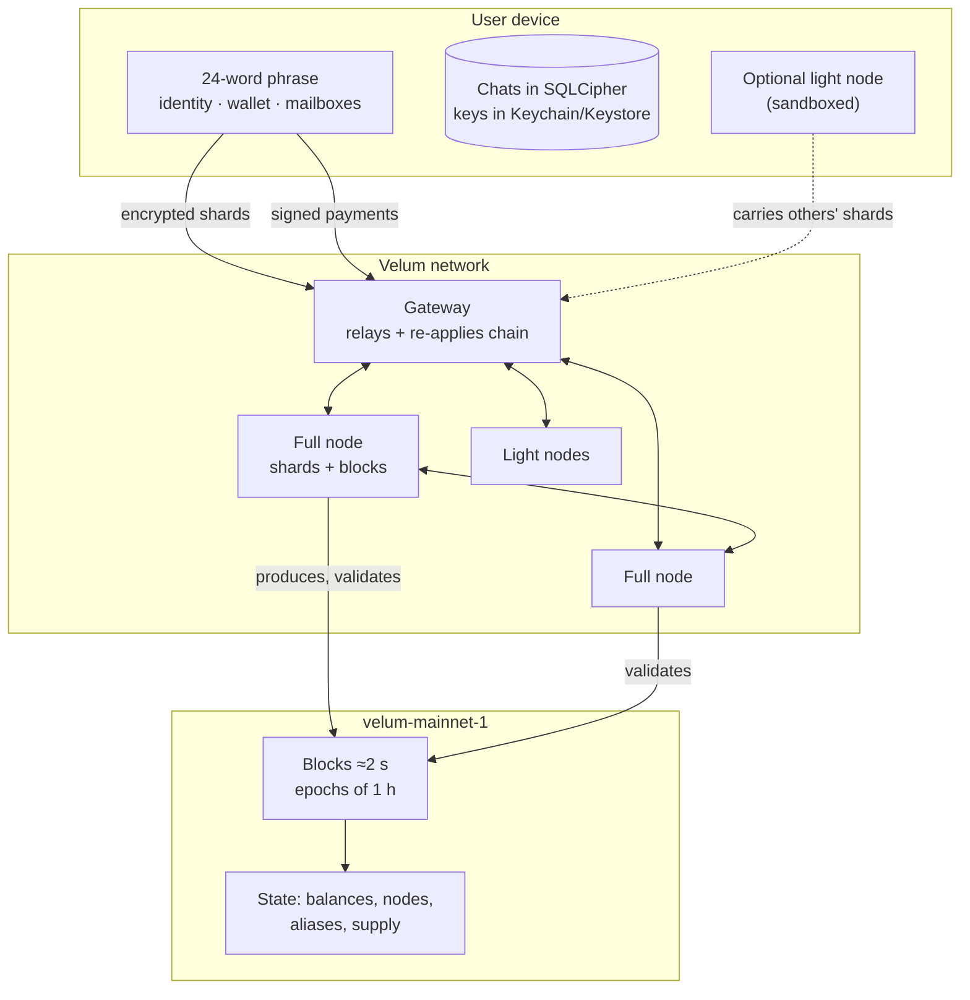
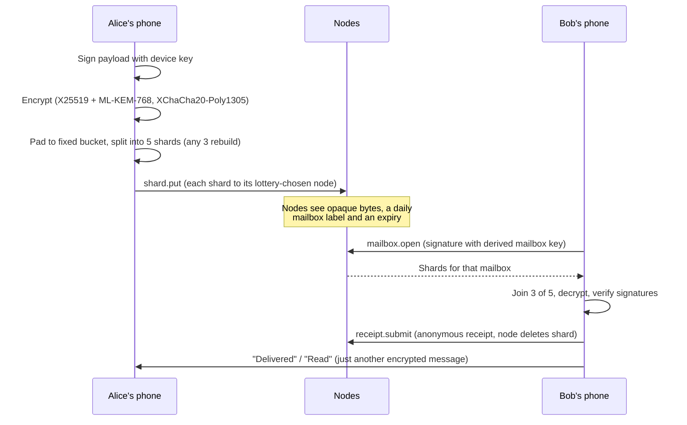
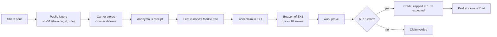
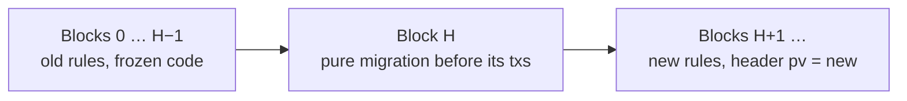

# Velum: Instant, Private and Self-Sustaining Messaging and Payments

**Version 1.0 — 2 November 2026 — network `velum-mainnet-1`**

> *Information at once, private and self-sustaining. To talk, pay and move value without stopping.*

Website: <https://velumprotocol.org> · Code (Apache-2.0): <https://github.com/Consultora-BIM/velum-node> · Spanish version: [velum-paper.es.md](velum-paper.es.md)

---

## Abstract

Velum is a private messaging network that runs on infrastructure carried by its own community and keeps the books of that work on a purpose-built ledger. Messages are end-to-end encrypted on the sender's device with a hybrid classical/post-quantum key agreement (X25519 + ML-KEM-768), padded to one of seven fixed sizes, split with a 3-of-5 Reed–Solomon code and left in daily-rotating mailboxes held by community nodes. Messages never touch the chain. The chain records payments, node registrations, aliases and *work claims*: compact Merkle commitments to anonymous delivery receipts, audited by public random sampling. Nodes that carry messages and produce blocks receive, every hourly epoch, a share of a pot made of fees, a slow release from a keyless Network Reserve and a fixed, halving emission. The native unit, VEL, has 18 decimals and a hard cap of 21,000,000,000; it is used for everyday payments (phone-to-phone or with a shop QR code) and to pay for messaging above a free quota. No VEL is ever burned.

The main network, `velum-mainnet-1`, has been live since 1 November 2026 at 21:00 UTC. Economy v4 activates in place at block 28,800 (scheduled for about 12:05 UTC on 2 November 2026) without restarting the chain. This paper describes the system as implemented in the reference code, including its present limits: today a single node produces blocks, there is no finality gadget yet, and signatures are classical Ed25519. We state these plainly and describe the plan to remove them.

---

## 1. Motivation

Mainstream messengers have made end-to-end encryption normal. Content is protected; the rest is not always. Three problems remain.

1. **Metadata.** A central server sees who talks to whom, when and how much. Even with sealed sender, the operator still controls the mailboxes, the directory and the delivery path.
2. **Identity.** Most messengers require a phone number to sign up. The number links the account to a legal identity and to a carrier.
3. **Sustainability.** Someone pays for servers. That is either advertising, a company's goodwill or donations. Users have no way to contribute capacity and no way to see what it costs.

Payment networks have the mirror problem. Card and bank rails are fast for the user but slow and costly to settle, and depend on intermediaries. Public blockchains remove intermediaries, but their fees, confirmation times and user experience rarely fit a coffee or a transfer between friends.

Velum joins the two needs in one design:

- **Messaging is the main utility.** Text, voice, images and files, end-to-end encrypted, with no central message server.
- **No phone number required.** An account is a 24-word phrase. Friends find you by alias (nickname), link, QR code or one-time invite. Adding a phone number so contacts can find you, as in WhatsApp or Telegram, is optional and never required to sign up.
- **The network pays for itself.** Nodes that carry messages prove it with anonymous receipts and are compensated by protocol rules, in VEL, from fees, the Network Reserve and a fixed emission schedule.
- **VEL is for everyday payments.** Phone-to-phone or at a shop counter with a QR code; free below a threshold (with a small proof-of-work stamp), one basis point above it.

The operator that started the project (NC CONSULTORIA E INVERSIONES SL, Seville, Spain) does not sell VEL and does not give it away. This paper describes technical rules. It makes no statement about the value of VEL.

---

## 2. System model and threat model

### 2.1 Participants

| Participant | Role |
|---|---|
| **Client** | Mobile app (iOS, Android) or desktop interface. Holds keys, encrypts, decrypts, signs payments. Stores chats locally in an encrypted database. |
| **Full node** | Binary `velum-node`. Stores and delivers message shards, validates every block, takes turns producing blocks. Lottery weight 2. |
| **Light node** | Runs inside the mobile app in an isolated sandbox, or anywhere with a WebSocket. Stores and delivers shards; does not keep the chain or produce blocks. Lottery weight 1. |
| **Gateway (hub)** | Entry service that relays gossip and client RPC, and indexes the chain by re-applying every block with the same core code. Holds no keys. |
| **Explorer** | Public web view fed by the gateway's re-computed state. |

There is no separate validator or relay role. Any registered full node with recent liveness signals can produce blocks.



Two worlds are kept apart on purpose:

1. **Messages** travel as encrypted shards between clients and nodes. They are never written to the chain.
2. **The chain** sees payments, node and alias registrations, work claims and their proofs.

The bridge between them is the *work claim*: nodes prove, by sampling, that they carried shards that recipients actually received.

### 2.2 Adversaries

We consider:

- **A passive network observer** who sees IP traffic between clients, nodes and gateways.
- **Curious or malicious nodes**, including a coalition holding a fraction of total lottery weight, who store shards, see connection metadata and may drop, delay or replay data, or fabricate traffic to earn rewards.
- **A curious gateway operator** with the same view as a node for traffic that crosses it.
- **A malicious block producer** who may censor, reorder or withhold transactions, or try to pay itself more than the rules allow.
- **A chain observer** who reads every block.
- **A future quantum adversary** who records traffic today to decrypt it later ("harvest now, decrypt later").
- **A thief** in possession of a locked device.

### 2.3 Goals

| Goal | Mechanism |
|---|---|
| Confidentiality of content | Hybrid X25519 + ML-KEM-768 key agreement, XChaCha20-Poly1305 |
| Sender anonymity towards the network | Sealed sender: the sender is only inside the ciphertext |
| Recipient unlinkability across days | Mailbox labels and opening keys rotate daily |
| Size privacy | Padding to 7 fixed sizes |
| Availability | 3-of-5 erasure coding over different nodes; 7-day offline retention |
| Honest compensation | Public lottery assigns who gets paid for each shard; sampled audits of claims |
| Monetary integrity | Every node re-executes every block; emission is a fixed formula; no burn; no mint path besides emission |
| Upgradability without restart | Height-activated protocol versions with pure state migrations |

### 2.4 Non-goals (today)

Velum does not yet offer cover traffic or mixnet routing, per-message forward secrecy (double ratchet), post-quantum signatures, or Byzantine finality. Section 10 lists every known limitation.

---

## 3. Identities and keys

### 3.1 From phrase to keys

An account is a BIP-39 phrase of 24 words (256 bits of entropy). The 64-byte seed derives every long-term secret:

| Key | Derivation | Purpose |
|---|---|---|
| Seed | BIP-39 PBKDF2, no passphrase | Root |
| Identity | `HKDF-SHA512(seed, salt = ∅, "velum/v2/identity", 32)` → Ed25519 | Signs profiles, device lists, device certificates |
| Wallet | SLIP-10 Ed25519, path `m/44'/7420'/account'/0'/index'` (all hardened) | Signs transactions |
| Mailbox base | `HKDF-SHA512(seed, salt = ∅, "velum/v2/mailbox", 32)` | Derives rotating mailboxes |
| Device key | Random per device | Signs every outgoing message |
| Prekey | Random X25519 + ML-KEM-768, rotated every 24 h | Receives encrypted envelopes |

Identity and wallet are **different keys by design**: looking at the chain does not link a person's chats to their payments. The wallet path follows SLIP-44 coin type 7420, which is what hardware wallets implement for Ed25519.

An address is `"vel" + base58(Ed25519 public key)` (Bitcoin alphabet). Addresses starting with `vel_` are keyless system accounts (Section 9.2).

A **safety number** — SHA-256 of both addresses in canonical order, shown as six groups of five digits — lets two people verify in person that nobody sits in the middle.

### 3.2 Algorithms

| Use | Algorithm | Post-quantum? |
|---|---|---|
| Signatures (identity, device, wallet, mailbox) | Ed25519, RFC 8032 strict | **No** |
| Key agreement | X25519 **and** ML-KEM-768 (FIPS 203) | **Yes (hybrid)** |
| Key derivation | HKDF-SHA512 | — |
| Authenticated encryption | XChaCha20-Poly1305 (24-byte nonce) | Symmetric |
| Backups | Argon2id + XChaCha20-Poly1305 | Symmetric |

The reference implementation uses audited, dependency-free libraries (`@noble/curves`, `@noble/post-quantum`, `@noble/hashes`, `@noble/ciphers`).

**What this means.** Message content resists "harvest now, decrypt later" by a future quantum computer, because breaking the session key requires breaking *both* X25519 and ML-KEM-768. Signatures are not yet post-quantum: a future quantum adversary could forge Ed25519 signatures, but could not read messages already sent. Migration to post-quantum signatures (ML-DSA) is on the roadmap (Section 11).

### 3.3 Discovery: aliases, links and optional phone number

Users can be found in four ways, all optional:

| Way | What is published |
|---|---|
| **Alias (nickname)** — `name.register` | A signed contact card on the chain: identity key, first-contact prekey and a requests mailbox. Pattern `[a-z0-9_.]{3,24}`, one per wallet, valid one year, requires extra proof-of-work. |
| **Link or QR code** | The same card, off-chain. |
| **One-time invite** | A 32-byte secret valid for 24 h. |
| **Phone number (optional)** | Nothing on the chain. After SMS verification, the gateway stores `HMAC-SHA256(pepper, E.164 number) → card`. |

Phone lookup today sends the address-book numbers to the gateway over TLS. The gateway hashes them in memory, answers only with matches and does not store the query. Requests are signed by a device key, rate-limited (50 numbers per request, 500 per day per device) and can be withdrawn by an identity-signed deletion. A private-set-intersection or enclave-based lookup is planned. A user can set "find me" to everyone, contacts only or nobody.

Contact policy for strangers is *allow*, *request* (default) or *block*. First-contact requests are encrypted with the same hybrid scheme, padded and signed by the identity. Blocking is local.

### 3.4 Multiple devices

An identity may have up to **five devices**. The device list

```
DeviceList = { v: 2, identity, devices[≤5], seq, ts, sig }
```

is signed by the identity key; the highest `seq` wins. Each entry carries the device signing key, its current prekey, its mailbox seed and its mailbox public key. The list never goes on the chain: it travels to contacts inside encrypted `profile` messages. Every message carries a `DeviceCert` — the identity's signature over `{identity, device, signPub, ts}` — so recipients know the sending device belongs to the identity.

Removing a device publishes a new list with `seq + 1`; remaining devices rotate the mailbox salt, so the removed device cannot open new mailboxes.

Linking a new device uses an ephemeral hybrid session shown as a QR code that changes every 2 s (each frame valid 6 s), a `hello` through an ephemeral mailbox, and a six-digit code compared by eye. The active device then sends the account secrets and compressed history over the encrypted, sequenced channel. The session expires after 5 minutes.

---

## 4. Messaging protocol

### 4.1 Overview



### 4.2 The envelope

The message body is encrypted **once** under a random 32-byte key. For each recipient device (and each of the sender's other devices, to keep history in sync), the body key and a 32-byte *receipt seed* `rseed` are sealed with the hybrid scheme:

```
[1 version=2][32 eph X25519][1088 kemCt][24 nonce][80 wrap][24 nonce2][encrypted body]

k = HKDF-SHA512( X25519(eph, prekey) ‖ ss_ML-KEM ,
                 salt = eph ‖ kemCt , info = "velum/v2/envelope" , 32 )
```

The header is authenticated as associated data. The fixed overhead per copy is 1,265 bytes.

Inside is `[1 byte compression flag][JSON { p, cert }]`, deflated when the content is at most 64 KB and compression helps. `p` is the payload signed by the device key; `cert` is the device certificate. The sender (`from`, `dev`) appears **only inside the ciphertext** (sealed sender). Content types include text, image, audio, file, receipt, group, payment, profile, typing, sync and security. Media travel inside the same envelope as base64 blobs with their MIME type; the maximum envelope is 8 MB.

Group messages are one sealed copy per recipient device. On the network, a group message and a one-to-one message are indistinguishable.

"Delivered" and "read" are ordinary encrypted messages of type `receipt`. Turning off read receipts stops sending them (and seeing others').

### 4.3 Padding and shards

| Step | Rule |
|---|---|
| Padding | 4-byte length + data + zeros up to a bucket: 2, 8, 32, 128, 512, 2,048 or 8,192 KB |
| Coding | Systematic Reed–Solomon **3-of-5** over GF(2⁸) (polynomial 0x11d, Cauchy matrix), by stripes |
| Shard size | bucket / 3, rounded to 1 KB, capped at 24 KB (1, 3, 11 or 24 KB) |
| Retention | 7 days |

Velum uses a fixed-rate erasure code rather than a rateless fountain code: with five shards on five independently chosen nodes, any three rebuild the envelope, and the shard count per message is fixed and predictable for the lottery and the claims.

A shard is

```
Shard = { id, msg, mailbox, stripe, idx, k: 3, n: 5, bucket, data, rh, mbAuth, exp, ep? }
id    = hex( sha512("msg|stripe|idx") )[0..64]
```

What a node sees, and what it reveals:

| Field | Meaning | Reveals |
|---|---|---|
| `id` | Shard fingerprint | Nothing about content |
| `msg` | Random per copy | Groups the shards of *one* copy |
| `mailbox` | Recipient's mailbox for the day | That something goes to that mailbox today |
| `stripe, idx, k, n, bucket` | Position and size bucket | The bucket |
| `data` | Ciphertext | Nothing |
| `rh` | Hash of the receipt secret | Nothing |
| `mbAuth` | Mailbox opening key (daily) | Nothing across days |
| `exp, ep` | Expiry and lottery epoch | Approximate time |

Nodes validate shards **statelessly**: correct `id`, valid bucket, `k/n = 3/5`, exact size, formats of `rh` (128 hex) and `mbAuth` (64 hex), expiry within 7 days.

### 4.4 Rotating mailboxes

The mailbox label of the day is

```
mailbox(day) = hex( HMAC-SHA512(mailboxSeed, "day:" ‖ floor(ts / 86 400 000)) )[0..40]
```

Each device holds a secret scalar `s` with public point `mbPub = s·G`. The sender writes into each shard

```
t      = sha512("velum/v2/mbauth|" ‖ mbPub ‖ mailbox) mod L
mbAuth = mbPub + t·G
```

To open, the owner produces a standard Ed25519 signature with the tweaked scalar `s + t` over `velum/v2/open|<mailbox>|<ts>` (±15 minutes). The node verifies against `mbAuth` as the public key and delivers only shards carrying that `mbAuth`. A node therefore cannot link today's mailbox to yesterday's, and nobody else can empty someone's mailbox. Clients open today's and yesterday's mailboxes.

### 4.5 Anonymous receipts

For each shard the recipient derives

```
secret = HMAC-SHA512(rseed, shardId)[0..32]        rh = sha512(secret)
Receipt = { shard, mailbox, rh, secret, carrier, courier, ts, ep? }
```

Only someone who opened the envelope knows `rseed`, so only the real recipient can produce `secret`. A receipt carries no signature and no recipient identity; it is valid iff `sha512(secret) = rh`. On a valid receipt, nodes delete the shard.

### 4.6 Routing by public lottery

A node that is paid per delivered shard has an incentive to send itself fake traffic. Velum removes the choice: **who gets credit for a shard is drawn by a public, deterministic lottery** that nobody can predict before the epoch starts.

- At the start of each epoch the chain stores a snapshot of eligible nodes: registered before the epoch and with a liveness signal in the last 300 blocks. Full nodes weigh 2, light nodes 1 (times tier and bond factors, Section 5.6).
- The beacon is the hash of the last block of the previous epoch.
- For each shard and role (`carrier` stores it, `courier` delivers it):

```
x = first 8 bytes (big-endian) of sha512(beacon ‖ "|" ‖ id ‖ "|" ‖ role)  mod  Σweights
```

  selects a node by cumulative weight over nodes sorted by address. Rounds `i ≥ 1` with suffix `"|" ‖ i` give up to three candidates.

The client sends each shard to the online candidate with the lowest latency and the receipt to the drawn courier. If none answers, the shard goes through another node: it still arrives, but that role earns nothing. The accepting node stores the shard and forwards it to its peers.

If an attacker with weight fraction `σ` fabricates `F` shards, its nodes are drawn for about `σ·F` of them: fabricating traffic does not increase its share. The residual attack — a sender grinding shard ids until the lottery picks its own node — is bounded by a per-(node, mailbox) cap of 400 credits per epoch and a plausibility cap (Section 5.4).

### 4.7 Offline delivery and limits

Shards wait up to **7 days**; then they expire. The reference node keeps at most 2,000 shards per mailbox and 200,000 in total (evicting the soonest to expire), cleans every 60 s, accepts 50 `shard.put` per second per connection (burst 200) and rejects calls over 1 MB. An `open` returns up to 16 mailboxes and 700 KB per response; the rest is pushed. Remote push notifications do not exist yet: clients are notified over their open WebSocket.

### 4.8 Local storage and backups

Chats, contacts and settings live only on the user's devices, in SQLite with SQLCipher under a random 32-byte key kept in the iOS Keychain or Android Keystore (`WHEN_UNLOCKED_THIS_DEVICE_ONLY`, so it does not travel in cloud backups). A `.velum` backup is

```
header = "VELUMBK1" ‖ version ‖ kdf ‖ m ‖ t ‖ p ‖ salt(16) ‖ nonce(24)
key    = Argon2id(NFKC password, salt, m = 19 456 KiB, t = 2, p = 1, 32 B)
body   = XChaCha20-Poly1305(key, nonce, deflate(JSON), AAD = header)
```

with a 10-character minimum password. Parameters live in the header so they can be raised without breaking old files.

### 4.9 Spam control and messaging credits

| Mechanism | Status |
|---|---|
| Per-connection rate (50 `shard.put`/s, burst 200), per-mailbox and global caps | Active in nodes |
| Proof-of-work stamp (16–26 bits, retargeted per epoch) | Active, on transactions only |
| Free quota of 20 messages per 10 minutes per sender | Defined in code, **not yet enforced** |
| Messaging credits (`credits.buy`) | Purchase active from v4; **consumption not yet implemented** |

Credits are for businesses and bots that send above the free quota; people do not need them. Because shards carry no sender (that is the privacy property), a node cannot enforce a per-sender quota by looking at a shard. Enforcement needs an anonymous pass — for example a rate-limiting nullifier, blind tickets or an attested device signature. This is open work (Section 11).

---

## 5. Network, nodes and consensus

### 5.1 Transport

All traffic is JSON over WebSocket, with roles `node`, `client` and `watch`.

- **Gateway** (`wss://…/hub?role=…`). A node greets with `{t:"hello", node, name, version, height, ts, sig, kind?}` where `sig` is an Ed25519 signature over `hello|<node>|<ts>` (±2 min). The gateway relays gossip (`block`, `tx`, `shard`, `receipt`, `presence`), routes client RPC to a node, pushes shards to clients and forwards node-to-node `direct` frames.
- **Direct peers** (`ws://host:7420/ws?role=node`). Same frames, plus peer exchange (`{t:"peers", urls}`): up to 64 known peers and 12 outbound connections.
- **Discovery.** Gateways in order, `endpoint`s published on chain by nodes that opt in, DNS seeds (TXT records) and peer exchange. If all gateways fail, nodes continue among themselves.

The node binary ships for `darwin-arm64`, `darwin-x64`, `linux-x64`, `linux-arm64` and `windows-x64`. Updates are pulled from a manifest signed with Ed25519 by a publishing key whose address is embedded in the binary; the node checks the signature and the SHA-512 of the download, swaps atomically, and rolls back if the new binary does not survive 60 s. A node older than the manifest's `minNodeVersion` holds itself back and stops contributing until updated.

### 5.2 Encoding and transactions

Canonical JSON (keys sorted by UTF-16 code unit, no whitespace) is the signing and hashing format. `hashHex(x) = SHA-256(UTF-8(x))`. Merkle roots pair hex leaves, duplicating the last on odd levels. Amounts are **decimal strings** of integers in minimal units (`^(0|[1-9][0-9]{0,77})$`); a JSON number in an amount field makes a transaction invalid, so a pre-v4 transaction can never be mistaken for a v4 one.

Every transaction carries `{chain, from, nonce, ts, sig}` and is signed by the wallet over the canonical JSON without `sig`. Types include `transfer`, `register` (`kind: full | light`), `name.register`, `token.create`, `token.mint`, `pool.fund`, `order.place`, `order.cancel`, `device.attest`, `work.claim`, `work.prove`, `node.bond`, `node.unbond`, `stake.delegate`, `stake.undelegate`, `node.commission`, `bridge.mint`, `bridge.redeem` and, from v4, `credits.buy`. `txId = hashObj(tx)[0..48]`.

Below the fee threshold, transactions carry a **proof-of-work stamp** instead of a fee:

```
body  = sha512(canonical(tx without sig, pow))
stamp = sha512(body ‖ u64be(pow))      valid iff leadingZeroBits(stamp) ≥ bits(epoch)
```

`bits` moves between 16 and 26, retargeted each epoch around 3,000 stamped transactions per minute. It is computed before signing, so it cannot be reused. It is an anti-spam device, not mining.

Byte-exact **test vectors** (`spec/vectors/*.json`) cover canonical encoding, keys, envelopes, shards, mailboxes, receipts, lottery, claims, transactions, blocks, amounts, supply, fees, PoW, oracle, tiers and settlement. An implementation is compatible if it reproduces them.

### 5.3 Blocks, slots and fork choice

| Parameter | Value |
|---|---|
| Nominal block interval | 2 s |
| Epoch | 1,800 blocks ≈ 1 hour (mainnet) |
| Epoch close | `height mod 1800 = 0` |

**Slot leader.** Active producers are registered full nodes with a liveness signal in the last 15 blocks. The slot is `floor((now − genesis) / 2 s)`. Active nodes are ordered by `hashHex(prevHash | slot | address)`; the first is the leader and backups wait ¼ block (500 ms) per rank. Every empty slot advances everyone one rank, so the chain cannot stall while any producer is online. With no active producers, anyone may start (bootstrap). Bond and delegation do not change turns; they only weigh in rewards.

**Header.** `chain, height, prev, ts, slot, proposer, txRoot, receiptRoot, presenceRoot, stateRoot` and, on mainnet, `pv` (protocol version). `stateRoot = SHA-256(canonical consensus state)`. The block hash is the header hash; the proposer signs it.

**Validation.** Every node checks chain, height, link, time (≤ 5 s in the future), slot, header hash, proposer signature, protocol version and turn window, then **rebuilds the block** from the same transactions and liveness signals. If the resulting hash — which commits to the state root — differs, the block is rejected and not relayed. The gateway applies the same procedure to index the chain, so explorer balances and supply come from re-computed state, not from what a node claims.

**Fork choice.** Highest chain wins; at equal height, lowest hash. **There is no finality today.** Payment software therefore distinguishes *included* (in a block, ≈ 2 s) from *firm* (30 blocks on top, ≈ 1 min; 1,800 blocks for amounts of 10,000 VEL or more).

### 5.4 Work claims and sampled audits

Receipts do not go into blocks. Instead:

1. Each node records as a leaf `{r, role}` every receipt in which it appears and is among the three lottery candidates for that role.
2. In epoch E+1 it publishes `work.claim {epoch, count, root}` — the count of leaves and a SHA-512 Merkle root.
3. The beacon of epoch E+3 selects **16 leaves** at random; the node publishes them with Merkle paths in `work.prove`.
4. One invalid leaf voids the whole claim. A plausibility cap limits credit to **1.5×** what the node's weight would predict.
5. The work pot of epoch E is split at the close of E+4 in proportion to verified credit.



A node that inflates its count by a fraction `f` of fake leaves passes the audit with probability `(1 − f)^16`; at `f = 10%` that is 18.5%, at `f = 25%` it is 1%, and what it obtains is in any case bounded by the plausibility cap.

### 5.5 Epoch close

At every multiple of 1,800 the state machine, deterministically: pays producers, settles claims of epoch E−4, updates tiers and unbonding queues, retargets PoW difficulty, closes the oracle window, expires aliases and takes the node snapshot for the next lottery.

### 5.6 Tiers, bonds and delegation

| Concept | Rule |
|---|---|
| Lottery weight | `kind (2 full / 1 light) × tier × bondFactor` |
| Tiers by continuous service | New 0.5 · Active 0.65 (1 month, ≥ 90 % presence) · Veteran 0.85 (3 months, ≥ 95 %) · Pillar 1.0 (6–12 months, ≥ 98 %). An absence of more than 48 h resets the streak |
| Bond (`node.bond`) | Optional, up to 10,000 VEL; `bondFactor = 1 + min(bond, 10 000)/10 000`, i.e. up to ×2 |
| Delegation (`stake.delegate`) | Minimum 1 VEL, up to 1,000 delegators per node; counts toward the same cap |
| Unbonding / undelegation | 14 days |
| Node commission | 10 % default, 20 % max; changes of ±5 points, at most once every 7 days |

Tiers, bonds and delegation **never create VEL**: they redistribute the same pot. Bonded and delegated VEL sit in the keyless `vel_escrow` account and move only by chain rules.

### 5.7 Light nodes on phones

Light nodes run inside the app in a sandbox with their own key, memory and rate limits; they cannot touch the user's keys or chats and know only the payout address. They are off by default; once enabled they run on Wi-Fi and while charging, never below 30 % battery. On Android they use a foreground service with a persistent notice; on iOS they run while the app is open and in the background windows the system grants (≈ 25 s, typically at night while charging). Sandbox limits are 400 shards / 8 MB / 150 MB per hour in normal mode and half in saver mode. iOS does not allow a permanent server, so an iOS light node contributes little by design.

---

## 6. Economy v4

### 6.1 Parameters

| Parameter | Value |
|---|---|
| Unit | **1 velo = 10⁻¹⁸ VEL** (18 decimals) |
| Hard cap | **21,000,000,000 VEL** |
| Genesis reserve | 100,000,000 VEL, in the operator's offline cold wallet |
| Discoverable by work | 20,900,000,000 VEL |
| Epoch | 1 h = 1,800 blocks; 8,766 epochs per year |
| Halving | every **35,064 epochs** (4 years) |
| End of emission | after **33 halvings** (≈ 132 years) |
| Initial epoch reward `R0` | 298,026.465890942276979237 VEL |
| Burn | **None.** VEL is never destroyed |
| Payment fee | 0 below 1,100 vUSDT of value (with PoW stamp); **1 bp (0.01 %)** from there |
| Fee split | 80 % node pot · 20 % Network Reserve |
| Reserve release | 0.1 % of its balance per epoch, to the node pot |
| Messaging credit | 22 µUSDT per message above the free quota |
| Free quota | 20 messages / 10 min (≈ 2,880/day) — defined, not yet enforced |
| Pot split | 15 % block producers · 85 % verified messaging work |
| Token creation | 100 VEL to the Reserve (anti-spam) |

### 6.2 Emission

All arithmetic is integer (BigInt, velos); `>>` is a right shift (floor division by 2ᵏ).

```
VELO      = 10^18
CAP       = 21 000 000 000 · VELO
GENESIS   = 100 000 000 · VELO
MINEABLE  = CAP − GENESIS
HALVING   = 35 064                                  (= round(4 · 365.25 · 24))
R0        = floor(MINEABLE / (2 · HALVING))         = 298 026 465 890 942 276 979 237 velos

k(e)      = floor(e / HALVING)
R(e)      = k(e) ≥ 33 ? 0 : R0 >> k(e)
emission(e) = someoneProducedBlocks(e) ? min(R(e), CAP − minted) : 0
```

The epoch `e` counts from genesis. Because of integer flooring,

```
Σ_{k=0..32} HALVING · (R0 >> k) = 20 899 999 997.567… VEL
```

so about 2.43 VEL are never discovered and the cap is never reached. `R0 >> 32 ≈ 0.0000694 VEL`; the `k ≥ 33` cut-off stops the 78-bit `R0` from dripping until halving 77.

| Period `k` | Years | VEL per epoch | VEL per day | Discovered at end |
|---|---|---|---|---|
| 0 | 0–4 | 298,026.47 | 7,152,635 | 50.00 % |
| 1 | 4–8 | 149,013.23 | 3,576,318 | 75.00 % |
| 2 | 8–12 | 74,506.62 | 1,788,159 | 87.50 % |
| 3 | 12–16 | 37,253.31 | 894,079 | 93.75 % |
| 6 | 24–28 | 4,656.66 | 111,760 | 99.22 % |
| 32 | 128–132 | 0.0000694 | 0.0017 | ≈ 100 % |
| ≥ 33 | > 132 | 0 | 0 | — |

The profile mirrors Bitcoin's (210,000 blocks per halving, ≈4 years, last unit around 2140) scaled by 1,000 in supply [1][2]. There is no tail emission. The cap and the 33 halvings are not adjustable parameters.

### 6.3 Fees

Let `P` be the oracle's one-hour time-weighted average price of VEL in µUSDT (Section 6.6), and `a` an amount in velos.

```
value(a)    = floor(a · P / VELO)                               (µUSDT)
fee(a)      = (P ≠ null ∧ value(a) ≥ 1 100 000 000) ? max(1, floor(a / 10 000)) : 0
pool_fee    = floor(fee · 8 000 / 10 000)                       (80 %)
reserve_fee = fee − pool_fee                                    (20 %)
```

Below the threshold, or when the oracle has no price, the fee is zero and a PoW stamp is required instead. The payee always receives the full amount; the payer pays the fee on top. Fees are never burned.

### 6.4 The epoch pot

```
release(e) = floor(balance(vel_reserve) · 10 / 10 000)                      (0.1 %)
pot(e)     = Σ pool_fee(e) + Σ VEL of credits.buy(e) + release(e) + emission(e)
producers  = someoneProduced ? floor(pot · 1 500 / 10 000) : 0             (15 %, ∝ blocks)
work(e)    = pot − producers                                                (85 %, settled in E+4)
```

Within a node's reward, the node's commission is taken first and the remainder is split pro rata between its own bond and its delegators (integer floor; rounding remainder to the node).

**The Network Reserve does not create money; it delays it.** Its half-life is `ln 2 / −ln(1 − 0.001) ≈ 692.8 epochs ≈ 28.9 days`; a VEL that enters stays on average 1,000 epochs (≈ 42 days). In steady state the release equals the inflow, and the equilibrium balance is 1,000 epochs of inflow. It smooths gaps of one to two months, in the spirit of Nym's reserve [3] and Filecoin's baseline minting [4]. It is not a multi-year fund.

### 6.5 Messaging credits

```
credits.buy { amount, to?, fee }
credits(a) = floor(a · P / (VELO · 22))         requires P ≠ null and a ≥ 1 VEL
```

Credits are non-transferable, belong to `to` (default the buyer), and the VEL paid goes **entirely to the current epoch's node pot**. At 22 µUSDT per message, 100,000 messages above the quota cost 2.2 USDT of VEL. Purchases are recorded on chain (`supply.creditsPaid`, `supply.credits`); consumption is counted off-chain by gateways and nodes and is not yet implemented (Section 4.9).

### 6.6 Oracle

The only oracle pair on mainnet is `VEL/vUSDT`, from the on-chain order book. The price is a one-hour (one-epoch) time-weighted average and is used only if at least 1,000 VEL traded in the window; otherwise there is "no price": fees are zero and `credits.buy` is rejected. The euro never enters consensus. `vUSDT` is a 6-decimal wrapped token minted only by the bridge authority (Section 7.4); the bridge service is closed today, so the order book is empty and the oracle reports no price.

### 6.7 Sustainability

Node compensation comes from four sources:

| Source | Paid by | Destination | Tied to usage? |
|---|---|---|---|
| Emission `R(e)` | nobody (new VEL) | pot | No — fixed schedule |
| 1 bp fee (≥ 1,100 vUSDT) | payer / market taker | 80 % pot · 20 % Reserve | Yes — share of payment value |
| Messaging credits | businesses and bots above quota | 100 % pot | Yes — fixed USDT price per message |
| Token creation | creator | 100 % Reserve | Yes |

Emission is the **bootstrap engine**: 50 % of the discoverable amount is issued in the first four years and 99.2 % within 28 years. After that, what keeps nodes running must come from **use**: payment fees and messaging credits, both denominated in value terms (a fraction of USDT value, a fixed USDT price per message) rather than in VEL units. As a reference for the order of magnitude, at a WhatsApp-like 10¹¹ messages per day, if 5 % were business traffic above the quota, credits alone would route 110,000 USDT of VEL per day to nodes.

The number of nodes is not fixed: if compensation does not cover a node's costs, operators switch off until those that remain do. This self-adjustment is expected and healthy. Nothing in the protocol promises any operator a return.

Known economic weaknesses are listed in Section 10.3; the levers to correct them (credit price, free quota, cost of identity, per-account aggregation of the fee threshold, reserve release rate, oracle volume floor) are all protocol versions with an activation height. Emission is not a lever.

### 6.8 Accounting invariant

```
Σ VEL balances (including vel_reserve, vel_escrow, vel_htlc) + epoch pot + Σ pending work pots  ==  supply.minted
```

`velLedgerGap(state)` must be 0 at every height. It holds by construction — every path that credits an account debits another first, and the only new money is emission, which also increments `minted` — and is checked at every height by the public replay script (Section 9.3), in tests and in vector generation.

---

## 7. Payments

### 7.1 Transfers

A payment is a signed `transfer {to, amount, token?, memo?, fee}`. Everyday payments below the threshold pay no fee and carry a PoW stamp computed in tenths of a second on a phone. A transfer is *included* in ≈ 2 s and *firm* after 30 blocks.

### 7.2 Payment links and signed invoices: `velum:pay`

```
velum:pay?to=<address>&amount=<VEL>&ref=<id>&label=<text>&exp=<ms>&ts=<ms>&sig=<signature>
```

`amount` uses a dot decimal with up to 18 decimals; `ref` (1–64 of `[A-Za-z0-9_-]`) identifies the sale; `token` and `dec` select another on-chain token; `exp` is an expiry. The URI fits a QR code (≈ 250 characters, error-correction level M) or an NFC tag (NDEF URI record). `velum:<address>` alone asks the payer for the amount.

The **signed invoice** is

```json
{ "v": 1, "t": "velum-invoice", "chain": "velum-mainnet-1", "to": "vel…",
  "amount": "12500000000000000000", "ref": "T-0042", "label": "Coffee",
  "exp": 1793571311013, "ts": 1793570411013, "sig": "…" }
```

signed by the payee's wallet key over its canonical JSON. If anyone swaps the QR code (another amount or address), the signature fails and the app warns; unsigned requests are shown as "unverified".

The payer sends a `transfer` with `memo = "pay:<ref>"`. The payee recognises it with `paysInvoice(tx, invoice)`: destination, token, amount equal or greater, and the reference in the memo. The SDK's `watchPayment` follows blocks and reports *pending → included → firm*, re-checking if the block containing the payment is reorganised. Any phone with the app is a point of sale, and a minimal point-of-sale server ships as an SDK example; it holds only the key needed to sign invoices and never moves funds.

### 7.3 Atomic peer-to-peer exchange (HTLC)

Hash-time-locked contracts let two people swap VEL for a token on another chain with no intermediary:

| Tx | Fields | Effect |
|---|---|---|
| `htlc.lock` | `to, amount, token?, hash (sha256), expiresEpoch` | Moves `amount` from `from` into keyless `vel_htlc` |
| `htlc.claim` | `id, preimage (32 B)` | Before expiry, if `sha256(preimage) = hash`, pays `to` |
| `htlc.refund` | `id` | From `expiresEpoch`, returns to `from` |

All three are fee-free with a PoW stamp; anyone may submit `claim` or `refund` (funds can only go to `to` or back to `from`), so a watcher can close on a user's behalf. Expiry ranges from 1 to 720 epochs; at most 100 open locks per wallet. The party that creates the secret locks first and with the longer timeout (recommended margin ≥ 6 h). SHA-256 matches standard EVM and TRON HTLC contracts, so one preimage opens both sides.

**Status:** written and tested as protocol version 5, **not activated** — there is no activation height yet, and until there is, the chain rejects these transactions.

### 7.4 Wrapped USDT bridge

`bridge.mint {to, amount, src, ref}` may only be issued by the bridge authority and mints **vUSDT, never VEL**; each deposit `ref` is unique on chain. `bridge.redeem` burns nothing: it moves vUSDT for redemption to a TRON or EVM address. Daily caps live in the off-chain service, which publishes proof of reserves. The service is built and tested but **closed**; opening it requires legal review and an explicit decision.

---

## 8. Live protocol upgrades

Velum changes rules without restarting the chain.



1. Each protocol version has an **activation height** in the `UPGRADES` table.
2. If the state format changes, the version brings a **pure migration** (no clock, no randomness), applied once in the activation block before its transactions.
3. Old blocks are validated with the old code, **frozen** byte for byte. A node replaying from genesis and a node upgraded in place reach the same roots.
4. A binary that does not know a block's version **stops** ("upgrade required"). It does not fork.
5. The signed manifest raises `minNodeVersion` before the height.

| Version | Mainnet height | Change | Status |
|---|---|---|---|
| v1 | 0 | Genesis `velum-mainnet-1` (v3 economy: 6 decimals, cap 1,000 M VEL, 2-year halving) | Active from 2026-11-01 21:00 UTC |
| v4 | **28,800** (epoch 16) | 18 decimals, cap 21,000 M VEL, 4-year halving, no `burned` field, messaging credits | Scheduled ≈ 12:05 UTC, 2026-11-02; node 2.1.0 |
| v5 | — | HTLC locks | Written, no height |

**The v4 migration.** In block 28,800, before its transactions, every VEL amount in the state (balances, bonds, delegations, unbonding queues, earned counters, `minted`, pots, the Reserve) is multiplied by 10¹² (µVEL → velos; other tokens unchanged); `supply.burned` (always 0) is removed; `msgCredits`, `supply.creditsPaid` and `supply.credits` appear. From that block the state root uses the v4 encoding (decimal-string amounts) and headers carry `pv: 4`. Balances expressed in VEL do not change. Emission continues from the same epoch counter with the v4 formula, so epoch 16 discovers `R(16) = R0`.

---

## 9. Security analysis

### 9.1 Messaging

| Attack | Possible? | Defence |
|---|---|---|
| Read a message in transit | No | Hybrid end-to-end encryption |
| Read stored traffic with a future quantum computer | No | ML-KEM-768 in the key agreement |
| Impersonate a sender | No (classically) | Device signature + identity certificate |
| Forge receipts to earn | No | Only the envelope opener knows `rseed` |
| Empty someone's mailbox | No | Opening requires the tweaked key `s + t` |
| Fill someone's mailbox | **Yes, bounded** | 2,000 shards per mailbox, per-connection rate |
| Correlate timing and size | **Partly** | Buckets and rotating mailboxes; no cover traffic |
| Delete undelivered messages | One node can drop its shards | 5 shards on different nodes; any 3 suffice |
| Read last week's messages after stealing device keys | **Yes** | Prekeys rotate daily but are kept 7 days; no per-message ratchet yet |

**What each actor sees.** A node storing shards sees connecting IPs, the mailbox of the day, the size bucket, the per-copy `msg` value, times, and which mailboxes a connection opens; it does not see content, sender, real recipient, group membership, message type, or other days' mailboxes. The gateway sees the same for traffic through it and, during a phone lookup, the queried numbers. A chain observer sees payments, aliases and public cards, node registrations and claims — never messages. A thief with a locked phone gets nothing useful; keys and database are bound to the device.

### 9.2 Monetary integrity

A balance changes only inside the state machine through one internal function, and every credit except epoch emission is preceded by a debit elsewhere.

| Path that adds to a balance | Why it cannot create VEL |
|---|---|
| Genesis | Fixed constant in block 0; mainnet build fails if the public reserve file or its fingerprint is missing |
| `transfer` | Signature, exact nonce, sufficient balance; debit before credit |
| Fees | Debited from the payer; 80/20 split; nothing burned |
| `token.create` / `token.mint` | The symbol `VEL` is forbidden; only the issuer, under its cap |
| Escrow paths (orders, bonds, pools, HTLC) | Paid out of `vel_escrow` / `vel_htlc`, which were funded by debits |
| `credits.buy` | VEL goes to the pot; credits are not VEL and are not transferable |
| `bridge.mint` | Mints vUSDT only |
| Epoch close | From the pot: fees + Reserve release + formula emission |

The emission is computed by every node at epoch close. A producer that pays itself one velo more changes the state, therefore the `stateRoot`, therefore the block hash, and **every validator rejects the block**. Keyless accounts (`vel_reserve`, `vel_pool`, `vel_escrow`, `vel_htlc`) cannot sign: address validation rejects them as senders.

### 9.3 Anyone can verify

```bash
VELUM_NETWORK=mainnet bun packages/core/scripts/replay-mainnet.ts
```

The script downloads blocks, starts from the genesis state, applies every block with the same `applyBlock`, and at every height requires the header's state root **and** `velLedgerGap = 0`. Old blocks are applied with the frozen v1/v3 core, so the entire history replays.

### 9.4 What a block producer can and cannot do

| Can | Cannot |
|---|---|
| Censor (not include) transactions | Spend from someone else's account |
| Order transactions in its block | Skip or repeat a nonce |
| Omit others' liveness signals | Mint more than `R(e)` or pass the cap |
| Choose its timestamp within bounds | Change balances without changing the root |
| Stall the chain by not producing | Make other nodes accept a different state |

---

## 10. Known limitations

We list here everything we know is missing or weak, as of 2 November 2026.

### 10.1 Centralisation today

- **One block producer.** Today a single node produces blocks. The protocol already admits any registered, active full node into the turn order, but none other is producing yet. Consequences: it can censor; if it stops, blocks stop until another full node takes over (empty slots advance the order); it could publish a longer alternative branch (hence the 30-block "firm" rule). It **cannot** steal or create VEL: every validator, the gateway and the public replay check every block.
- **No finality.** The highest branch wins; there is no reorganisation depth limit.
- **One gateway.** A single global gateway relays most traffic and indexes the chain. Direct peers, on-chain endpoints and DNS seeds are fallbacks; the network topology is still a star and handles on the order of 10³ nodes.
- **One publishing key** signs node binaries. Signature and SHA-512 checks are mandatory and auto-update can be disabled, but key compromise would allow publishing a malicious binary.
- **Genesis reserve** keys are a single cold wallet, offline. Multisig is planned.

### 10.2 Cryptography and privacy

- Ed25519 signatures only; ML-DSA is not implemented.
- No double ratchet: forward secrecy is per prekey window (24 h rotation, 7 days retention).
- No cover traffic or multi-hop mixing; nodes see IPs, timing and buckets.
- Phone lookup exposes queried numbers to the gateway during the request.
- Compression before encryption; bucket padding limits but does not remove what this leaks.
- Blocking is local only; nodes keep storing and delivering blocked senders' shards.
- A misconfigured build could run without SQLCipher and only log a warning.
- Device linking and `.velum` backups export the root secrets; they must be protected like the phrase.

### 10.3 Economy and anti-abuse

- **Free quota and credit consumption are not enforced.** An anonymous pass is still to be designed.
- **Splitting payments below the threshold** avoids the 1 bp fee at the cost of a PoW stamp per payment. Per-account aggregation of the threshold is a candidate fix.
- **Sybil identities** can stay under a per-identity quota; registration costs only proof-of-work.
- **Node registration is free** (no fee, PoW or bond). This enables fake nodes (not VEL creation). A minimum bond or PoW for producers is planned.
- **Shard-id grinding** lets a sender aim shards at its own node; bounded by per-pair and plausibility caps.
- **Thin oracle.** The 1,000 VEL volume floor is low; while there is little trading the price can be moved cheaply. Measuring the floor in USDT is a candidate fix.

### 10.4 Implementation hardening

- `velLedgerGap` is checked in tests and replay, not live in nodes or the gateway.
- The `rewards` list in blocks is informative and not hashed; the explorer stores it as received (real balances do not depend on it).
- `snapshot import` checks the file's own root, not a network header.
- Attestation is "soft" in consensus; strict mode applies only at service time.
- The state root is a hash of the whole state, not a sparse Merkle tree: no per-account proofs for light clients yet.

---

## 11. Roadmap

No date below is a promise. Activations are announced in advance and enter as protocol versions with a height.

| Area | Next steps |
|---|---|
| **Decentralise production** | Encourage independent operators to run full nodes 2.1.0 (the turn order already admits them); cost of entry for producers (minimum bond or PoW); multiple independent gateways; multisig for the publishing key and cold wallet |
| **Finality** | Per-epoch committee of 512 full nodes drawn by the beacon, weighted by tier and bond; blocks final with signatures of > 2/3 of committee weight; backup committee after 30 empty slots |
| **Scale to 10⁶–10⁹ nodes** | Sparse Merkle state root; hierarchical claim aggregation by cells with two-level sampling; GossipSub mesh with gateways only for bootstrap; Kademlia DHT for mailboxes; canonical CBOR on the wire; header-only light clients |
| **Post-quantum signatures** | ML-DSA for identity, device and wallet keys, with a migration path for addresses |
| **Privacy** | Double ratchet; cover traffic and three-hop routes; private-set-intersection phone lookup; end-to-end encrypted push through a blind relay; network-level blocking |
| **Anti-abuse** | Anonymous quota pass (rate-limiting nullifiers or blind tickets); on-chain aggregated credit consumption |
| **Payments** | Invoice verification and receipts in all apps; NFC tap-to-pay; `velum:pay` on desktop; HTLC activation (v5) with app support |
| **Hardening** | Live invariant on the explorer; hashed or recomputed `rewards`; snapshot checks against network headers; reorganisation depth limit |

Every one of these keeps the chain's history: the network never restarts to scale.

---

## 12. Conclusion

Velum's bet is that private messaging and everyday payments can share one network carried by its users, and that the cost of that network can be paid by rules everyone can check rather than by advertising or goodwill. The messaging layer keeps content, sender and long-term recipient identity away from the infrastructure. The ledger stays small: it records payments and audited claims of work, never messages. The monetary rules are a fixed, halving formula with no burn and no discretionary mint, verified by every node and by anyone who replays the chain.

The system is live but young. One node produces blocks, finality is missing and signatures are classical. These are the next problems, stated in public, with designs already written.

---

## References

1. S. Nakamoto. *Bitcoin: A Peer-to-Peer Electronic Cash System.* 2008. <https://bitcoin.org/bitcoin.pdf>
2. Bitcoin Wiki. *Controlled supply.* <https://en.bitcoin.it/wiki/Controlled_supply>
3. C. Diaz, H. Halpin, A. Kiayias. *Reward Sharing for Mixnets.* Nym, 2021–2022. <https://nym.com/nym-cryptoecon-paper.pdf>
4. Filecoin. *Minting Model (baseline minting).* <https://spec.filecoin.io/systems/filecoin_token/minting_model/>
5. NIST. *FIPS 203: Module-Lattice-Based Key-Encapsulation Mechanism Standard (ML-KEM).* 2024. <https://csrc.nist.gov/pubs/fips/203/final>
6. NIST. *FIPS 204: Module-Lattice-Based Digital Signature Standard (ML-DSA).* 2024. <https://csrc.nist.gov/pubs/fips/204/final>
7. S. Josefsson, I. Liusvaara. *RFC 8032: Edwards-Curve Digital Signature Algorithm (EdDSA).* 2017. <https://www.rfc-editor.org/rfc/rfc8032>
8. A. Langley, M. Hamburg, S. Turner. *RFC 7748: Elliptic Curves for Security (X25519).* 2016. <https://www.rfc-editor.org/rfc/rfc7748>
9. H. Krawczyk, P. Eronen. *RFC 5869: HMAC-based Extract-and-Expand Key Derivation Function (HKDF).* 2010. <https://www.rfc-editor.org/rfc/rfc5869>
10. S. Arciszewski. *XChaCha: eXtended-nonce ChaCha and AEAD_XChaCha20_Poly1305.* IETF draft. <https://datatracker.ietf.org/doc/html/draft-irtf-cfrg-xchacha>
11. A. Biryukov, D. Dinu, D. Khovratovich. *RFC 9106: Argon2 Memory-Hard Function.* 2021. <https://www.rfc-editor.org/rfc/rfc9106>
12. M. Palatinus et al. *BIP-39: Mnemonic code for generating deterministic keys.* <https://github.com/bitcoin/bips/blob/master/bip-0039.mediawiki>
13. SatoshiLabs. *SLIP-0010: Universal private key derivation from master private key.* <https://github.com/satoshilabs/slips/blob/master/slip-0010.md>
14. I. S. Reed, G. Solomon. *Polynomial Codes over Certain Finite Fields.* J. SIAM, 1960.
15. A. Back. *Hashcash — A Denial of Service Counter-Measure.* 2002.
16. J. R. Douceur. *The Sybil Attack.* IPTPS, 2002.
17. Privacy & Scaling Explorations. *Rate-Limiting Nullifier (RLN).* 2023. <https://pse.dev/blog/rate-limiting-nullifier-rln>
18. E. Buchman, J. Kwon, Z. Milosevic. *The latest gossip on BFT consensus (Tendermint).* 2018. <https://arxiv.org/abs/1807.04938>
19. Signal. *The X3DH Key Agreement Protocol* and *The Double Ratchet Algorithm.* <https://signal.org/docs/>
20. Signal. *Sealed sender.* 2018. <https://signal.org/blog/sealed-sender/>
21. P. Maymounkov, D. Mazières. *Kademlia: A Peer-to-peer Information System Based on the XOR Metric.* IPTPS, 2002.
22. D. Vyzovitis et al. *GossipSub: Attack-Resilient Message Propagation in the Filecoin and ETH2.0 Networks.* 2020. <https://arxiv.org/abs/2007.02754>
23. Velum. *Protocol specification and test vectors.* `PROTOCOL.md`, `spec/vectors/`. <https://github.com/Consultora-BIM/velum-node>

---

*This document describes technical rules of an open protocol. It is not an offer of any kind and makes no statement about the value of VEL. NC CONSULTORIA E INVERSIONES SL does not sell or give away VEL.*
