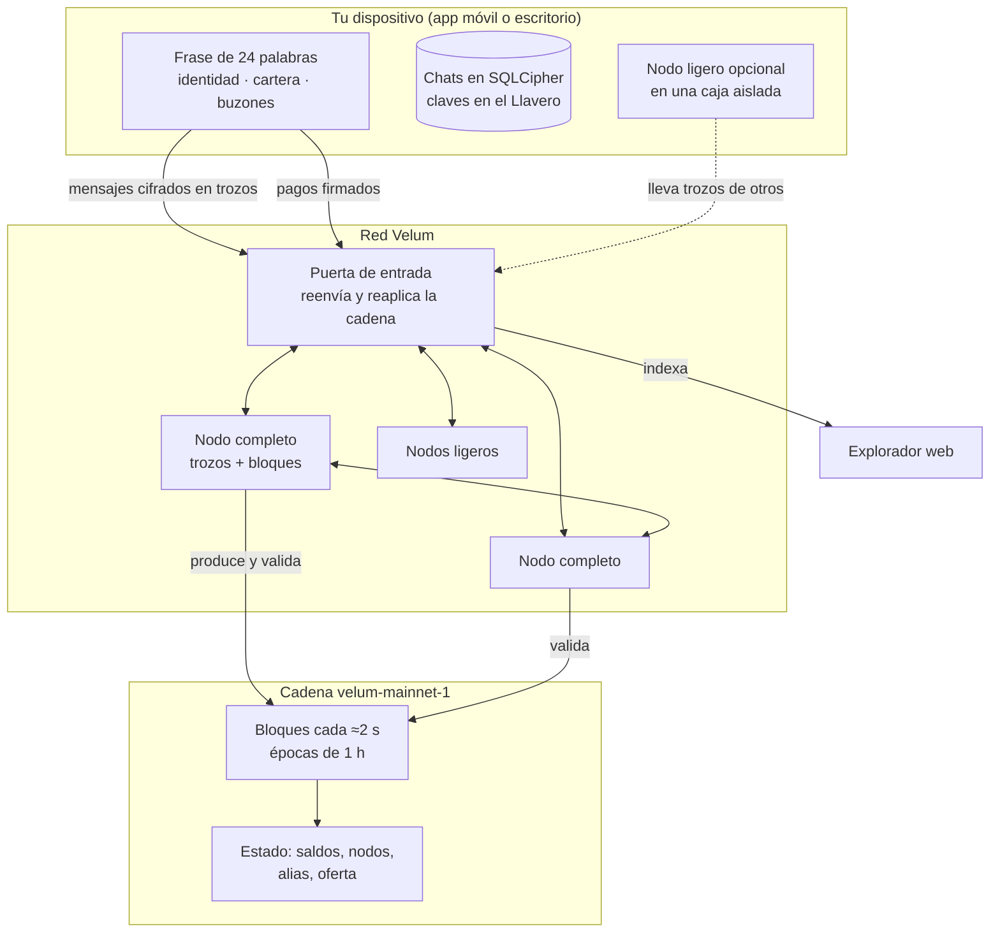

# Velum: el sistema completo

> Documentación técnica para personas de fuera: desarrolladores, operadores de nodos, comunidades de privacidad y auditores.
> Fuente de verdad: el código. Cada documento cita archivo y línea en su sección «Referencias».
> Red principal: `velum-mainnet-1`, en marcha desde el 1 de noviembre de 2026 a las 21:00 UTC.
> Código público: https://github.com/Consultora-BIM/velum-node · Web: https://velumprotocol.org

## Índice

| Documento | Para quién | Qué cuenta |
|---|---|---|
| [Mensajería](mensajeria.md) | Desarrolladores, privacidad, auditores | Claves, cifrado poscuántico híbrido, sobres, trozos, buzones, recibos, antispam, contactos, almacenamiento y modelo de amenazas |
| [Nodos](nodos.md) | Operadores, desarrolladores | Tipos de nodo, instalación, actualización firmada, consenso, épocas, recompensas, fianza, nodos en el móvil, puerta, fotos, actualizaciones en vivo y escala |
| [Seguridad de la moneda](seguridad-moneda.md) | Auditores, cualquiera | Por qué nadie puede meter VEL en una cartera a la fuerza, la reserva de génesis y los límites de hoy |
| [Hoja de ruta](hoja-de-ruta.md) | Todos | Qué falta, con su estado real |

Especificación para implementaciones en otros lenguajes: [`PROTOCOL.md`](../../PROTOCOL.md) y los vectores de `spec/vectors`.

## Qué es Velum

Velum es una **red de mensajería privada** con su propia cadena de bloques.

- **El uso principal son los mensajes.** Texto, audio, imágenes y archivos, cifrados en tu teléfono.
- **Sin número ni correo.** Tu cuenta es una frase de 24 palabras. Te encuentran por alias, enlace, QR o, si quieres, por teléfono.
- **Sin servidor central de mensajes.** Los llevan nodos de la comunidad, que solo ven trozos opacos de tamaño fijo.
- **VEL** es la moneda de la red. Sirve para **pagar en el día a día** (de móvil a móvil o en una tienda con un QR) y para que los nodos cobren por su trabajo.

La empresa que impulsa el proyecto no vende, no regala y no promete valor por VEL. Esta documentación describe reglas técnicas, no precios.

## Por qué usarlo

| Necesidad | Qué hace Velum |
|---|---|
| Que nadie lea tus mensajes | Cifrado de extremo a extremo, híbrido X25519 + ML-KEM-768 |
| Que nadie sepa con quién hablas | Remitente sellado, buzones que cambian cada día, recibos anónimos |
| Que el tamaño no delate el contenido | Relleno a 7 tamaños fijos |
| Que tus chats sean tuyos | Se guardan solo en tus dispositivos, en una base cifrada |
| Pagar sin intermediarios | Transferencias firmadas; sin comisión por debajo de un umbral (con un pequeño sello de trabajo) |
| Que nadie cree dinero de la nada | Emisión por fórmula fija que comprueba cada nodo |

## Cómo encajan las piezas

Dos mundos separados:

1. **Mensajes:** viajan en trozos cifrados por los nodos. **No tocan la cadena.**
2. **Cadena:** solo ve pagos, altas de nodos y alias, reclamaciones de trabajo y sus pruebas.

El puente entre los dos: los nodos que llevan mensajes **lo demuestran** con recibos anónimos y muestreo. Con eso, y produciendo bloques, **descubren VEL** cada época.

## Cifras clave

| Concepto | Antes de la v4 (bloques 0 a 28.799) | Economía v4 (desde el bloque 28.800) |
|---|---|---|
| Decimales de VEL | 6 | 18 (1 velo = 10⁻¹⁸ VEL) |
| Tope | 1.000 M VEL | 21.000 M VEL |
| Reserva de génesis | 100 M VEL (billetera fría del operador, fuera de línea) | Igual |
| Emisión por época (1 h) | 25.684,93 VEL | 298.026,47 VEL, mitad cada 4 años (35.064 épocas) |
| Quema | Ninguna | Ninguna |
| Comisión de pago | 0 bajo 1.100 vUSDT de valor (con sello PoW); 0,01 % desde ahí | Igual |
| Cupo gratis de mensajes | — | 20 cada 10 min (definido; **aún no se aplica**) |
| Créditos de mensajería | — | 22 µUSDT por mensaje por encima del cupo |

La v4 se activa **en vivo**, sin reiniciar la cadena, en el bloque **28.800** (época 16, hacia las 12:05 UTC del 2 de noviembre de 2026), con el nodo 2.1.0. Ver [nodos §10](nodos.md#10-actualizaciones-de-protocolo-en-vivo).

## Estado honesto, en una tabla

| Pieza | Estado |
|---|---|
| Mensajería cifrada, buzones, recibos, trozos | Activa |
| Pagos VEL | Activos |
| Nodos completos y ligeros, recompensas por trabajo | Activos |
| Producción de bloques | **Un solo nodo hoy.** El protocolo admite muchos |
| Finalidad de bloques | No existe todavía (gana la rama más alta) |
| Economía v4 | Activación en el bloque 28.800 (nodo 2.1.0) |
| Intercambio P2P (HTLC) | Escrito, sin activar |
| Pasarela USDT ⇄ vUSDT | Cerrada |
| Firmas poscuánticas | Pendientes (hoy ed25519; el cifrado sí es poscuántico híbrido) |

## Glosario rápido

| Término | Significado |
|---|---|
| Trozo (*shard*) | Una de las 5 partes de un sobre cifrado; bastan 3 |
| Buzón | Etiqueta del día donde esperan tus trozos; cambia cada día |
| Puente | Ruta que abre un nodo para llevar trozos |
| Carrier / courier | Nodo que guarda el trozo / nodo que lo entrega |
| Época | 1.800 bloques, unos 60 minutos |
| Descubrir VEL | Recibir la parte de la bolsa de la época por trabajo verificado |
| Reserva de la Red | Cuenta sin clave que recibe el 20 % de las comisiones y devuelve el 0,1 % por época |
| Puerta (*hub*) | Servicio de entrada que reenvía tráfico e indexa la cadena |
| velo | 10⁻¹⁸ VEL (desde la v4) |

## Referencias

- Parámetros de red y economía: `packages/core/src/constants.ts:10-51`, `:61-77`, `:243-260`; `packages/core/src/v3/constants.ts:15-27`, `:74-80`.
- Red y génesis: `packages/core/src/network.ts:1-22`; `packages/core/src/genesis.ts:35-55`; `packages/core/genesis/mainnet.json`.
- Actualizaciones en vivo: `packages/core/src/upgrades.ts:1-68`; `packages/core/src/era.ts:1-20`.
- Mensajes fuera de la cadena: `packages/core/src/envelope.ts:1-8`; `packages/core/src/shards.ts:1-3`; `docs/escalado.md` §1.
- Puerta e indexador: `apps/web/worker/hub.ts:1-8`.
- Turnos de producción: `packages/core/src/state.ts:459-482`.
- Elección de rama: `packages/core/src/state.ts:1152-1155`.
- Cupo y créditos: `packages/core/src/constants.ts:243-250`.
- HTLC: `packages/core/src/htlc.ts:14-15`.
- Pasarela cerrada: `apps/bridge/src/config.ts:2`, `:125`.
