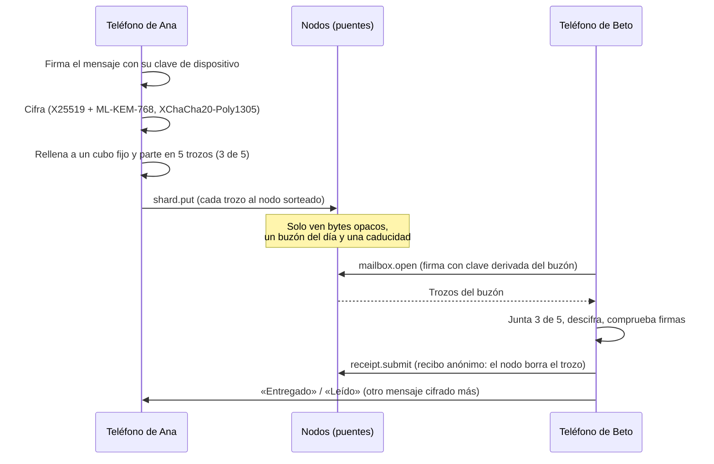
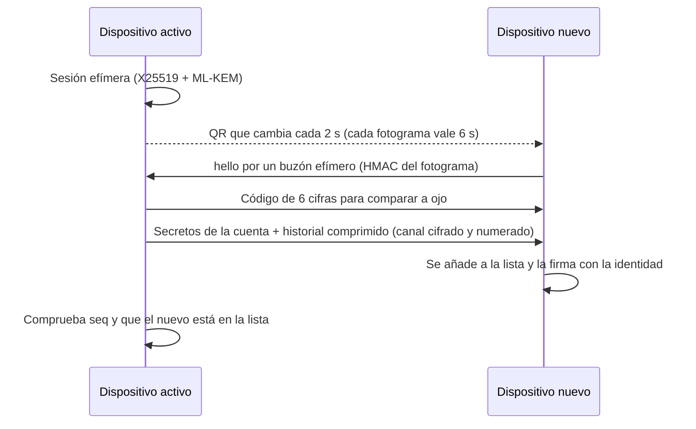

# Mensajería de Velum, de punta a punta

> Para desarrolladores, auditores y comunidades de privacidad.
> Fuente de verdad: el código de `packages/core/src` (rama de trabajo v4). Cada afirmación lleva su referencia al final.
> Si un documento antiguo dice otra cosa, manda el código (ver «Diferencias con documentos anteriores»).

## 1. Resumen en 6 frases

1. Tu cuenta es una frase de 24 palabras. De ella salen tu identidad, tu cartera y tus buzones.
2. Cada mensaje se cifra en tu teléfono, una vez por cada dispositivo que lo recibe.
3. El cifrado es híbrido: X25519 (clásico) + ML-KEM-768 (poscuántico). Para leerlo hay que romper los dos.
4. El sobre cifrado se rellena a un tamaño fijo y se parte en 5 trozos; bastan 3 para rehacerlo.
5. Los trozos esperan en nodos de la comunidad, en buzones que cambian cada día, hasta 7 días.
6. Los chats viven solo en tus dispositivos, en una base cifrada.



## 2. Identidad y claves

### 2.1 De la frase a las claves

| Clave | Cómo se obtiene | Para qué sirve |
|---|---|---|
| Frase | BIP-39, 24 palabras (256 bits) | Recuperar la cuenta |
| Semilla | PBKDF2 de BIP-39 (64 B) | Raíz de todo |
| Identidad | `HKDF-SHA512(semilla, "velum/v2/identity")` → ed25519 | Firma perfiles, listas de dispositivos y certificados |
| Cartera | SLIP-10 ed25519, ruta `m/44'/7420'/cuenta'/0'/índice'` | Firma transacciones (pagos) |
| Base de buzones | `HKDF-SHA512(semilla, "velum/v2/mailbox")` | Deriva los buzones que rotan |
| Dispositivo | **Aleatoria**, una por dispositivo | Firma cada mensaje enviado |
| Prellave | X25519 + ML-KEM-768, aleatoria, rota cada 24 h | Recibir mensajes cifrados |

- Identidad y cartera son **claves distintas a propósito**: nadie puede unir tus chats con tus pagos solo mirando la cadena.
- Dirección: `"vel" + base58(clave pública ed25519)`. Lo que empieza por `vel_` son cuentas especiales sin clave.
- Número de seguridad: SHA-256 de las dos direcciones ordenadas, en 6 grupos de 5 cifras. Sirve para comprobar en persona que no hay nadie en medio.

### 2.2 Algoritmos que usa el código (de verdad)

| Uso | Algoritmo | Biblioteca | ¿Poscuántico? |
|---|---|---|---|
| Firmas (identidad, dispositivo, cartera, buzón) | ed25519 (RFC 8032 estricto) | `@noble/curves` | **No** |
| Acuerdo de clave | X25519 **+** ML-KEM-768 | `@noble/curves`, `@noble/post-quantum` | **Sí (híbrido)** |
| Derivación | HKDF-SHA512 | `@noble/hashes` | — |
| Cifrado | XChaCha20-Poly1305 (nonce de 24 B) | `@noble/ciphers` | Simétrico (resiste) |
| Copias de seguridad | Argon2id + XChaCha20-Poly1305 | `@noble/hashes`, `@noble/ciphers` | Simétrico |

**Qué significa:** el contenido de los mensajes resiste a «guardar ahora, descifrar luego» con un ordenador cuántico. Las **firmas no** son poscuánticas todavía. Un atacante cuántico futuro podría falsificar firmas, pero no leer mensajes ya enviados. ML-DSA está en la hoja de ruta.

## 3. Varios dispositivos

- Hasta **5 dispositivos** por identidad.
- La `DeviceList` = `{ v: 2, identity, devices[], seq, ts, sig }` la firma la identidad. Gana la de `seq` mayor.
- Cada entrada lleva la clave de firma del dispositivo, su prellave actual (X25519 + ML-KEM), la semilla de buzón y la pública del buzón.
- La lista **no va a la cadena**. Viaja a tus contactos dentro de mensajes cifrados de tipo `profile`.
- Cada mensaje lleva un `DeviceCert`: la identidad firma `{ identity, device, signPub, ts }`. Así el receptor sabe que ese dispositivo es tuyo.
- **Quitar un dispositivo:** se firma una lista nueva con `seq + 1` y los demás rotan la sal del buzón. El expulsado deja de poder abrir tus buzones nuevos.

### 3.1 Vincular un dispositivo nuevo



- La sesión caduca a los 5 minutos. Una foto del QR caduca en segundos.
- También existe el modo inverso: el dispositivo nuevo enseña el QR (como en un navegador de escritorio).
- **Ojo:** el canal pasa al dispositivo nuevo los secretos raíz (identidad, cartera, base de buzones y, si existe, la frase). Es lo esperado: es tu misma cuenta. Pero quien controle ese canal controla la cuenta. Por eso hay código de comparación.

## 4. El sobre

### 4.1 Formato

```
[1 versión=2][32 eph X25519][1088 kemCt][24 nonce][80 envoltorio][24 nonce2][cuerpo cifrado]
```

1. El cuerpo se cifra **una vez** con una clave aleatoria de 32 B.
2. Para cada dispositivo destino, la clave del cuerpo y una semilla de recibos `rseed` (32 B) se sellan con el cifrado híbrido:
   `clave = HKDF-SHA512(X25519(eph, prellave) ‖ secretoML-KEM, salt = eph ‖ kemCt, "velum/v2/envelope", 32)`.
3. La cabecera va como dato autenticado (AAD).
4. Sobrecoste fijo: 1.265 B.

### 4.2 Qué va dentro

- `[1 byte de compresión][JSON { p, cert }]`. Se comprime con deflate si el contenido mide 64 KB o menos y si ayuda.
- `p` es el `Payload`, firmado por la clave del dispositivo. `cert` es el certificado del dispositivo.
- **Remitente sellado:** quién envía (`from`, `dev`) solo está dentro del cifrado. Fuera no hay nada.
- Tipos de contenido: texto, imagen, audio, archivo, recibo, grupo, pago, perfil, escribiendo, sincronización y seguridad.

### 4.3 Imágenes, audio y archivos

- Van **dentro del mismo sobre**, como `blob` en base64 con su `mime`. No hay un canal aparte.
- Tamaño máximo de un sobre: **8 MB**.
- Gracias al relleno, una foto y un texto largo pueden medir lo mismo en la red.

### 4.4 Grupos y copias

- Una copia sellada por cada dispositivo de cada destinatario **y por tus otros dispositivos** (para que el historial sea igual en todos).
- Un mensaje de grupo y uno de 1 a 1 son **iguales en la red**. Los nodos no saben que hay un grupo.

### 4.5 «Entregado» y «Leído»

- Son mensajes cifrados normales, de tipo `receipt`, con `status: "delivered" | "read"`.
- Si apagas las confirmaciones de lectura, tu app no envía «leído» (y tampoco ve las de otros).

## 5. Relleno y trozos

| Paso | Regla |
|---|---|
| Relleno | 4 B de longitud + datos + ceros hasta el cubo: 2, 8, 32, 128, 512, 2.048 u 8.192 KB |
| Corte | Reed-Solomon sistemático **3 de 5** sobre GF(256) (polinomio 0x11d, matriz de Cauchy), por franjas |
| Tamaño de trozo | cubo / 3, redondeado a 1 KB, con tope de 24 KB |
| Caducidad | 7 días |

Campos de un trozo que **sí ve** un nodo:

| Campo | Qué es | Qué revela |
|---|---|---|
| `id` | Huella del trozo | Nada del contenido |
| `msg` | Aleatorio por copia | Agrupa los trozos de **una** copia |
| `mailbox` | Buzón del día del destinatario | Que algo va a ese buzón hoy |
| `stripe`, `idx`, `k`, `n`, `bucket` | Posición y cubo | El cubo de tamaño |
| `data` | Bytes cifrados | Nada |
| `rh` | Huella del secreto de recibo | Nada |
| `mbAuth` | Clave para abrir el buzón (cambia cada día) | Nada entre días |
| `exp`, `ep` | Caducidad y época del sorteo | Momento aproximado |

Un nodo valida cada trozo **sin estado**: id correcto, cubo válido, `k/n = 3/5`, tamaño exacto, formatos de `rh` y `mbAuth`, y caducidad dentro de 7 días.

## 6. Cómo viajan por los nodos

### 6.1 Buzones que rotan

- Buzón del día: `hex(HMAC-SHA512(semillaBuzón, "day:" + día))[0..40]`.
- Cada dispositivo tiene un escalar secreto `s` (pública `mbPub = s·G`). El emisor pone en cada trozo `mbAuth = mbPub + t·G`, con `t` derivado del buzón del día.
- Para abrir, el dueño firma `velum/v2/open|<buzón>|<ts>` con `s + t` (margen de ±15 min). El nodo comprueba con `mbAuth` y **solo entrega los trozos con ese `mbAuth`**.
- Resultado: el nodo no puede unir el buzón de hoy con el de ayer, y nadie más puede vaciarte el buzón.
- El cliente abre el buzón de hoy y el de ayer.

### 6.2 Envío, sorteo y entrega

1. Para cada trozo, un **sorteo público** elige 3 candidatos a `carrier` (quien lo guarda). La baliza es el hash del último bloque de la época anterior.
2. El cliente lo manda al candidato **en línea con menor latencia**. Si ninguno responde, sale por otro nodo (llega igual, pero ese papel no cobra).
3. El nodo que lo acepta lo guarda y **lo reenvía a sus pares**.
4. Cuando el destinatario abre su buzón, recibe los trozos. El nodo que se los da es el `courier`.
5. El destinatario monta un **recibo anónimo** por trozo: `secreto = HMAC-SHA512(rseed, idTrozo)[0..32]`. Solo él conoce `rseed`.
6. Con un recibo válido (`sha512(secreto) == rh`), los nodos **borran** el trozo. El recibo no lleva firma ni dice quién recibe.

### 6.3 Entrega sin conexión

- Si el destinatario está apagado, sus trozos esperan **hasta 7 días**. Luego se borran solos.
- Límites del nodo de referencia: 2.000 trozos y 40 MB pendientes por buzón; por remitente y buzón, 700 trozos y 16 MB (se liberan al entregarse o caducar); 200.000 en total (desaloja los que antes caducan) y limpieza cada 60 s. Al pasarse, `shard.put` responde con un error claro.
- Al abrir buzón: hasta 16 buzones por llamada y 700 KB por respuesta; el resto llega empujado.
- **Notificaciones:** hoy no hay push remoto. El aviso llega por el WebSocket abierto. El push cifrado (APNs) está pendiente.

## 7. Antispam

| Mecanismo | Estado en el código |
|---|---|
| Ritmo por conexión: 50 `shard.put`/s (ráfaga 200) | **Activo** en el nodo |
| Tope por buzón (2.000 trozos, 40 MB) y global (200.000) | **Activo** en el nodo |
| Tope por remitente en un buzón (700 trozos, 16 MB) | **Activo** en el nodo; en la puerta, como ritmo cada 10 min |
| Llamadas de 1 MB como máximo | Activo |
| Sello PoW (16–26 bits, se ajusta por época) | **Activo, pero solo en transacciones** de la cadena, no en trozos |
| Cupo gratis de **20 mensajes cada 10 min** | **Activo** en la puerta y en los nodos completos (`quota.ts`, fuera de consenso). Aún no en nodos ligeros |
| Créditos de mensajería (`credits.buy`, v4) | Compra en la cadena; **consumo fuera de la cadena**, en el libro de cada relé |

### 7.1 Créditos de mensajería (v4)

- `credits.buy { amount, to?, fee }` convierte VEL en créditos **no transferibles** para `to` (por defecto, quien compra).
- Créditos = `floor(amount × precio / 10^18 / 22)`, con el precio del oráculo en µUSDT por VEL. Es decir, 22 µUSDT por crédito.
- Mínimo 1 VEL. Sin precio del oráculo, la compra se rechaza.
- El VEL pagado va **entero a la bolsa de nodos** de la época. No se destruye.
- Se consultan con la llamada `credits.of`.
- Las personas no necesitan créditos. Son para empresas y bots que envían por encima del cupo.

### 7.2 Cupo por remitente sin romper el remitente sellado

- El trozo no cambia. Junto a él, `shard.put` lleva un **pase de envío** opcional: `{ v, k, ts, msg, sig }`.
- `k` es una clave de cupo que el dispositivo deriva **cada día** de su clave de firma (`HKDF(…, "velum/v2/quota|día")`). El relé ve un seudónimo diario: no la identidad, no el dispositivo, y no puede unir días.
- Unidad: una copia (`msg`). Un «mensaje» = 10 copias. Cupo: 200 copias cada 10 min por remitente.
- Sin pase (app 2.1.0): el remitente es la conexión. Además: 4 seudónimos por conexión y un tope holgado por IP (la IP se guarda como huella con sal en memoria).
- Créditos: el pase añade `cr = { a, sig }` (dirección con créditos y su firma sobre `k` y el día). **Revela la dirección al relé**: es opcional, para bots y empresas. Cada relé descuenta en su libro; no hay contabilidad global todavía.
- **Límite honesto:** crear seudónimos es gratis. Los frenan los topes por conexión e IP. Un pase fuerte contra Sybil (dispositivo atestado, RLN o tickets ciegos) sigue en la hoja de ruta.

## 8. Privacidad de los contactos

### 8.1 Cómo te encuentran

| Vía | Qué se publica | Notas |
|---|---|---|
| Alias (`name.register`) | Tarjeta de contacto en la cadena: identidad, prellave de primer contacto y buzón de solicitudes, firmada | Uno por cartera, dura 1 año, cuesta PoW extra |
| Enlace o QR | La tarjeta, fuera de la cadena | — |
| Invitación de un solo uso | Secreto de 32 B, vale 24 h | Quien la canjea pasa a ser contacto |
| Teléfono (opcional) | Nada en la cadena | Ver 8.2 |

### 8.2 Teléfono (opcional)

- Alta con SMS (Twilio Verify). La puerta guarda `HMAC-SHA256(PEPPER, número E.164) → tarjeta`. `PEPPER` es un secreto del servidor.
- **Búsqueda privada (PSI ligero, `phonepsi.ts`):** OPRF de RFC 9497 sobre ristretto255. La app ciega cada número; la puerta lo evalúa con su clave sin verlo y devuelve, por cada prefijo de 12 bits de `sha256(número)`, las huellas cortas registradas. La app ve si el suyo está y pide la tarjeta con una huella larga (`/api/phone/match`). La puerta solo aprende el prefijo (compartido por ~1/4.096 de todos los números) y qué tarjetas coinciden.
- Claves OPRF con `kid` y rotación (actual + anterior activas). Sin `PHONE_OPRF_SEED`, se deriva de `PEPPER`.
- **Obsoleto:** `/api/phone/lookup` (números en claro) sigue solo para la app 2.1.0, con cabeceras `Deprecation`/`Sunset` (1-2-2027). Cada coincidencia por esa vía crea las huellas OPRF que faltaban a los registrados antes.
- Límites: 50 números por petición, 500 al día por dispositivo y un tope por IP (guardada como HMAC).
- Las peticiones van firmadas por la clave del dispositivo (±5 min).
- Baja firmada por la identidad. Un número nuevo borra el anterior.

### 8.3 Solicitudes y bloqueos

- Política para desconocidos: **permitir**, **solicitud** (por defecto) o **bloquear**.
- «Encontrarme»: todos, solo contactos o nadie («nadie» quita tu número del directorio).
- La primera solicitud va cifrada (híbrido, `velum/v3/request`), rellenada y firmada por la identidad.
- **Todo se decide en tu dispositivo.** Bloquear marca el contacto y borra el chat. Los mensajes bloqueados se descartan **después** de descifrarlos. Los nodos siguen guardando y entregando esos trozos.

## 9. Lo que se guarda en el teléfono

| Qué | Dónde | Protección |
|---|---|---|
| Chats, contactos, ajustes | SQLite con **SQLCipher** | Clave aleatoria de 32 B |
| Clave de la base | Llavero (iOS) / Keystore (Android) | `WHEN_UNLOCKED_THIS_DEVICE_ONLY`: no viaja en copias de iCloud |
| Cuenta (identidad, cartera, claves de dispositivo) y frase | Llavero | Igual |
| Preferencias del nodo ligero | Llavero | `AFTER_FIRST_UNLOCK_THIS_DEVICE_ONLY` (las lee la tarea de fondo) |
| Face ID / código | Puerta de la app | No va atada al elemento del Llavero |

- Si la base no abre, se aparta con otro nombre y se crea una nueva. **Nunca se borra.**
- Si SQLCipher no está activo en una compilación, la app **no arranca**: enseña una pantalla de bloqueo y no escribe nada en claro (si acaba de crear el archivo vacío, lo quita).

### 9.1 Copia de seguridad `.velum`

```
cabecera (59 B) = "VELUMBK1" ‖ versión ‖ kdf ‖ m (KiB) ‖ t ‖ p ‖ sal (16) ‖ nonce (24)
cuerpo          = XChaCha20-Poly1305(clave, nonce, deflate(JSON), AAD = cabecera)
clave           = Argon2id(contraseña NFKC, sal, m = 19.456 KiB, t = 2, p = 1, 32 B)
```

- Contraseña de **10 caracteres como mínimo**. Los parámetros van en la cabecera: se pueden subir sin romper archivos viejos.
- Contiene: secretos de identidad y cartera, base de buzones, lista de dispositivos, frase, nombre, contactos, chats y, si quieres, el historial **sin adjuntos**.
- Al restaurar se crea una clave de dispositivo nueva. Si ya hay 5, sale el más antiguo.
- Sin la contraseña, el archivo no sirve. La seguridad está en ella.

## 10. Modelo de amenazas

### 10.1 Qué puede y qué no puede ver cada uno

| Actor | Puede ver | No puede ver |
|---|---|---|
| **Nodo que guarda trozos** | IP de quien conecta, buzón del día, cubo de tamaño, `msg` (agrupa trozos de una copia), horas, qué buzones abre una conexión | Contenido, remitente, destinatario real, si es grupo, tipo de mensaje, buzones de otros días |
| **Puerta de entrada (hub)** | Lo mismo que un nodo para el tráfico que pasa por ella; IP; seudónimo de cupo del día; prefijos de 12 bits de los números buscados (y los números en claro solo con la búsqueda obsoleta de la app 2.1.0) | Contenido, remitente. No guarda las búsquedas |
| **Operador de la red** | Lo mismo que la puerta, si opera la puerta | Contenido. No tiene claves de nadie |
| **Observador de la cadena** | Pagos, alias y tarjetas públicas, altas de nodos, reclamaciones | Mensajes (no van a la cadena) |
| **Contacto** | Tus mensajes, tu lista de dispositivos, tu última vez (si la compartes) | Tu cartera, salvo que se la des |
| **Ladrón del teléfono bloqueado** | Nada útil sin desbloquear | Base y claves (cifradas, atadas al dispositivo) |
| **Atacante cuántico futuro** | Podría falsificar firmas ed25519 | Contenido ya enviado (acuerdo híbrido con ML-KEM) |

### 10.2 Qué puede hacer un atacante

| Ataque | ¿Posible? | Defensa |
|---|---|---|
| Leer un mensaje en tránsito | No | Cifrado híbrido de extremo a extremo |
| Suplantar a un remitente | No | Firma del dispositivo + certificado de la identidad |
| Fabricar recibos para cobrar | No | Solo quien abre el sobre conoce `rseed` |
| Vaciar el buzón de otro | No | Abrir exige la clave del buzón (`s + t`) |
| Llenar el buzón de alguien | **Más difícil** | Topes por buzón (2.000 trozos, 40 MB), por remitente y buzón (700, 16 MB) y cupo por remitente. Varios seudónimos aún pueden sumar |
| Correlacionar horas y tamaños | **Parcialmente** | Relleno a cubos y buzones que rotan. **No hay** tráfico de cobertura ni rutas mezcladas |
| Borrar mensajes no entregados | Un nodo puede tirar sus trozos | 5 trozos en nodos distintos; bastan 3 |
| Leer chats de un dispositivo robado y abierto | Sí | Es el límite de cualquier app. Face ID y Llavero «solo este dispositivo» |
| Leer mensajes de la última semana si roba claves de un dispositivo | **Sí** | Las prellaves duran 24 h y se guardan 7 días. No hay doble trinquete todavía |

## 11. Riesgos y límites conocidos

1. Firmas solo clásicas (ed25519). Sin ML-DSA todavía.
2. Sin trinquete por mensaje: el secreto hacia delante es por ventana de ~7 días.
3. Cupo gratis y créditos aplicados por cada relé, sin contabilidad global; los seudónimos de cupo se crean gratis.
4. Un buzón aún se puede saturar con muchos seudónimos (topes por buzón: 2.000 trozos / 40 MB).
5. Los nodos ven IP, cubo, `msg`, horas y el conjunto de buzones que abre cada conexión. Sin tráfico de cobertura.
6. La búsqueda por teléfono obsoleta (app 2.1.0) aún expone los números a la puerta hasta su retirada.
7. Bloquear es solo local.
8. Se comprime antes de cifrar. El relleno a cubos limita lo que esto filtra.
9. (Resuelto) Sin SQLCipher la app no arranca.
10. La vinculación y la copia `.velum` exportan los secretos raíz. Protégelas como la frase.

## 12. Diferencias con documentos anteriores

| Documento | Dice | El código hace |
|---|---|---|
| `constants.ts:208` (comentario) | Trozos de 24 KB en franjas de 4 datos + 1 de paridad | 3 de 5 por franja (`msgconst.ts`, `shards.ts`) |
| `protocolo-v2.md` §5 | Abrir buzón con `HMAC(...)` y `mbAuth = sha512(...)` | Firma ed25519 con escalar ajustado (`mailbox.ts`) |
| `protocolo-v3.md` §C | Elegir el candidato de menor latencia está pendiente | Ya lo hace `client.ts › bestCandidate` |
| `economia-v4.md` §1 | Cupo gratis de 20 / 10 min | Lo aplican puerta y nodos completos, por copias (`quota.ts`) |
| `respaldo-formato.ts:1` | Remite a `docs/formato-velum.md` | Ese archivo no existe |

## Referencias

- Claves y frase: `packages/core/src/seed.ts:30-32`, `:53-57`, `:59-94`; `packages/core/src/slip10.ts:9-44`; `packages/core/src/keys.ts:15-33`, `:65`, `:115-128`.
- Etiquetas y constantes de mensajería: `packages/core/src/msgconst.ts:4-43`.
- Cifrado híbrido: `packages/core/src/pq.ts:1-18`, `:45-47`, `:71-78`.
- Dispositivos: `packages/core/src/devices.ts:37-71`, `:86-97`, `:117-129`, `:133-172`.
- Vinculación: `packages/core/src/link.ts:14-19`, `:39`, `:58-65`, `:85-153`, `:184-191`, `:291-315`, `:409-421`.
- Sobre: `packages/core/src/envelope.ts:6-41`, `:69-115`, `:156-168`.
- Trozos y Reed-Solomon: `packages/core/src/shards.ts:10-60`, `:90`, `:110-160`; `packages/core/src/rs.ts:1-4`.
- Buzones: `packages/core/src/mailbox.ts:4-9`, `:35-37`, `:63-71`, `:95-126`.
- Recibos: `packages/core/src/proof.ts:8-35`.
- Cliente (envío, sorteo, recibos, confirmaciones): `packages/core/src/client.ts:302-315`, `:380-391`, `:525-575`, `:624-625`; `packages/core/src/lottery.ts`.
- Nodo (ritmo, topes, reenvío, apertura): `apps/node/src/node.ts:45-48`, `:652-668`, `:959-997`, `:1087-1140`; `apps/node/src/store.ts:28-30`, `:138-141`.
- Red: `packages/core/src/wire.ts:1-5`, `:99-107`; `apps/web/worker/hub.ts:1-8`, `:387-388`, `:466-482`.
- Antispam y créditos: `packages/core/src/constants.ts:135-141`, `:243-250`; `packages/core/src/pow.ts:5-46`; `packages/core/src/state.ts:203-204`, `:498`, `:661-675`, `:1015-1016`; `packages/core/src/tx.ts:194-197`; `apps/node/src/node.ts:1040-1041`.
- Alias, tarjetas, solicitudes e invitaciones: `packages/core/src/names.ts:22-40`, `:111-122`, `:185-231`; `packages/core/src/tx.ts:145-160`; `packages/core/src/constants.ts:162-165`.
- Teléfono: `apps/web/worker/phone.ts:2-5`, `:29-58`, `:142-143`, `:241-245`, `:284`, `:347-359`.
- Privacidad en la app: `apps/mobile/src/lib/privacidad.ts:1-36`; `apps/mobile/src/lib/velum.ts:203-209`, `:680-719`.
- Almacenamiento: `apps/mobile/app.json:150-155`; `apps/mobile/src/lib/almacen.ts:22-24`, `:47-85`; `apps/mobile/src/lib/identidad.ts:18-21`, `:59`, `:89`; `apps/mobile/src/lib/seguridad.ts:23`; `apps/mobile/src/lib/nodo-ligero.ts:27-30`.
- Copia `.velum`: `apps/mobile/src/lib/respaldo-formato.ts:1-22`, `:47-114`; `apps/mobile/src/lib/respaldo.ts:19-68`.
- Sin push remoto: `apps/mobile/plugins/sin-push.js:1-8`.
