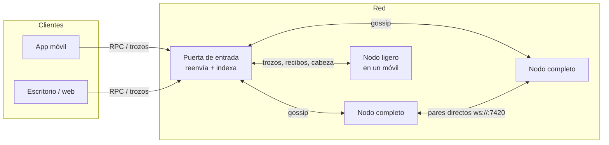
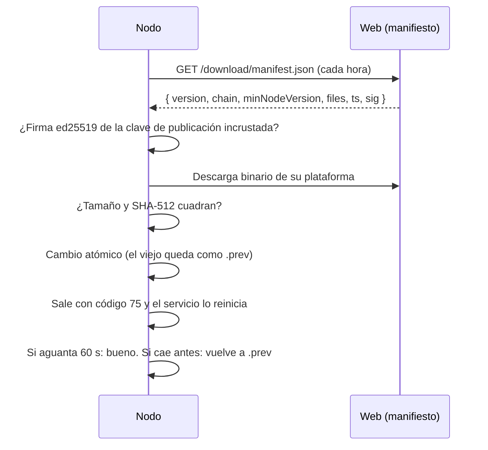
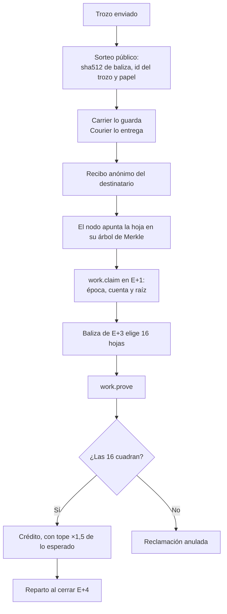
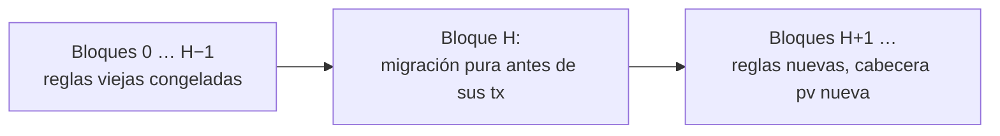

# Nodos de Velum

> Para operadores de nodos, desarrolladores y auditores.
> Fuente de verdad: `apps/node/src`, `packages/core/src` y `apps/web/worker/hub.ts`. Referencias al final.

## 1. Qué hace un nodo

Un nodo hace dos trabajos a la vez:

1. **Lleva mensajes.** Guarda trozos cifrados en buzones y los entrega. A esto lo llamamos «abrir puentes».
2. **Lleva la cadena.** Valida cada bloque y, si es completo, produce bloques por turnos.

Por ese trabajo, los nodos **descubren VEL** cada época (1 hora), según una fórmula fija.

### 1.1 Tipos de nodo

| Tipo | Dónde corre | Guarda la cadena | Produce bloques | Lleva trozos | Peso en el sorteo |
|---|---|---|---|---|---|
| **Completo** (`full`) | Ordenador o servidor (binario `velum-node`) | Sí | Sí, por turnos | Sí | 2 |
| **Ligero** (`light`) | App del móvil, o cualquier sitio con WebSocket | No (sigue la cabeza y el sorteo) | **No** | Sí | 1 |
| **Puerta** (`hub`) | Servicio web | Sí (la reaplica para indexar) | No | Reenvía | — |

No hay un papel separado de «validador» o «relé»: **todo nodo completo registrado y con señal de vida reciente puede producir bloques**.



## 2. Montar un nodo

### 2.1 Instalar

- **Binarios únicos** por plataforma: `darwin-arm64`, `darwin-x64`, `linux-x64`, `linux-arm64`, `windows-x64`. No hace falta instalar Bun.
- Instalador para macOS y Linux: `install.sh` (sin `sudo`). En Windows: `install.ps1`. Se descargan de https://velumprotocol.org.
- El instalador:
  1. Lee `download/manifest.json` (con orígenes de respaldo).
  2. Comprueba el SHA-512 del binario.
  3. Ejecuta `velum-node init` (crea la clave y la configuración).
  4. Crea la orden `velum` y un servicio de usuario (launchd o systemd).
- En macOS el binario lleva firma *ad hoc*, no de desarrollador identificado.

### 2.2 Configurar

Todo vive en `~/.velum` (o en `VELUM_HOME`).

| Archivo | Qué es |
|---|---|
| `node.key` | Clave ed25519 del nodo (permisos 0600). **Es el nodo.** |
| `config.json` | Configuración guardada |
| `velum-velum-mainnet-1.db` | Cadena y trozos (SQLite). Se llama por cadena, no por versión |

| Opción | Por defecto | Qué hace |
|---|---|---|
| `--payout vel…` | La dirección del nodo | Cartera que cobra lo descubierto |
| `--port N` | 7420 | Panel local y conexiones directas |
| `--gateway URL[,URL]` | Puertas oficiales | Puertas por orden; `none` = solo pares directos |
| `--peer ws://h:p/ws` | — | Par directo (se repite) |
| `--endpoint ws://…` | — | Dirección pública; **se publica en la cadena** |
| `--dns-seed NOMBRE` | — | Semilla DNS (TXT) |
| `--name NOMBRE` | Vacío | Decorativo. Nunca sale del equipo ni del usuario |
| `--no-auto-update` | Activado | Desactiva la actualización automática |

Órdenes: `start` (por defecto), `init`, `update`, `status`, `open`, `reset`, `snapshot export|import ARCHIVO`, `address`, `version`.

Entorno (solo para esa ejecución): `VELUM_HOME`, `VELUM_PORT`, `VELUM_GATEWAY`, `VELUM_PEERS`, `VELUM_MANIFEST_URL`, `VELUM_AUTO_UPDATE=0`, `VELUM_LOG=debug`.

### 2.3 Anonimato del nodo

- Un nodo es su **dirección**. Las pantallas enseñan `4 primeros…4 últimos` y un identicono.
- Sin nombre por defecto. La puerta nunca enseña IPs.
- Detrás de la puerta, un nodo no publica `endpoint` salvo que su operador lo pida.

### 2.4 Encontrar vecinos

1. Puertas de entrada (lista por orden, con respaldo).
2. `endpoint` publicados en la cadena.
3. Semillas DNS (registros TXT).
4. Intercambio de vecinos (PEX): hasta 64 conocidos y 12 conexiones salientes.

Si caen todas las puertas, los nodos siguen entre ellos con pares directos.

## 3. Actualización automática firmada



- El manifiesto se firma (ed25519) sobre su JSON canónico sin `sig`. La clave **pública** va dentro del binario. La secreta no está en el repositorio.
- Se comprueba cada hora; la primera vez, entre 20 y 40 s después de arrancar.
- **`minNodeVersion`:** si el nodo es más viejo, **se retiene** y deja de aportar hasta actualizar. Pasa también con la actualización automática apagada.
- `VELUM_MANIFEST_URL` cambia el origen, pero la firma se sigue exigiendo.
- Versión actual del nodo en el código: **2.1.0** (la que trae la economía v4).

## 4. Producción de bloques y consenso

### 4.1 Ritmo

| Parámetro | Valor |
|---|---|
| Ritmo nominal | 1 bloque cada 2 s (el explorador muestra el medido) |
| Época | 1.800 bloques ≈ 1 hora (mainnet) |
| Cierre de época | cuando `altura % 1.800 == 0` |

### 4.2 A quién le toca

1. **Activos** = nodos completos registrados con señal de vida en los últimos 15 bloques.
2. **Hueco** = `floor((hora − génesis) / 2 s)`.
3. Orden del hueco: se ordenan los activos por `hash(hashAnterior | hueco | dirección)`. El primero es el titular.
4. Los **suplentes** esperan ¼ de bloque (500 ms) por puesto.
5. Cada hueco vacío adelanta un puesto a todos. Así la cadena nunca se queda parada.
6. Si no hay ningún activo, cualquiera puede empezar (arranque).

La fianza y la delegación **no cambian el turno**. Solo pesan en el sorteo de recompensas.

### 4.3 Qué comprueba cada nodo en un bloque

Cadena, altura, enlace con el anterior, hora (no más de 5 s en el futuro), hueco, hash de cabecera, firma del proponente, versión de protocolo y ventana de turno. Después **reconstruye el bloque** con las mismas transacciones y señales de vida. Si el hash resultante (que incluye la raíz de estado) no es idéntico, lo rechaza.

Cabecera: `chain, height, prev, ts, slot, proposer, txRoot, receiptRoot, presenceRoot, stateRoot` y, en mainnet, `pv` (versión de protocolo).

### 4.4 Elección de rama y finalidad

- Gana la rama **más alta**. A igual altura, la de **hash menor**.
- **No hay finalidad** en el código actual. Un bloque reciente podría reorganizarse.
- Por eso los pagos usan «incluido» (≈ 2 s) e «firme» (30 bloques; 1.800 si el importe es grande).

### 4.5 Cierre de época (cada hora)

Paga a los productores, liquida reclamaciones de trabajo de la época E−4, actualiza niveles y desbloqueos, ajusta la dificultad del sello PoW, cierra la ventana del oráculo, caduca alias y saca la foto de nodos para el sorteo.

## 5. Cómo un nodo descubre VEL

### 5.1 La bolsa de cada época

```
bolsa(e) = comisiones de la época + 0,1 % de la Reserva de la Red + emisión R(e)
```

- La emisión solo entra si alguien produjo bloques en la época. Nunca supera `tope − acuñado`.
- **15 %** a quienes produjeron bloques, en proporción a los bloques hechos.
- **85 %** al trabajo verificado de llevar mensajes.

### 5.2 Emisión

| | Economía v3 (bloques 0 a 28.799) | Economía v4 (desde el bloque 64.800) |
|---|---|---|
| Decimales | 6 (µVEL) | 18 (velos) |
| Tope | 1.000.000.000 VEL | 21.000.000.000 VEL |
| Génesis | 100 M VEL | 100 M VEL |
| Mitad cada | 17.520 épocas (2 años) | **35.064 épocas (4 años)** |
| `R0` por época | 25.684,931506 VEL | 298.026,465890942276979237 VEL |
| Fin | — | Tras 33 mitades (≈ 132 años) |

Fórmula v4: `R(e) = R0 >> floor(e / 35.064)`, y 0 desde la mitad 33. La época `e` cuenta desde génesis.

### 5.3 Trabajo verificado



- **Peso en el sorteo** = tipo (2 completo, 1 ligero) × nivel × factor de fianza.
- **Niveles por antigüedad continua:** Nuevo 0,5 · Activo 0,65 · Veterano 0,85 · Pilar 1,0. Una ausencia de más de 48 h reinicia la racha.
- Los niveles y la fianza **no crean VEL**: reparten la misma bolsa.
- El sello PoW (`pow.ts`) **no es minería**: es un antispam para transacciones sin comisión.

## 6. Fianza y delegación

| Concepto | Regla |
|---|---|
| Fianza propia (`node.bond`) | Opcional, hasta 10.000 VEL. Sube el peso en el sorteo hasta ×2 |
| Desbloqueo | 14 días. Máximo 8 desbloqueos pendientes |
| Delegar (`stake.delegate`) | Mínimo 1 VEL. Hasta 1.000 delegados por nodo. Suma a la fianza en el peso (mismo tope) |
| Retirar (`stake.undelegate`) | 14 días de espera |
| Comisión del nodo (`node.commission`) | 10 % por defecto, 20 % máximo; cambios de ±5 puntos, uno cada 7 días |
| Reparto | Primero la comisión. El resto, a prorrata entre fianza propia y delegados (el sobrante por redondeo, al nodo) |

El VEL de fianzas y delegaciones queda en una cuenta interna sin clave (`vel_escrow`). Solo las reglas de la cadena lo sacan.

## 7. Nodos ligeros en el móvil

- Corren **dentro de la app**, en una caja con su propia clave, memoria y ritmo. **No tocan tus claves ni tus chats**. Solo conocen tu dirección de cobro.
- Alta gratis con `register { kind: "light" }`. Mandan señal de vida para entrar en el sorteo.
- Atienden `shard.put`, `mailbox.open` y `receipt.submit`, y siguen la cabeza y la foto del sorteo.

| Condición | Regla |
|---|---|
| Por defecto | Apagado. Al encenderlo: solo con Wi-Fi y cargando |
| Batería | Nunca arranca por debajo del 30 % |
| Android | Servicio en primer plano con aviso fijo; sigue con la app cerrada. Wakelock con tope de 6 h |
| iOS | Con la app abierta y en las ventanas de fondo que da el sistema (≈ 25 s cada una, normalmente de noche y cargando) |

Límites de la caja:

| Modo | Trozos | Almacén | Datos por hora | Mensajes por segundo |
|---|---|---|---|---|
| Normal | 400 | 8 MB | 150 MB | 40 |
| Ahorro (sin cargar) | 200 | 4 MB | 40 MB | 15 |

**Plan de bajo consumo:** el modo ahorro ya existe. Lo que falta está en la [hoja de ruta](hoja-de-ruta.md): push cifrado para despertar el nodo sin socket abierto y pasar los importes del móvil a BigInt (v4).

## 8. Puerta de entrada (hub)

- Un único servicio global (un Durable Object de Cloudflare).
- **Nodos** entran con un saludo firmado (±2 min). **Clientes** mandan RPC. **Web** recibe bloques y estadísticas en vivo.
- Reenvía gossip entre nodos. A los ligeros solo les manda trozos, recibos, cabeza y época.
- **Indexa la cadena reaplicando cada bloque** con el mismo núcleo (`applyBlock`). Rechaza bloques inválidos. Por eso los saldos y la emisión del explorador son los de la cadena, no los que diga un nodo.
- Sigue la misma regla de rama que los nodos. Guarda 24 estados recientes para reorganizaciones.
- `packages/core/src/hubrouter.ts` es una copia sin cadena para pruebas y desarrollo local.

## 9. Fotos de estado

- `velum-node snapshot export ARCHIVO` y `snapshot import ARCHIVO`, con el nodo parado.
- Formato: `{ v: 1, chain, height, hash, stateRoot, protocol, state }`.
- Al importar se comprueban la cadena, la coherencia de altura y hash, y **se recalcula la raíz**. Si no cuadra, se rechaza.
- **Ojo:** el nodo no compara la foto con la red. Compara tú el hash con el explorador antes de fiarte.
- El nodo guarda además una foto propia cada 64 bloques.

## 10. Actualizaciones de protocolo en vivo



Reglas:

1. Cada versión tiene una **altura de activación** en la tabla `UPGRADES`.
2. Si cambia el formato del estado, trae una **migración pura** (sin reloj ni azar). Se aplica una vez, en el bloque de activación.
3. Los bloques viejos se validan con el código viejo **congelado** (`packages/core/src/v3`). Así un nodo que reaplica desde génesis llega a las mismas raíces.
4. Un binario que no conoce la versión de un bloque **se para** («Actualización necesaria»). No bifurca.
5. Aviso público con al menos **14 días**. El manifiesto sube `minNodeVersion` antes de la altura.
6. No hay botón de reinicio. Si algo sale mal, se corrige con otra versión.

| Versión | Altura (mainnet) | Qué cambia | Estado |
|---|---|---|---|
| v1 | 0 | Génesis `velum-mainnet-1` (economía v3, µVEL) | Activa |
| v4 | `MAINNET_V4_HEIGHT` | 18 decimales (×10¹²), tope 21.000 M, mitad cada 4 años, sin `burned`, créditos de mensajería | **Altura 64.800** (época 36, ≈ 09:00 UTC del 3 de noviembre de 2026) |
| v5 | — | Candados hash-tiempo (HTLC) para intercambio P2P | Escrita. **Sin altura** |

> **Altura v4.** `MAINNET_V4_HEIGHT = 64_800`: primer cierre de época al menos 2 h después de publicar el nodo 2.1.0, fijado el 2 de noviembre de 2026.

La testnet (`velum-testnet-4`) corre v4 desde génesis.

## 11. Estado actual y plan de escala

### 11.1 Hoy

- **Hoy produce bloques un solo nodo.** El protocolo admite muchos: cualquier nodo completo registrado y activo entra en el turno.
- Toda la red pasa por una puerta en estrella. Aguanta del orden de 10³ nodos.
- La raíz de estado es un hash del estado entero (O(tamaño del estado) por bloque).

### 11.2 Plan (no implementado)

| Escala | Cambio | Dónde |
|---|---|---|
| 10⁶ nodos | Comité de 512 por época con firmas de finalidad (> 2/3) | `state.ts`, `node.ts` |
| | Raíz de estado con árbol de Merkle disperso (incremental) | `state.ts › stateRoot` |
| | Reclamaciones agregadas por células con muestreo en dos niveles | `claims.ts`, `tx.ts` |
| | Malla GossipSub; la puerta solo para arrancar | `hub.ts`, `node.ts` |
| | Buzones en una DHT Kademlia (5 nodos más cercanos) | `node.ts`, `lightnode.ts`, `client.ts` |
| | Formato binario (CBOR canónico) en red | `wire.ts`, `tx.ts` |
| 10⁹ nodos | Muestreo de células, cobro con prueba, clientes solo de cabeceras | — |

Cada cambio entra como versión de protocolo con altura. **Nunca se reinicia la cadena para escalar.** Detalle en `docs/escalado.md`.

## 12. Otras piezas de la cadena

| Pieza | Qué es | Estado |
|---|---|---|
| Mercado (DEX) | Libro de órdenes `VEL/<token>` en la cadena | Activo; vacío sin vUSDT |
| Oráculo | Precio medio (TWAP de 1 h) del par `VEL/vUSDT` | Activo; sin volumen, «sin precio» |
| Pasarela USDT ⇄ vUSDT | `bridge.mint` (solo la autoridad), `bridge.redeem` | En consenso sí; el servicio está **cerrado** |
| Tokens propios | Crear cuesta 100 VEL (a la Reserva) | Activo |
| HTLC | Candados hash-tiempo | **Inactivo** (v5 sin altura) |

## 13. Riesgos conocidos

| Riesgo | Por qué | Qué lo limita |
|---|---|---|
| Alta de nodo gratis | `register` no pide comisión, PoW ni fianza | Niveles por antigüedad; la bolsa es la misma para todos |
| Sin finalidad | Gana la rama más alta, sin límite de profundidad | Esperar confirmaciones; comités en el plan de escala |
| Arranque abierto | Sin activos, cualquiera puede proponer | Solo pasa si se apagan todos a la vez |
| Reloj local | La única cota de hora es reloj local + 5 s | — |
| Elegir id de trozo | Un emisor puede probar ids hasta que el sorteo elija su nodo | Tope ×1,5 por nodo |
| Atestación «suave» | En consenso nunca bloquea | La aplican la puerta y el nodo al dar servicio |
| Una sola clave de publicación | Quien la tenga puede publicar binarios | Firma obligatoria + SHA-512; se puede apagar la actualización |
| Una sola puerta | Punto central de reenvío e índice | Pares directos, `endpoint` en cadena, semillas DNS |

## Referencias

- Tipos y parámetros: `packages/core/src/constants.ts:10`, `:61-71`, `:77`, `:81-83`, `:88`, `:102-118`, `:135-141`, `:202-204`, `:232-239`, `:256-260`; `packages/core/src/v3/constants.ts:15`, `:21`, `:27`, `:74-80`.
- Configuración y CLI: `apps/node/src/config.ts:7-29`, `:31-39`, `:69-80`, `:90-127`; `apps/node/src/main.ts:17-42`, `:168-170`, `:180-183`, `:190-220`.
- Base de datos: `apps/node/src/store.ts:2`, `:13`.
- Descubrimiento de vecinos: `apps/node/src/discovery.ts:1-32`; `apps/node/src/node.ts:41-42`.
- Distribución: `apps/node/scripts/release.ts:5-10`, `:25-50`; `apps/node/scripts/build.ts:12-16`; `apps/web/public/install.sh`, `apps/web/public/install.ps1`.
- Actualización: `apps/node/src/update.ts:1-38`, `:63-91`, `:144-198`; `apps/node/src/version.ts:2`.
- Turnos y validación: `packages/core/src/state.ts:453-482`, `:1095-1110`, `:1118-1147`; `packages/core/src/tx.ts:459-473`, `:497`; `packages/core/src/bytes.ts:41-44`.
- Rama: `packages/core/src/state.ts:1152-1155`; `apps/node/src/chain.ts:131-138`.
- Bolsa, emisión y cierre: `packages/core/src/state.ts:217-221`, `:879-937`, `:974-1030`.
- Trabajo: `packages/core/src/lottery.ts:1-84`; `packages/core/src/claims.ts:3-55`; `packages/core/src/state.ts:719-795`; `packages/core/src/workbook.ts`.
- Antispam: `packages/core/src/pow.ts:1-46`. Atestación: `packages/core/src/attest.ts:1-9`.
- Fianza y delegación: `packages/core/src/staking.ts:34-113`; `packages/core/src/state.ts:450-456`, `:576`, `:1004-1011`.
- Nodo ligero: `packages/core/src/lightnode.ts:1-16`; `apps/mobile/src/lib/nodo-ligero.ts:1-48`, `:112-155`, `:210-222`; `apps/mobile/src/lib/nodo/caja.ts:29-45`; `apps/mobile/modules/nodo-servicio/android/src/main/java/expo/modules/nodoservicio/NodoServicio.kt:15-40`.
- Puerta: `apps/web/worker/hub.ts:1-8`, `:42-54`, `:535-570`; `packages/core/src/hubrouter.ts:1-6`.
- Fotos: `packages/core/src/snapshot.ts:9-38`; `apps/node/src/chain.ts:7`, `:135`.
- Actualizaciones de protocolo: `packages/core/src/upgrades.ts:1-68`; `packages/core/src/era.ts:1-104`, `:160-193`; `packages/core/src/state.ts:1074`, `:1123-1127`, `:1149`; `packages/core/src/htlc.ts:14-15`.
- Red y génesis: `packages/core/src/network.ts:1-22`; `packages/core/src/genesis.ts:23-55`.
- Otras piezas: `packages/core/src/dex.ts:1-6`; `packages/core/src/oracle.ts:1-9`; `packages/core/src/bridge.ts:1-5`; `packages/core/src/tokens.ts:1`.
- Plan de escala: `docs/escalado.md` §3–§10.
