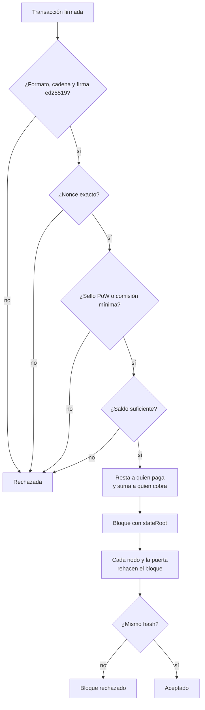

# Seguridad de la moneda: por qué nadie puede meterte VEL a la fuerza

> Para auditores, desarrolladores y cualquiera que quiera comprobarlo por su cuenta.
> Fuente de verdad: `packages/core/src/state.ts`, `tx.ts`, `era.ts` y el núcleo congelado `packages/core/src/v3`.
> VEL es una herramienta para pagar y para el servicio de mensajería. Este documento explica reglas, no valor.

## 1. La idea en 5 frases

1. Un saldo solo cambia dentro de la máquina de estados, con una única función interna (`credit`).
2. Todo lo que suma a una cuenta **resta antes** de otra cuenta, salvo la emisión de cada época.
3. La emisión es una **fórmula fija** que calcula cada nodo por su cuenta. Nadie la elige.
4. Cada nodo **rehace cada bloque** y compara el hash. Si alguien suma un velo de más, el hash no cuadra y el bloque se rechaza.
5. Cualquiera puede **reaplicar la cadena desde el bloque 0** y comprobar cada raíz de estado.



## 2. Solo las transferencias firmadas mueven valor

### 2.1 Qué se comprueba en cada transacción

| Comprobación | Qué evita |
|---|---|
| Firma ed25519 (RFC 8032 estricto) del JSON canónico sin `sig` | Que alguien gaste por ti |
| `chain` firmado y igual a `velum-mainnet-1` | Reutilizar una tx de otra red |
| Nonce secuencial por cuenta | Repetir una tx ya aplicada |
| Sello PoW (bajo el umbral) o comisión mínima | Spam gratis |
| Importes como texto decimal (v4) | Confundir una tx v3 (µVEL) con una v4 (velos) |
| Saldo ≥ importe + comisión | Gastar lo que no tienes |
| Saldos nunca negativos (la función lanza error) | Crear dinero con números negativos |

La dirección **es** la clave pública. No hay registro aparte que se pueda falsificar.

### 2.2 Cuentas especiales sin clave

`vel_reserve` (Reserva de la Red), `vel_pool` (bolsa), `vel_escrow` (fianzas, órdenes) y `vel_htlc` (candados) empiezan por `vel_`. Ninguna tx puede firmarse desde ellas: `isAddress` las rechaza. Solo las reglas de la cadena las mueven.

### 2.3 Todas las vías que suman a un saldo

| Vía | Qué suma | Qué lo impide si no toca |
|---|---|---|
| Génesis | 100 M VEL a la reserva de génesis | Constante fija en el bloque 0 |
| `transfer` | Lo que firma quien paga | Firma, nonce y saldo; resta antes de sumar |
| Comisiones | 80 % a la bolsa, 20 % a la Reserva | Se restan a quien paga. Nada se quema |
| `token.create` / `token.mint` | Tokens propios | **El símbolo `VEL` está prohibido.** Solo el emisor, bajo su tope |
| `pool.fund` | Pagos desde una bolsa ya depositada | Sale de `vel_escrow` |
| Fianza y delegación | Devoluciones tras 14 días | Sale de `vel_escrow` |
| Mercado (DEX) | Lo cruzado en una orden | Sale de `vel_escrow` |
| HTLC (v5, inactivo) | Importe bloqueado | Solo a `to` con el secreto antes de caducar, o vuelta a `from` después |
| `credits.buy` | Créditos de mensajería (no son VEL) | El VEL va a la bolsa; los créditos no se transfieren |
| `bridge.mint` | **vUSDT, nunca VEL** | Solo la autoridad de la pasarela; `ref` única por depósito |
| Cierre de época | Recompensas de nodos | Salen de la bolsa: comisiones + 0,1 % de la Reserva + emisión de la fórmula |

No existe ninguna transacción que añada VEL a una cuenta «de la nada».

## 3. La emisión es una fórmula, no una decisión

```
emisión(e) = (alguien produjo bloques en e) ? min(R(e), TOPE − acuñado) : 0
R(e)       = R0 >> floor(e / MITAD)        (0 desde la mitad 33 en v4)
```

| | v3 (bloques 0 a 28.799) | v4 (desde el bloque 64.800) |
|---|---|---|
| Tope | 1.000 M VEL | 21.000 M VEL |
| `R0` por época de 1 h | 25.684,931506 VEL | 298.026,465890942276979237 VEL |
| Mitad | 17.520 épocas (2 años) | 35.064 épocas (4 años) |

- La calcula **cada nodo** al cerrar la época (`computeEpochPot`). Se suma a `supply.minted` y va a la bolsa.
- La bolsa se reparte con reglas fijas: 15 % a quien produjo bloques, 85 % al trabajo probado con muestreo.
- Un productor que se pague de más cambia el estado → cambia `stateRoot` → cambia el hash → **todos rechazan su bloque**.

## 4. Raíz de estado y validación

- `stateRoot = SHA-256(JSON canónico del estado de consenso completo)`. Incluye saldos, cuentas, nodos, `supply`, bolsas y todo lo demás.
- La raíz va en la cabecera. El hash del bloque es el hash de la cabecera. El proponente lo firma.
- `applyBlock` **reconstruye** el bloque con las mismas transacciones y señales de vida. Si falta alguna tx o el hash no coincide, lo rechaza.
- Hoy la raíz **no es un árbol de Merkle** del estado: no hay pruebas por cuenta para clientes ligeros. Está en el plan de escala.

## 5. El invariante de contabilidad

```
Σ saldos VEL (incluye vel_reserve, vel_escrow, vel_htlc) + bolsa de la época + bolsas de trabajo pendientes == supply.minted
```

- Función: `velLedgerGap(s)`. Debe dar **0** siempre.
- **Dónde se comprueba hoy:** en los tests, en la generación de vectores y en `packages/core/scripts/replay-mainnet.ts`, que lo verifica en **cada altura**.
- **Dónde no se comprueba:** ni el nodo ni la puerta lo evalúan en marcha. Se cumple por construcción: cada vía resta antes de sumar, y la única entrada nueva es la emisión, que también suma `minted`.
- Recomendación: que la puerta lo publique en el explorador en cada bloque.

## 6. Reaplicar desde génesis (compruébalo tú)

```bash
VELUM_NETWORK=mainnet bun packages/core/scripts/replay-mainnet.ts
```

1. Pide la cabeza y baja los bloques de 200 en 200.
2. Parte del estado de génesis y aplica cada bloque con `applyBlock`.
3. En cada altura exige: raíz de estado igual a la de la cabecera **y** `velLedgerGap == 0`.
4. Al final imprime el total acuñado.

Además:

- Un **nodo** al arrancar usa su estado guardado si encaja con su cadena; si no, reaplica desde génesis. Cada bloque nuevo pasa por `applyBlock`.
- La **puerta** (explorador) reaplica cada bloque con el mismo núcleo. Las cifras de oferta salen del estado recalculado, no de lo que diga un nodo.
- Tras la v4, los bloques viejos se validan con el núcleo v3 **congelado**. Por eso la historia se puede reaplicar entera.

## 7. La reserva de génesis (100 M VEL)

| Pregunta | Respuesta |
|---|---|
| ¿Qué es? | 100.000.000 VEL creados en el bloque 0, la única asignación inicial |
| ¿Dónde están? | En una **billetera fría del operador, fuera de línea** |
| ¿Cuenta en la oferta? | **Sí, desde el bloque 0.** `supply.minted` empieza en 100 M |
| ¿Puede crecer? | No. Es una constante. No hay otra vía de acuñación fuera de la emisión |
| ¿Hay grifo? | No. La mainnet nace sin grifo ni tokens de prueba |
| ¿Se puede arrancar con otra dirección? | No. La compilación de mainnet falla si falta el archivo público de la reserva o si su huella no cuadra |

**Por qué el explorador muestra ≈100,3 M:** son los 100 M de génesis más lo que los nodos han descubierto desde el arranque (1 de noviembre de 2026, 21:00 UTC). Con la economía v3, cada época de 1 h descubre unos 25.685 VEL mientras haya bloques. Unas 12 épocas dan ≈0,3 M.

En la migración v4, **todo** (incluida la reserva y `minted`) se multiplica por 10¹² para pasar de µVEL a velos. Los saldos en VEL no cambian.

## 8. La pasarela no puede crear VEL

- `bridge.mint` solo acuña **vUSDT** (token envuelto de 6 decimales), y solo la autoridad de la pasarela.
- Cada depósito tiene una `ref` única: la cadena no acuña dos veces el mismo.
- Los topes diarios están **fuera** de la cadena, en el servicio. Si la clave de la pasarela se filtrara, alguien podría acuñar vUSDT sin respaldo, **nunca VEL**. La prueba de reservas (`/reserves`) lo delataría.
- La pasarela nace **cerrada**.

## 9. Qué puede y qué no puede hacer quien produce bloques

| Puede | No puede |
|---|---|
| No incluir (censurar) transacciones | Gastar desde una cuenta ajena (no tiene la firma) |
| Ordenar las transacciones de su bloque | Saltarse un nonce o repetir una tx |
| Omitir señales de vida de otros nodos | Acuñar más que `R(e)` o pasar del tope |
| Elegir su hora dentro de los márgenes | Cambiar saldos sin que cambie la raíz |
| Retrasar la cadena si no produce | Hacer que otros nodos acepten un estado distinto |

Si un bloque es inválido, el nodo lo registra y lo descarta. **No lo reenvía.** Si es de una versión que no conoce, se para.

## 10. Límites honestos de hoy

### 10.1 Un solo nodo productor

Hoy **un único nodo produce bloques**. Qué implica:

| Riesgo | Qué significa | Qué protege igualmente |
|---|---|---|
| Censura | Puede no incluir tu tx | Nada técnico hoy; más productores lo resuelven |
| Parada | Si se apaga, no hay bloques | Cualquier nodo completo registrado puede tomar el relevo: los huecos vacíos adelantan turnos |
| Reorganización | Puede publicar una rama distinta y más larga | Esperar confirmaciones («firme» = 30 bloques) |
| Robar o inventar VEL | **No puede** | Toda la cadena la valida cualquiera: nodos, puerta y `replay-mainnet.ts` |

Lo que **no** depende de confiar en el productor: firmas, nonces, emisión, tope y contabilidad. Todo eso lo comprueba cada validador.

### 10.2 Otros límites

| Límite | Detalle |
|---|---|
| Sin finalidad | Gana la rama más alta; no hay límite de profundidad de reorganización |
| Alta de nodo gratis | Sin comisión, PoW ni fianza. Abre la puerta a muchos nodos falsos (no a crear VEL) |
| Invariante no comprobado en marcha | Solo en tests y en la reaplicación |
| Lista `rewards` del bloque | Es **informativa**: no entra en el hash. El explorador la guarda tal cual llega. Los saldos reales no dependen de ella |
| Foto de estado | `snapshot import` comprueba la raíz del archivo, no la compara con la red. Compara el hash con el explorador |
| Actualizaciones | Una sola clave de publicación firma los binarios |

### 10.3 Plan para descentralizar

1. Publicar el nodo 2.1.0 y animar a operadores independientes a correr nodos completos (el turno ya los admite).
2. Exigir algo para darse de alta como productor (fianza mínima o PoW) contra nodos falsos.
3. Comités por época con firmas de finalidad (> 2/3 del peso) y comité de respaldo (`docs/escalado.md` §3).
4. Raíz de estado con árbol de Merkle disperso para pruebas por cuenta.
5. Malla entre nodos (GossipSub) para que la puerta sea solo de arranque.
6. Multifirma para la clave de publicación y la billetera fría.

Detalle y estado en la [hoja de ruta](hoja-de-ruta.md).

## Referencias

- Saldos: `packages/core/src/state.ts:229-251` (`setBalance`, `credit`, `debit`).
- Comprobaciones de tx: `packages/core/src/state.ts:489-500`, `:606`; `packages/core/src/tx.ts:215-223`, `:244-258`, `:291`; `packages/core/src/amount.ts:17-31`; `packages/core/src/keys.ts:17-33`, `:65`.
- Comisiones y sello: `packages/core/src/state.ts:262-307`, `:326-337`; `packages/core/src/constants.ts:30-51`.
- Cuentas especiales: `packages/core/src/constants.ts:52-58`; `packages/core/src/htlc.ts:13`; `packages/core/src/keys.ts:26-27`.
- Vías de crédito: `packages/core/src/state.ts:508-514` (transfer), `:562`, `:576`, `:627-654` (HTLC), `:661-675` (créditos), `:879-962`, `:1004-1011`; `packages/core/src/tokens.ts:39-77`; `packages/core/src/staking.ts:40-113`; `packages/core/src/dex.ts:101-184`; `packages/core/src/bridge.ts:1-67`.
- Emisión: `packages/core/src/constants.ts:20-26`, `:61-77`; `packages/core/src/state.ts:217-221`, `:974-998`; `packages/core/src/v3/constants.ts:21`, `:74-80`.
- Raíz y bloque: `packages/core/src/state.ts:394-402`, `:1095-1147`; `packages/core/src/tx.ts:459-505`; `packages/core/src/bytes.ts:41-60`.
- Rama: `packages/core/src/state.ts:1152-1155`.
- Invariante: `packages/core/src/state.ts:1157-1166`; `packages/core/src/v3/state.ts:1045-1050`; `packages/core/scripts/replay-mainnet.ts:20-33`; `packages/core/scripts/vectors.ts:136`.
- Arranque y reaplicación del nodo: `apps/node/src/chain.ts:38-75`, `:131-135`; `apps/node/src/node.ts:1167-1175`.
- Puerta: `apps/web/worker/hub.ts:5-6`, `:536-570`, `:626-650`, `:670-681`.
- Génesis: `packages/core/src/state.ts:343-380`; `packages/core/src/constants.ts:22`; `packages/core/src/genesis.ts:35-55`; `packages/core/genesis/mainnet.json`.
- Migración v4: `packages/core/src/era.ts:1-104`, `:160-193`; `packages/core/src/upgrades.ts:17-39`.
- Fotos: `packages/core/src/snapshot.ts:29-38`; `apps/node/src/main.ts:207-213`.
- Pasarela: `apps/bridge/src/config.ts:70-106`; `docs/mainnet.md` §6.
